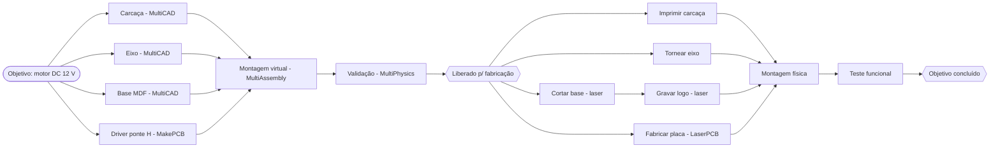

# MultiProject — Especificação do projeto

**Estado:** decisões D1–D12 aprovadas (20/10/2026). Fases 1 (documento e tarefas) e 2 (grafo) concluídas no Linux, usando componentes genéricos novos da suíte CHATGPT (`AI Project Core`).
**Pasta do módulo:** [`multiproject/`](../multiproject/README.md).

Este é o documento único de referência do MultiProject na pasta `docs`. Ele reúne objetivo,
modelo da tarefa, grafo, integração com as ferramentas, layout, requisitos do Microsoft Project
e etapas de implementação. Os detalhes técnicos de cada tema estão nos documentos do módulo:

| Documento | Conteúdo |
|---|---|
| [REQUISITOS](../multiproject/docs/REQUISITOS.md) | Requisitos completos, IDs `PJ-*`, prioridades e aceite |
| [ARCHITECTURE](../multiproject/docs/ARCHITECTURE.md) | Modelo de dados, algoritmos, `.mproj`, integração e contrato da IA |
| [LAYOUT](../multiproject/docs/LAYOUT.md) | Tela, painéis, vistas e atalhos |
| [TAREFA](../multiproject/docs/TAREFA.md) | Decisões D1–D12, fases com tarefas atômicas, critério de pronto e riscos |
| [AI_GUIDE](../multiproject/docs/AI_GUIDE.md) | Regras para IA que alterar o módulo |

---

## 1. Objetivo

O MultiProject é um **gerenciador de projetos de peças mecânicas e eletrônicas**. O usuário
define um **objetivo** (exemplo: *construir um motor*). Uma pessoa ou a IA divide esse
objetivo em **tarefas**:

- peças;
- eletrônica;
- montagem;
- validação;
- fabricação;
- teste.

As tarefas se relacionam por uma **lista de grafos**, em **cadeia** ou em **paralelo**.

Cada tarefa fica ligada à **ferramenta da suíte** que a executa. Quando o arquivo dessa
ferramenta fica pronto, ele é **vinculado** à tarefa. Quando um conjunto de tarefas fica
pronto, o MultiProject **gera as tarefas seguintes**, nesta ordem:

1. montagem no MultiAssembly;
2. validação no MultiPhysics;
3. fabricação;
4. teste.

A referência funcional é o **Microsoft Project**: cada requisito funcional dele foi levantado
e adaptado (seção 7).

### O que o MultiProject faz e o que não faz

| Faz | Não faz |
|---|---|
| Objetivo, EAP, tarefas, grafo, cronograma, recursos, custos, acompanhamento e relatórios | Modelar peça, desenhar placa, montar ou simular (isso é de cada ferramenta) |
| Abre a ferramenta certa para cada tarefa e vincula o arquivo | Gerar percurso ou fatiar |
| Sugere as tarefas seguintes | Enviar comando para máquina: isso é só do **MultiCNC** |
| Usa as máquinas do `multicnc.json` como recursos (somente leitura) | Alterar o cadastro de máquinas |

---

## 2. A tarefa

| Campo | Obrigatório | Descrição |
|---|---|---|
| **ID** | sim | Estável: `T-0001` (tarefa) ou `M-0001` (marco), nunca reaproveitado |
| **Nome** | sim | |
| **Descrição curta** | sim | Uma linha |
| **Descrição longa** | campo presente | Texto livre |
| **Especificação técnica** | campo presente | Lista chave/valor/unidade (material, dimensões, tolerância, tensão, potência…) + texto livre |
| **Especificação funcional** | campo presente | Critérios de aceite verificáveis, cada um pendente, aprovado, reprovado ou dispensado, com evidência. A tarefa só é concluída com todos aprovados ou dispensados |

Campos de cronograma e controle:
- tipo e processo;
- estado e modo automático/manual;
- duração e restrição;
- data limite e prioridade;
- recursos;
- artefato vinculado;
- origem (usuário, regra ou IA);
- anotações e anexos.

**Estados:**
- Sugerida → Planejada → Em andamento → Pronta para revisão → Concluída;
- mais Bloqueada, Desatualizada e Cancelada.

---

## 3. Grafo de relações entre tarefas

- O grafo é guardado como **lista de adjacência**: sucessoras e predecessoras de cada tarefa.
- **Quatro tipos de vínculo** (como no Project):
  - **TI**, término-início: o padrão, para tarefas encadeadas;
  - **II**, início-início;
  - **TT**, término-término;
  - **IT**, início-término.

  Todos aceitam **latência** em duração ou em %. Latência negativa é antecipação. A latência
  pode ser decorrida (cura, secagem).
- **Em cadeia** = existe caminho entre as duas tarefas. **Em paralelo** = não existe caminho em
  nenhum sentido. A tela mostra essa relação para a tarefa selecionada.
- **Lista de grafos:** o projeto pode ter vários componentes conexos (cadeias independentes).
  Cada um aparece separado na lateral e serve de filtro.
- **Entrega artefato:** o vínculo pode indicar que a sucessora consome o arquivo da predecessora.
  Exemplos: o `.mcad` da carcaça alimenta a impressão; as peças alimentam a montagem.
- **Sem ciclos:** o vínculo que fecharia um ciclo é recusado, mostrando o caminho. Uma
  validação reprovada gera uma **tarefa de revisão nova**, nunca uma aresta de volta.

---

## 4. Tipos de tarefa e ferramentas

| Tipo | Ferramenta | Arquivo vinculado | Máquina |
|---|---|---|---|
| Peça mecânica | MultiCAD | `.mcad` | — |
| Eletrônica | MakePCB | `.mpcb` + Gerber/Excellon | — |
| Montagem (ligação entre as peças) | MultiAssembly | `.massembly` | — |
| Teste e validação | MultiPhysics | `.mphys` | — |
| Impressão 3D | MultiSlicer → MultiCNC | `.mslice` + G-code | impressora 3D |
| Usinagem CNC Router | MakeRouter (madeira, chapa) ou MultiCAM (peça mecânica) → MultiCNC | `.mrouter` / G-code | router |
| Corte laser | LaserArt (camada de corte) → MultiCNC | `.lart` + G-code | laser |
| Arte laser | LaserArt (gravação) → MultiCNC | `.lart` + G-code | laser |
| Usinagem de torno | manual: folha de processo (D7) | desenho + folha | torno |
| Impressão de placa | LaserPCB ou RouterPCB → MultiCNC | G-code | laser ou router |
| Montagem física, teste funcional, compra, geral, marco | — | checklist/anotações | — |

**Abrir na ferramenta:**
- Sem arquivo: o MultiProject propõe `<pasta>/<ID>_<nome>.<ext>` dentro da raiz do projeto e
  abre a ferramenta com `--project`, `--new` e `--task` (novos parâmetros do contexto da suíte,
  D4).
- Com arquivo: abre com `--file`.
- Um `<arquivo>.task.json` leva as especificações e os arquivos de entrada para a ferramenta.

**Pronta e vinculada (D5):** a tarefa fica pronta quando o arquivo existe, o verificador do tipo
aprova e o usuário clica **Marcar pronta**. Se o arquivo mudar depois (hash), a tarefa volta
para revisão e as sucessoras ficam **desatualizadas**.

---

## 5. Regras de geração de tarefas

As regras **propõem** tarefas no estado Sugerida, e o usuário aceita ou recusa. Nenhuma regra
apaga tarefa nem altera tarefa concluída.

| Regra | Quando | Gera |
|---|---|---|
| A01 | Peça com processo definido | Tarefa de fabricação (impressão, router, corte laser, torno) |
| A02 | Tarefa de eletrônica | "Fabricar placa" (LaserPCB/RouterPCB) e "Comprar componentes" |
| A03 | Peças e placas de um subsistema prontas | "Montagem virtual" (MultiAssembly), com as tarefas como predecessoras |
| A04 | Montagem pronta | "Validar" (MultiPhysics), com o tipo de estudo sugerido pela especificação técnica |
| A05 | Validação aprovada | Marco "Liberado para fabricação" (D6) |
| A06 | Fabricações concluídas | Montagem física → Teste funcional → marco "Objetivo concluído" |
| A07 | Validação ou teste reprovado | Tarefa de revisão da peça ou placa |

### Exemplo: construir um motor DC didático

- As quatro tarefas de projeto correm em **paralelo**.
- A gravação do logo vem **encadeada** depois do corte, porque usa o mesmo laser e a mesma chapa.
- Todas as tarefas depois das de projeto são geradas pelas regras.

---

## 6. Layout

O layout é o mesmo das outras aplicações: MakeRouter, MultiSlicer e MultiAssembly.

| Área | Medida (100% DPI) | Conteúdo |
|---|---|---|
| Cabeçalho `TSuiteHeader` | 72 px | MultiProject, "Gestão de projetos mecânicos e eletrônicos / MultiSuite", ícone `sikProject`, projeto e revisão |
| Lateral esquerda | 214 px | 7 etapas, Novo/Abrir/Salvar/Demo, lista **Cadeias** (grafos) e lista **Sugestões** |
| Barra da vista | 52 px | Gantt, Rede, Quadro, Equipe, Calendário, Linha do tempo, zoom, filtro e agrupamento |
| Área central | restante | Vista ativa desenhada em `TCustomControl` |
| Painel direito | 336 px | Página da etapa ou da tarefa selecionada (formulário da tarefa) |
| Rodapé | 66 px | Avisos, término previsto, críticas e a relação da seleção. Botões **Validar**, **Gerar tarefas** e **Abrir na ferramenta** |

**Etapas laterais:**
1. Objetivo
2. Tarefas
3. Relações
4. Recursos
5. Cronograma
6. Acompanhar
7. Relatórios

Na suíte, o MultiProject entra num novo grupo **PLANEJAR** da bandeja, antes de PROJETAR.

---

## 7. Requisitos funcionais do Microsoft Project integrados

Resumo por área. A lista completa, com ID, prioridade e aceite de cada item, está em
[REQUISITOS](../multiproject/docs/REQUISITOS.md).

| Área do Project | Recursos levantados | Como entra no MultiProject | Prioridade |
|---|---|---|---|
| Informações do projeto | Início e término, data de status, agendar a partir do término, modelos, campos personalizados | Objetivo com critérios de sucesso, calendário e modelos (Peça impressa, Placa, Motor DC) | P0/P1 |
| Tarefas | Resumo/estrutura de tópicos, EAP, marco, agendamento manual/automático, duração estimada e decorrida, tipos de tarefa, controlada pelo empenho, inativa, anotações, recorrente, dividida, prioridade, indicadores | Os 6 campos obrigatórios + tudo isso. A duração decorrida é o padrão para máquina | P0–P2 |
| Vínculos | TI/II/TT/IT, latência e antecipação, colunas Predecessoras/Sucessoras, vínculo de resumo, caminho da tarefa, autolink, aviso de ciclo | Grafo em lista de adjacência, cadeias, entrega de artefato, revisão sem ciclo | P0/P1 |
| Restrições e cronograma | ASAP, ALAP, SNET, SNLT, FNET, FNLT, MSO, MFO, data limite, caminho crítico, margem total e livre, vários caminhos críticos, avisos | Cálculo CPM próprio com avisos que dizem tarefa, problema e correção | P0/P1 |
| Calendários | Base Padrão/24 Horas, exceções, calendário do recurso e da tarefa | Feriados brasileiros, máquina em 24 Horas | P0/P1 |
| Recursos | Trabalho/material/custo, unidades máximas, superalocação, nivelamento, recurso genérico, perfis, pool | Pessoa, IA, máquina (do MultiCNC), material. Uma máquina faz um trabalho por vez | P0–P2 |
| Custos | Taxas, custo por uso, custo fixo e acumulação, tabelas de taxa | Material automático pelo MultiSlicer (massa) e pela BOM do MultiAssembly | P1/P2 |
| Linha de base e acompanhamento | Linhas de base 0–10, plano provisório, % concluído, real, atualizar projeto, Gantt de controle, variações, linha de progresso | Progresso sugerido pelo estado do artefato; real das máquinas pelo log do MultiCNC | P0/P1 |
| Valor agregado | VP, VA, CR, VPR, VC, IDP, IDC, EAC, VNT, IDPT | Calculado na data de status | P1 |
| Modos de exibição | Gantt, Diagrama de rede, Quadro, Calendário, Linha do tempo, Planejador de equipe, Uso, tabelas, filtros, grupos, realce, modo dividido | As mesmas vistas no padrão da suíte; Equipe mostra a fila de cada máquina | P0/P1 |
| Relatórios | Painéis (visão geral, atrasadas, críticas, custo, burndown), impressão | HTML/PDF e o dossiê de artefatos do objetivo | P1 |
| Multiprojeto | Projeto mestre/subprojetos, pool de recursos, vínculos entre projetos | Subsistema em outro `.mproj` e pool da oficina | P2 |
| Importação e exportação | `.mpp`, XML (MSPDI), Excel/CSV, PDF | `.mproj` em JSON; XML do Project para abrir no Project/ProjectLibre; CSV | P0/P1 |
| Edição | Desfazer em vários níveis, realce de alterações, atalhos | Os da suíte + os do Project (Insert, Ctrl+F2, Shift+F2, F9) | P0 |
| Fora do escopo | Macros VBA, Project Online/Server, timesheets | Automação pela CLI e pela IA. A suíte é desktop e local | N/A |

Próprios do MultiProject:
- vínculo com as ferramentas (PJ-L01..L10);
- regras de geração (PJ-A01..A09);
- IA que decompõe o objetivo em plano JSON validado por parser determinístico e que entra só
  como sugestão (PJ-I01..I06).

---

## 8. Etapas de implementação

| Fase | Entrega | Prioridade |
|---|---|---|
| 0 Especificação | Este documento e os do módulo — **concluída** | — |
| 1 Documento e tarefas | Tarefa com os 6 campos, EAP, `.mproj`, desfazer — **concluída no Linux** | P0 |
| 2 Grafo | Lista de adjacência, 4 tipos de vínculo, latência, ciclo, cadeias — **concluída no Linux** | P0 |
| 3 Calendário e cronograma | Calendários, CPM, restrições, margens, caminho crítico, avisos | P0 |
| 4 Tela e registro na suíte | Layout da suíte, Gantt, Rede, Quadro, página da tarefa, bandeja | P0 |
| 5 Vínculo com as ferramentas | `--new`/`--task`, `.task.json`, detecção, verificadores, Abrir na ferramenta | P0 |
| 6 Regras e modelos | Regras A01–A08, exemplo Motor DC — **primeira entrega** | P0 |
| 7 Recursos e custos | Máquinas do MultiCNC, nivelamento, Equipe, custos | P1 |
| 8 Acompanhamento e relatórios | Linhas de base, progresso, valor agregado, HTML/PDF | P1 |
| 9 IA | Decomposição do objetivo pela suíte CHATGPT | P1 |
| 10 Intercâmbio e multiprojeto | XML do Project, CSV, CLI, subprojetos, pool | P1/P2 |

Componentes genéricos (grafo, calendário, cronograma, duração, desfazer, JSON, contrato de
plano da IA) entram primeiro na suíte CHATGPT (`pacote/AI Project Core`), e o MultiProject só os
adapta ([TAREFA](../multiproject/docs/TAREFA.md#reuso-da-suíte-chatgpt)).

Cada fase termina com:
- testes no Linux e no Win64;
- commit e push na `fila`;
- o progresso registrado em [TAREFA](../multiproject/docs/TAREFA.md).

---

## 9. Decisões (aprovadas em 20/10/2026)

| # | Assunto | Proposta |
|---|---|---|
| D1 | Lugar na suíte | `multiproject/`, `stiMultiProject`, grupo PLANEJAR |
| D2 | Projeto do MultiSuite | Registrar os artefatos no `TWorkspace`, sem duplicar |
| D3 | Formato | JSON `.mproj` com `schema_version` |
| D4 | Abrir arquivo novo | `--new` e `--task` no contexto da suíte |
| D5 | Quando está pronta | Arquivo + verificador + confirmação do usuário |
| D6 | Validar antes de fabricar | Sim, desligável por projeto |
| D7 | Torno | Tarefa manual com folha de processo; ferramenta de torno no futuro |
| D8 | Corte e arte laser | LaserArt; falta importar o DXF do MultiCAD no LaserArt |
| D9 | Router | MakeRouter para madeira; MultiCAM para peça mecânica |
| D10 | Vistas | `TCustomControl` próprio, sem componente de terceiros |
| D11 | Tempo | Minuto útil inteiro; máquina em duração decorrida |
| D12 | IA | Suíte CHATGPT, plano JSON validado, só como sugestão |

Detalhes e justificativas em [TAREFA](../multiproject/docs/TAREFA.md#decisões-para-o-marcelo).
