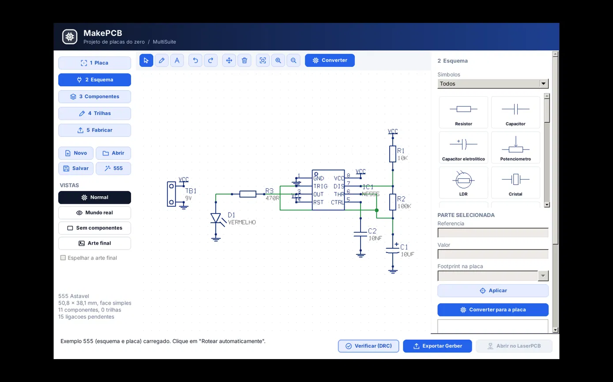
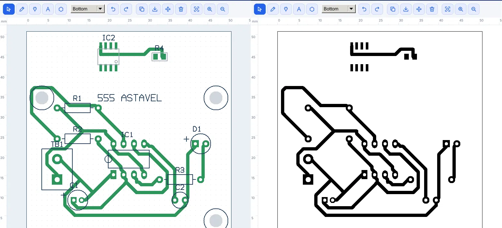
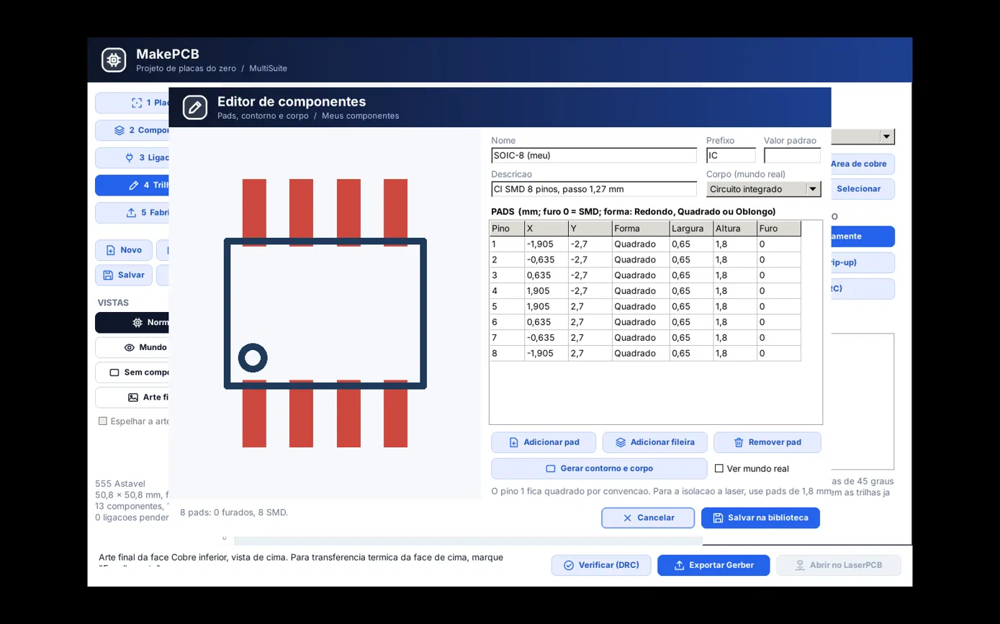
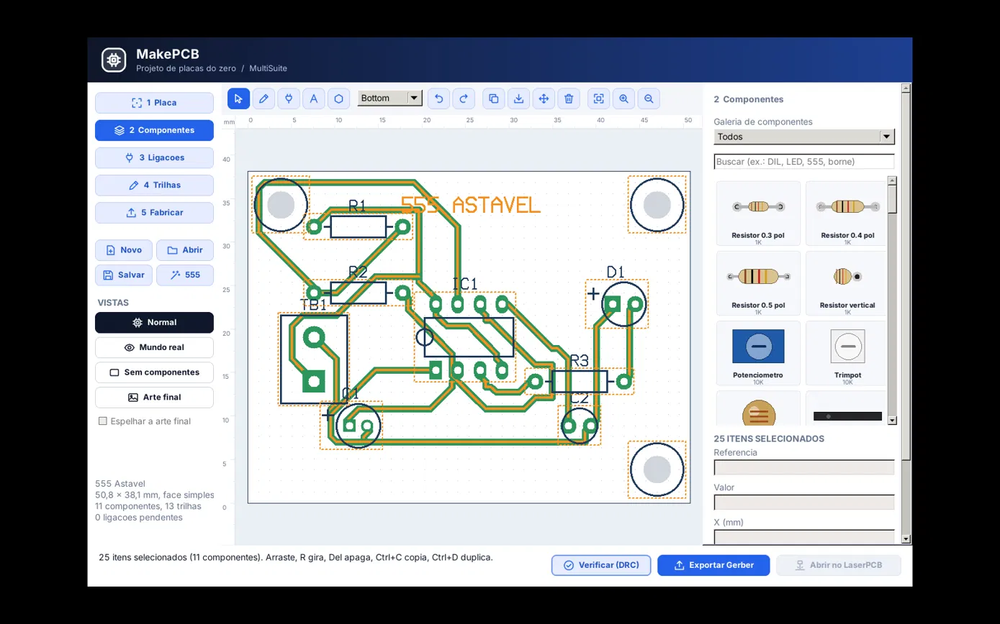
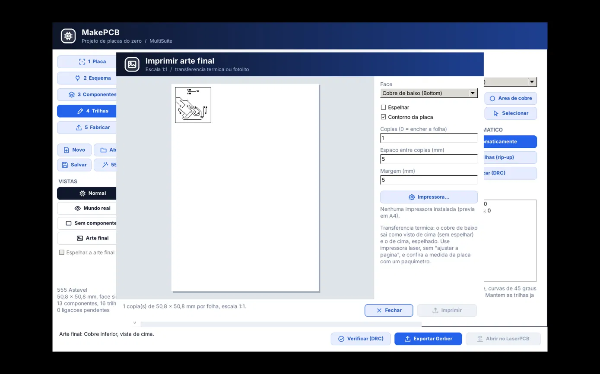

# MakePCB - Manual do usuário

Versão de referência: **0.1.0.0**. Edição: **13/10/2026**. Windows x64.

[Versão ilustrada em PDF](Manual_do_Usuario_MakePCB_0.1.0.0_PT-BR.pdf)

## Sumário

1. Fluxo de trabalho e visão geral da suíte
2. Conheça a interface
3. Etapa 1: Configuração e dimensões da placa
4. Etapa 2: Editor esquemático e biblioteca de símbolos
5. Etapa 2: Fios, junções e redes elétricas
6. Conversão do esquema para a placa
7. Ligação direta pad a pad
8. Etapa 3: Biblioteca e galeria de componentes
9. Manipulação e posicionamento de peças
10. Componentes SMD e face inferior
11. Editor de componentes personalizados
12. Gestão de pegadas pessoais e portabilidade
13. Modos de visualização das abas
14. Etapa 4: Traçado manual de trilhas
15. Áreas de cobre e planos de terra
16. Inserção de texto e marcações
17. Seleção múltipla e operações em bloco
18. Roteamento automático (Autorouter A*)
19. Verificação de regras de projeto (DRC)
20. Lista de materiais (BOM)
21. Etapa 5: Exportação Gerber e Excellon
22. Impressão 1:1 da arte final
23. Integração com o LaserPCB
24. Integração com o RouterPCB
25. Exercício guiado: Projetando o oscilador 555
26. Resolução de problemas comuns
27. Teclas de atalho e comandos rápidos
28. Especificações técnicas e compatibilidade

---

## 01. Fluxo de trabalho e visão geral da suíte

O MakePCB foi concebido para eliminar a fragmentação no desenvolvimento de eletrônica na MultiSuite. Inspirado na facilidade do clássico PCB Wizard, ele permite conceber o circuito desde o primeiro símbolo até a entrega de arquivos universais de fabricação (Gerber e Excellon).

### As cinco etapas essenciais de desenvolvimento

1. **Definição da Placa:** Ajuste o tamanho físico da placa virgem, número de faces (simples ou dupla), largura padrão de trilhas e folga de isolação.
2. **Esboço do Esquema:** Desenhe o circuito com símbolos intuitivos (resistores, CIs, conectores), trace os fios e clique em *Converter para a placa*.
3. **Disposição dos Componentes:** Posicione as pegadas sobre a placa. Escolha componentes PTH ou SMD, gire com a tecla R ou monte na face de baixo com F.
4. **Roteamento das Trilhas:** Conecte os terminais manualmente em 45° ou utilize o roteador automático A*. Em seguida, valide todo o projeto com o DRC.
5. **Fabricação e Produção:** Gere a lista de componentes (BOM), imprima a arte final em escala 1:1 para confecção térmica, ou envie diretamente para o LaserPCB ou RouterPCB.

| Aplicação | Papel no Ecossistema | Formato de Troca |
|---|---|---|
| **MakePCB** | Concepção esquemática, layout da placa e geração industrial | Projeto .mpcb / Gerber RS-274X |
| **LaserPCB** | Preparação de isolamento a laser, furação e corte em CNC Laser | Consome pasta Gerber / Emite G-code |
| **RouterPCB** | Isolamento mecânico com fresa em V, mapa de altura e furação CNC | Consome pasta Gerber / Emite G-code |
| **MultiCNC** | Operação das máquinas físicas (CNC Router, CNC Laser ou Impressora 3D) | Executa G-code com supervisão ao vivo |

---

## 02. Conheça a interface

A interface do MakePCB segue rigorosamente a identidade visual da MultiSuite: limpa, contrastante e com painéis contextuais que se adaptam à etapa ativa de trabalho.

| Região | Localização | Função Principal |
|---|---|---|
| **Cabeçalho** | Topo | Título do projeto, identificação do módulo e botão de informações da suíte. |
| **Barra Lateral** | Esquerda | Navegação entre as 5 etapas, botões Novo/Abrir/Salvar/555 e seleção das 4 vistas. |
| **Barra de Ações** | Centro-superior | Ferramentas contextuais de edição (Seleção, Traçado, Zoom, Rotação e Desfazer). |
| **Área de Desenho** | Centro | Tela de trabalho interativa com suporte a zoom no cursor do mouse e pan com botão do meio. |
| **Painel da Etapa** | Direita | Propriedades e configurações detalhadas do objeto selecionado ou da etapa em foco. |
| **Rodapé** | Base | Status do cursor (coordenadas X/Y), atalhos rápidos de DRC, Exportar e envio para a suíte. |

---

## 03. Etapa 1: Configuração e dimensões da placa

A primeira etapa define a geometria da placa virgem de fenolite ou fibra de vidro (FR4) e estabelece as restrições globais de fabricação do seu circuito.

| Parâmetro | Valores Recomendados | Descrição e Impacto no Projeto |
|---|---|---|
| **Nome da Placa** | Texto identificador | Identifica o projeto e define o prefixo dos arquivos Gerber gerados. |
| **Largura / Altura** | Ex: 50.8 x 38.1 mm | Dimensões físicas em milímetros da placa de circuito impresso. |
| **Camadas (Faces)** | Face simples / Dupla face | Face simples coloca cobre apenas no lado inferior; dupla face ativa as duas faces. |
| **Largura de Trilha** | 0.6 a 1.2 mm (padrão: 0.8) | Espessura padrão das trilhas de cobre criadas pelo usuário ou autoroute. |
| **Folga (Clearance)** | 0.4 a 0.8 mm (padrão: 0.5) | Distância mínima permitida entre trilhas, pads e planos de cobre. |
| **Grade (Grid)** | 2.54, 1.27, 0.635, 1.0, 0.5 mm | Resolução do encaixe magnético do mouse ao mover peças e traçar trilhas. |

### Procedimento para iniciar uma nova placa

1. Clique em **Novo** na barra lateral esquerda para reiniciar os parâmetros.
2. No painel direito da etapa **1 Placa**, digite o nome do projeto (ex: *Fonte_Regulada*).
3. Insira as dimensões máximas que a placa pode ocupar no seu gabinete ou produto.
4. Selecione **Face simples** se você pretende confeccionar a placa em casa via corrosão ácida ou usinagem rápida.
5. Para circuitos integrados DIP tradicionais, utilize a grade padrão de **2.54 mm (0.1 polegada)** ou **1.27 mm**.
6. Clique em **Aplicar** para atualizar os limites gráficos na tela de desenho.

---

## 04. Etapa 2: Editor esquemático e biblioteca de símbolos

Na etapa **2 Esquema**, você elabora o circuito a partir de representações elétricas convencionais, sem se preocupar antecipadamente com o formato físico de cada trilha.

| Categoria | Símbolos Incluídos | Footprint Associado Padrão |
|---|---|---|
| **Passivos** | Resistores, Capacitores cerâmicos/eletrolíticos, Indutores | Resistor 0.4 pol, Cerâmico 0.1 pol, Eletrolítico |
| **Diodos / LEDs** | Diodos retificadores, Diodo zener, LEDs 3mm e 5mm | Diodo DO-35 / DO-41, LED 5mm |
| **Transistores** | NPN (BC547/BC337), PNP (BC557), MOSFET N e P | TO-92 com pinagem configurada (E-B-C) |
| **Reguladores** | Série 78xx (7805, 7812), LM317 | TO-220 vertical com dissipador |
| **Temporizadores** | NE555 / LM555 clássico | DIL-8 (8 pinos DIP 0.3 pol) |
| **Circuitos Integrados** | Portas lógicas, amplificadores operacionais, CIs DIL genéricos | DIL-8, DIL-14, DIL-16 |
| **Conectores** | Bornes com parafuso (2 e 3 vias), Headers macho/fêmea | Borne passo 5.08 mm, Header 2.54 mm |
| **Alimentação** | Símbolos de terra (GND), positivo VCC, +5V, +12V | Gera redes elétricas globais automáticas |

---

## 05. Etapa 2: Fios, junções e redes elétricas

A integridade elétrica do circuito depende da interligação correta dos pinos através dos fios esquemáticos. O MakePCB gerencia nós e junções com detecção inteligente de contato.

- **Ponto a Ponto:** Com a ferramenta **Fio** selecionada, clique no terminal de um símbolo e leve o segmento até o terminal de destino.
- **Junções em T:** Quando um fio encosta no meio de outro segmento existente, o software cria automaticamente um nó elétrico preenchido.
- **Alinhamento Magnético:** Os terminais atraem a ponta do fio para garantir que não haja contatos falsos ou imperceptíveis.
- **Desfazer Segmento:** Durante o traçado do fio, pressionar **Backspace** cancela o último ponto inserido sem perder o restante do caminho.

| Tipo de Rótulo | Exemplo | Comportamento de Conexão |
|---|---|---|
| **Alimentação Comum** | GND, TERRA, 0V | Todos os pinos tocados pelo símbolo de terra são unificados na rede GND. |
| **Tensão Positiva** | VCC, +5V, +12V | Cria barramentos elétricos virtuais de alimentação em toda a placa. |
| **Sinais de Controle** | RESET, TRIGGER, SAIDA | Conecta pinos remotos entre diferentes circuitos integrados sem traçar fios longos. |

---

## 06. Conversão do esquema para a placa

A transição entre o circuito teórico e a disposição física da placa é feita através do comando **Converter para a placa**. Este processo transfere a lista de componentes e calcula a rede de ligações elásticas pendentes (ratsnest).

1. **Compilação da Netlist:** O algoritmo `ComputeNets` analisa todas as conexões, junções e rótulos de rede do esquema.
2. **Criação de Componentes:** Componentes que ainda não existiam na placa são instanciados e alinhados ordenadamente na área de trabalho.
3. **Preservação de Trabalho Prévio:** Componentes que você já havia posicionado ou girado na placa **permanecem inalterados**.
4. **Preservação de Trilhas:** Trilhas já traçadas anteriormente não são apagadas; o MakePCB reconecta suas redes de forma transparente.
5. **Geração dos Fios Elásticos (Wires):** São traçadas linhas tracejadas amarelas/brancas representando as conexões que faltam rotear.
6. **Otimização de Distância:** Uma árvore geradora mínima (MST) conecta os pads mais próximos pertencentes à mesma rede elétrica.

---

## 07. Ligação direta pad a pad

Nem todo projeto necessita de um diagrama esquemático completo. Para circuitos simples, pequenos adaptadores, placas de ensaio ou protótipos de poucas peças, o MakePCB oferece a modalidade ágil **Ligação pad a pad**.

1. Na etapa **1 Placa**, defina o tamanho do substrato e as folgas desejadas.
2. Pule diretamente para a etapa **3 Componentes**.
3. Na galeria lateral, escolha os componentes necessários e clique diretamente na placa para posicioná-los.
4. Na etapa **2 Esquema**, clique no botão **Ligação pad a pad** ou utilize a ferramenta **Ligação** na etapa de trilhas.
5. Clique com o mouse no primeiro pad de origem; uma linha elástica acompanhará o cursor.
6. Clique no pad de destino para consolidar a conexão lógica. O MakePCB criará uma nova rede elétrica automaticamente.
7. Prossiga para a etapa **4 Trilhas** e roteie as conexões normalmente com o botão **Roteamento automático** ou manualmente.

---

## 08. Etapa 3: Biblioteca e galeria de componentes

Na etapa **3 Componentes**, você gerencia todos os encapsulamentos físicos da placa. A galeria lateral exibe miniaturas renderizadas em alta definição com medidas reais de espaçamento.

| Grupo | Encapsulamento | Dimensões e Características dos Pads |
|---|---|---|
| **Resistores PTH** | Resistor 0.4 pol (10.16 mm) | Passo padrão para resistores 1/4W axiais com folga para dobra. |
| **Capacitores PTH** | Passo 0.1 e 0.2 pol | Para capacitores cerâmicos multicamada e poliéster miniatura. |
| **Eletrolíticos** | Radial 5mm / 8mm | Identificação clara de polaridade (+) e pad quadrado no pino positivo. |
| **Circuitos DIP** | DIL-8, DIL-14, DIL-16, DIL-28 | Linhas de pads com espaçamento de 2.54 mm e largura de 0.3 pol (7.62 mm). |
| **Semicondutores** | TO-92, TO-220, DO-35, DO-41 | Pads reforçados para facilitar soldagem manual e dissipação. |
| **Chips SMD** | SOIC-8, SOIC-14, SOIC-16 | Passo de 1.27 mm com pads ampliados para soldagem e isolação a laser. |
| **Passivos SMD** | 0805 (2012 métrico), 1206 | Terminais retangulares adequados para solda com ferro convencional. |
| **Meus Componentes** | Criados pelo usuário | Pegadas personalizadas salvas na biblioteca local do projetista. |

---

## 09. Manipulação e posicionamento de peças

O posicionamento preciso dos componentes garante tanto a facilidade de montagem manual quanto uma estética profissional no circuito impresso final.

- **Arrasto com o Mouse:** Clique sobre o corpo do componente e arraste para a nova posição. O componente se ajusta à grade magnética ativa.
- **Movimento Fino pelas Setas:** As teclas direcionais do teclado movem a seleção exatamente um incremento da grade por toque.
- **Giro de 90 Graus (Tecla R):** Pressionar **R** rotaciona o componente em sentido horário em torno do seu centro de gravidade.
- **Virar para a Face Oposta (Tecla F):** Pressione **F** para alternar o componente entre a camada superior (Top) e inferior (Bottom).
- **Duplicação Rápida (Ctrl+D):** Cria uma cópia exata do componente selecionado mantendo suas propriedades e atribuindo nova referência.

---

## 10. Componentes SMD e face inferior

O MakePCB oferece suporte completo a componentes de montagem em superfície (SMD). Em placas de face simples, o software adota automaticamente o posicionamento no lado do cobre.

- **Definição de Pad SMD:** Todo pad com furo = 0 mm é tratado como pad SMD, existindo exclusivamente na face designada.
- **Face Simples Automática:** Em placas de face simples, componentes SMD são enviados diretamente para o lado inferior (Bottom Copper).
- **Espelhamento Geométrico:** Ao virar um CI (como SOIC-8) para baixo, a pinagem é espelhada no eixo X para encaixe físico correto.
- **Dimensões Otimizadas:** Os pads SMD possuem área de cobre ampliada para suportar usinagem CNC e isolamento a laser sem descolar.

---

## 11. Editor de componentes personalizados

Quando você necessita utilizar um conector, sensor ou circuito integrado que não consta na galeria padrão, o MakePCB conta com um ambiente gráfico próprio para criação de pegadas (footprints).

1. Na etapa **3 Componentes**, clique em **Novo footprint** para abrir a janela do editor.
2. Digite o nome da pegada (ex: *MODULO_BLUETOOTH*) e selecione a categoria desejada.
3. Na tabela de pads, insira as linhas correspondentes a cada pino: Nome do pino, X (mm), Y (mm), Formato (Circular, Retangular, Quadrado), Largura, Altura e Diâmetro do Furo (informe 0 para SMD).
4. Utilize os botões de **Gerar fileira** para criar sequências de pinos alinhados com passo automático (ex: 2.54 mm).
5. O contorno de serigrafia e as dimensões do corpo plástico são calculados automaticamente e mostrados na prévia.
6. Clique em **Salvar na biblioteca** para disponibilizar a nova peça na galeria.

---

## 12. Gestão de pegadas pessoais e portabilidade

O MakePCB foi projetado com uma arquitetura de portabilidade total:
- **Persistência Dupla:** Ao criar uma pegada personalizada, ela é salva localmente no arquivo `makepcb_componentes.json` (na pasta de dados de configuração do usuário) e também é **embutida integralmente dentro do arquivo de projeto `.mpcb`**.
- **Abertura em Outras Máquinas:** Ao enviar o seu arquivo `.mpcb` para um colega ou levá-lo para a máquina da oficina, todas as suas pegadas personalizadas abrem perfeitamente.
- **Independência de Versão:** Se você alterar a biblioteca local no futuro, os projetos existentes continuam preservando as especificações geométricas exatas com as quais foram criados.

---

## 13. Modos de visualização das abas

Assim como no PCB Wizard, o MakePCB oferece quatro modos de visualização acessíveis a qualquer momento pela barra lateral:

| Modo de Vista | Aspecto Gráfico | Objetivo e Finalidade de Uso |
|---|---|---|
| **Normal** | Fundo escuro, grade de pontos, trilhas coloridas (Top=vermelho, Bottom=verde), contornos e fios elásticos tracejados. | Modo principal de edição. Permite selecionar, traçar trilhas, mover componentes e acompanhar conexões pendentes. |
| **Mundo Real** | Fundo cinza, placa em fibra verde/azul com brilho de máscara de solda, pads prateados estanhados, serigrafia branca e corpos 3D. | Avaliação estética e ergonômica. Permite verificar interferências físicas entre peças vizinhas e visual geral do produto. |
| **Sem Componentes** | A placa fabricada sem os corpos dos componentes, exibindo apenas as trilhas, ilhas de solda, máscara e contornos. | Conferência das trilhas que passam por baixo de circuitos integrados ou conectores antes da montagem. |
| **Arte Final** | Alto contraste em preto e branco puro: cobre em preto 100% sobre fundo branco limpo. Opção de espelhar disponível. | Inspeção ótica de falhas e impressão direta para confecção caseira por método térmico ou fotolito. |

---

## 14. Etapa 4: Traçado manual de trilhas

O traçado manual confere ao projetista o controle total sobre caminhos de alta corrente, sinais críticos ou roteamentos sensíveis a ruído na etapa **4 Trilhas**.

1. Selecione a ferramenta **Trilha** na barra superior.
2. Escolha na caixa suspensa a camada desejada (**Bottom Copper** ou **Top Copper**).
3. Clique com o botão esquerdo sobre o pad de origem; o MakePCB inicia o segmento a partir do centro do pad.
4. Mova o cursor. O traçado se mantém automaticamente travado em ângulos de **0°, 45° ou 90°** para assegurar bom acabamento.
5. **Trilha livre:** Para traçar em qualquer ângulo sem travar em 45°, **mantenha pressionada a tecla Ctrl** enquanto move o mouse.
6. Clique com o botão esquerdo para fixar vértices intermediários ao contornar outros componentes.
7. Finalize o traçado clicando sobre o pad de destino. O MakePCB valida a conexão e encerra o fio elástico correspondente.

---

## 15. Áreas de cobre e planos de terra

A ferramenta **Área de cobre** permite preencher regiões inteiras da placa com metal contínuo. Isso reduz o tempo de corrosão química, economiza fresa na CNC e cria planos de terra de alta imunidade a ruídos.

1. Na etapa **4 Trilhas**, clique na ferramenta **Área de cobre** (ícone de polígono).
2. No painel lateral, defina a rede elétrica associada (geralmente **GND**) e a folga de isolação (clearance).
3. Clique nos vértices do perímetro da placa para desenhar o polígono que delimita o preenchimento.
4. Dê um clique duplo ou pressione **Enter** para fechar o polígono.
5. O MakePCB calcula o preenchimento geométrico por algoritmo booleano (Clipper2), desviando automaticamente de todas as trilhas e pads que não pertencem à rede GND.

---

## 16. Inserção de texto e marcações

Identificar o nome do projeto, data, versão, polaridade de alimentação (+ / -) e função dos conectores é indispensável para qualquer placa profissional.

- **Serigrafia Superior:** Tinta branca sobre máscara. Ideal para nomes de componentes (R1, C1), alertas e identificação de pinos.
- **Cobre Inferior (Bottom):** Gravado em cobre no fundo. Nome da placa e versão; útil em placas artesanais sem máscara serigráfica.
- **Cobre Superior (Top):** Gravado em cobre no topo para sinais em placas de dupla face.

---

## 17. Seleção múltipla e operações em bloco

Para acelerar o fluxo de trabalho em circuitos densos, o MakePCB oferece seleção por área, cópia estruturada em JSON e movimentação de blocos inteiros.

- **Seleção Retangular:** Arraste na área livre para selecionar múltiplos componentes e trilhas.
- **Seleção Aditiva (Shift + clique):** Adicione ou remova itens individuais da seleção.
- **Mover em Bloco:** Arraste para mover todo o grupo mantendo as conexões internas íntegras.
- **Copiar e Colar (Ctrl+C / Ctrl+V):** Duplica subcircuitos inteiros renomeando automaticamente as referências.

---

## 18. Roteamento automático (Autorouter A*)

O autorouter integrado do MakePCB é baseado em uma implementação avançada do algoritmo A* em grade com penalidades de curva e resolução dinâmica de conflitos (rip-up and retry).

1. Na etapa **4 Trilhas**, confirme no painel lateral a largura de trilha e a folga mínima.
2. O autorouter **respeita trilhas existentes**, preservando tudo o que você já desenhou manualmente.
3. Clique no botão **Roteamento automático**. O registro de progresso exibe as redes concluídas em tempo real.
4. Em placas dupla face, o roteador utiliza vias de transição quando necessário para atravessar obstáculos.
5. Conexões impossíveis em face simples permanecem como linhas elásticas para inserção de jumpers manuais.

---

## 19. Verificação de regras de projeto (DRC)

Antes de enviar qualquer placa para gravação ou fresagem, a verificação de regras de projeto (DRC - Design Rule Check) é obrigatória para prevenir pontes de solda, curtos-circuitos e circuitos abertos.

| Regra Verificada | Condição de Falha | Risco Evitado |
|---|---|---|
| **Folga Mínima (Clearance)** | Trilhas ou pads de redes distintas a menos de 0.5 mm. | Evita curtos-circuitos causados por pontes de solda ou corrosão irregular. |
| **Curto-Circuito Direto** | Sobreposição física entre cobre de redes elétricas diferentes. | Impede queima imediata de componentes ao energizar o circuito. |
| **Largura de Trilha** | Segmentos com espessura menor que a especificada nas regras. | Evita que trilhas finas se rompam durante a gravação ou por aquecimento. |
| **Conexões Pendentes** | Fios elásticos do esquema que não foram convertidos em trilhas. | Garante que nenhuma ligação elétrica seja esquecida sem solda. |
| **Limites da Placa** | Pads ou trilhas desenhados fora do contorno físico da placa. | Impede que o corte mecânico da placa decepe terminais ou trilhas. |

---

## 20. Lista de materiais (BOM)

Na etapa **5 Fabricar**, o MakePCB gera automaticamente a Lista de Materiais (Bill of Materials - BOM). A tabela agrupa componentes idênticos, somando quantidades para simplificar a compra e a montagem na bancada.

| Item | Designador (Ref) | Valor Elétrico | Encapsulamento (Footprint) | Qtd |
|---|---|---|---|---|
| 1 | U1 | NE555 | DIL-8 (8 pinos DIP 0.3 pol) | 1 |
| 2 | R1, R2 | 10k | Resistor 0.4 pol (10.16 mm) | 2 |
| 3 | R3 | 1k | Resistor 0.4 pol (10.16 mm) | 1 |
| 4 | C1 | 10uF 25V | Eletrolítico radial 5mm | 1 |
| 5 | C2 | 100nF | Cerâmico multicamada 0.1 pol | 1 |
| 6 | D1 | LED 5mm Vermelho | LED 5mm com polaridade | 1 |
| 7 | J1 | Conector Borne 2 vias | Borne de parafuso passo 5.08 mm | 1 |

O botão **Exportar BOM (.csv)** gera um arquivo legível compatível com Excel e LibreOffice.

---

## 21. Etapa 5: Exportação Gerber e Excellon

A exportação gera o pacote industrial de fabricação de circuito impresso. O MakePCB adota a norma internacional **RS-274X (Gerber estendido)** e arquivos de furação numérica **Excellon**.

| Arquivo Gerado | Formato | Conteúdo e Camada Representada |
|---|---|---|
| `<nome>-B_Cu.gbl` | Gerber RS-274X | Cobre inferior (Bottom Copper) com trilhas, ilhas de solda e planos. |
| `<nome>-F_Cu.gtl` | Gerber RS-274X | Cobre superior (Top Copper) - gerado em dupla face ou quando ativado. |
| `<nome>-B_Mask.gbs` | Gerber RS-274X | Máscara de solda inferior (aberturas para soldagem de pads). |
| `<nome>-F_Mask.gts` | Gerber RS-274X | Máscara de solda superior (para componentes da face de cima). |
| `<nome>-F_Silkscreen.gto` | Gerber RS-274X | Serigrafia superior contendo textos, logotipos e contornos de peças. |
| `<nome>-Edge_Cuts.gm1` | Gerber RS-274X | Contorno mecânico exato da placa para corte da borda. |
| `<nome>-PTH.drl` | Excellon | Furos metalizados condutivos (terminais de componentes passantes). |
| `<nome>-NPTH.drl` | Excellon | Furos não-metalizados mecânicos (parafusos de fixação no chassi). |

---

## 22. Impressão 1:1 da arte final

Para os entusiastas e projetistas que confeccionam suas placas em bancada pelo método de transferência térmica ou por fotolito com filme UV:

- **Escala Exata (1:1):** Calibrada pelo DPI da impressora para precisão milimétrica.
- **Seleção de Face:** Bottom (inferior) ou Top (superior).
- **Espelhamento:** Caixa de seleção 'Espelhar' para processos de transferência direta.
- **Cópias na Folha (Tiling):** Preenche a página A4 com múltiplas cópias do circuito.
- **Exportação PNG 600 DPI:** Imagem nítida para arquivamento ou impressão gráfica.

---

## 23. Integração com o LaserPCB

O MakePCB faz parte da MultiSuite e se conecta diretamente ao **LaserPCB**:
1. Na etapa **5 Fabricar**, clique em **Exportar Gerber**.
2. O botão **Abrir no LaserPCB** no rodapé ficará ativo. Clique nele.
3. O LaserPCB importa todas as camadas automaticamente e define os percursos de queima de tinta e corte mecânico.
4. O LaserPCB emite o código G-code pronto para execução na máquina CNC Laser via MultiCNC.

---

## 24. Integração com o RouterPCB

Para fresagem mecânica de circuito impresso em fresadoras CNC (como CNC 3018):
1. Exporte os arquivos Gerber e clique em **Abrir no RouterPCB**.
2. O RouterPCB calcula os percursos de isolamento com fresa cônica em V (V-bit de 20° ou 30°).
3. Executa a rotina de **Mapeamento de altura (Auto-Leveling por sonda)** para compensar empenamentos da chapa.
4. O programa emite o G-code de isolamento, furação por brocas e corte de borda para o MultiCNC.

---

## 25. Exercício guiado: Projetando o oscilador 555

Os arquivos de cada fase estão em `models/makepcb` (na instalação, `documentation\models\makepcb`): `pisca_555_sem_trilhas.mpcb` (antes do roteamento), `pisca_555_roteado.mpcb` (15 ligações, 13 trilhas, 0 vias, DRC sem erros) e `pisca_555_gerber/` (Gerber + Excellon). O README da pasta continua o exercício no RouterPCB e no LaserPCB.

1. **Nova Placa:** Defina Nome: *Pisca_555*, Largura: *50.8 mm*, Altura: *38.1 mm*, Face simples e Grade: *2.54 mm*.
2. **Carga do Exemplo:** Clique no botão **555** na barra lateral ou monte os símbolos no esquema.
3. **Conversão:** Clique em **Converter para a placa**.
4. **Disposição:** Posicione o CI 555 no centro, conectores na lateral e passivos ao redor.
5. **Roteamento:** Na etapa **4 Trilhas**, clique em **Rotear automaticamente**.
6. **Validação:** Clique em **Verificar (DRC)** e obtenha o status *DRC OK*.
7. **Fabricação:** Exporte os Gerbers na etapa 5 e realize a impressão 1:1.

---

## 26. Resolução de problemas comuns

| Sintoma / Erro | Causa Mais Provável | Como Solucionar |
|---|---|---|
| O autorouter deixou linhas tracejadas não roteadas | Falta de espaço entre componentes ou cruzamentos em face simples. | Afaste componentes vizinhos, mude a rotação de CIs em 90° ou adicione um jumper. |
| DRC aponta erro de Folga (Clearance) | Trilhas traçadas muito próximas a pads ou a outras trilhas. | Aumente o espaçamento manualmente ou reduza a largura padrão da trilha. |
| Fio no esquema não conecta ao terminal | O fio terminou fora do terminal do símbolo elétrico. | Apague o fio e refaça o traçado clicando exatamente sobre o círculo do terminal. |
| Texto impresso saiu espelhado / invertido | Opção de espelhamento configurada incorretamente. | Na janela de impressão, marque ou desmarque 'Espelhar' conforme a face desejada. |
| Botão 'Abrir no LaserPCB' desabilitado | Os arquivos Gerber ainda não foram gerados. | Clique no botão 'Exportar Gerber' primeiro; após a criação dos arquivos o botão será liberado. |

---

## 27. Teclas de atalho e comandos rápidos

| Tecla / Combinação | Contexto de Ação | O que faz |
|---|---|---|
| **R** | Componente ou seleção | Gira 90 graus no sentido horário (seleção atual ou peça sendo inserida). |
| **F** | Componente selecionado | Vira o componente para a face oposta (Top <-> Bottom / montar embaixo). |
| **Setas (← ↑ → ↓)** | Seleção na placa | Movem a seleção exatamente um incremento da grade de desenho. |
| **Del / Delete** | Qualquer objeto | Exclui componentes, trilhas, textos ou fios selecionados. |
| **Esc** | Qualquer ferramenta | Cancela a ferramenta ativa e retorna imediatamente para o modo Seleção. |
| **Ctrl (mantido)** | Traçado de trilha | Libera o movimento do mouse para traçar em qualquer ângulo sem travar em 45°. |
| **Backspace** | Traçado de trilha / fio | Desfaz o último vértice ou segmento clicado sem cancelar a trilha inteira. |
| **Ctrl + C / Ctrl + V** | Área de desenho | Copia e cola os componentes selecionados com novas referências automáticas. |
| **Ctrl + D** | Componente selecionado | Duplica imediatamente o componente ou bloco selecionado ao lado. |
| **Ctrl + Z / Ctrl + Y** | Geral | Desfaz / Refaz a última ação (histórico com até 60 passos). |
| **Roda do Mouse** | Área gráfica | Aplica zoom interativo centrado exatamente na ponta do cursor. |
| **Botão do Meio (arraste)**| Área gráfica | Arrasta a visualização da tela (Pan) suavemente em qualquer direção. |

---

## 28. Especificações técnicas e compatibilidade

- **Versão de Referência:** MakePCB 0.1.0.0 (Windows x64).
- **Formato de Arquivo Nativo:** `.mpcb` (formato JSON estruturado, portátil e legível).
- **Precisão Geométrica:** Ponto flutuante de dupla precisão (Double) em milímetros com tolerância micrométrica.
- **Motor Booleano de Polígonos:** Clipper2 Integrado para cálculo de planos de terra e áreas de cobre.
- **Conformidade Industrial:** Gerber RS-274X e Excellon 2:4 métrico nos padrões KiCad.
- **Desenvolvido por:** Marcelo Maurin Martins / MaurinSoft, integrado ao ecossistema MultiSuite.
