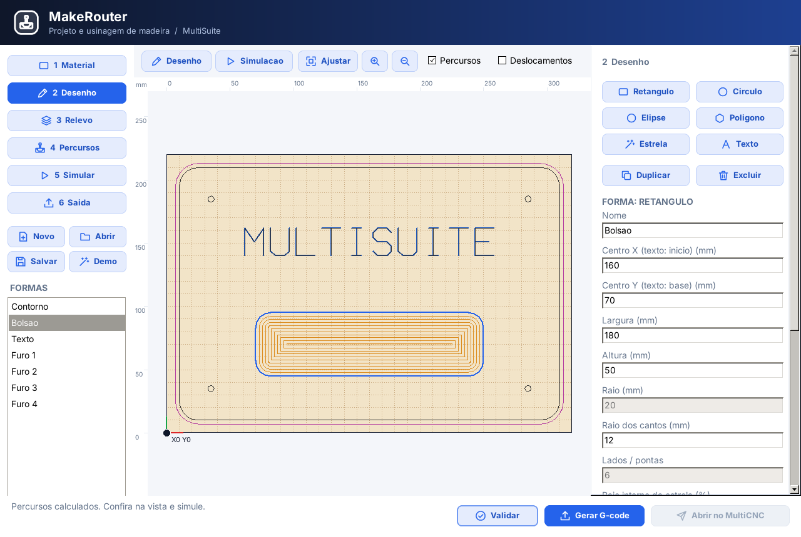
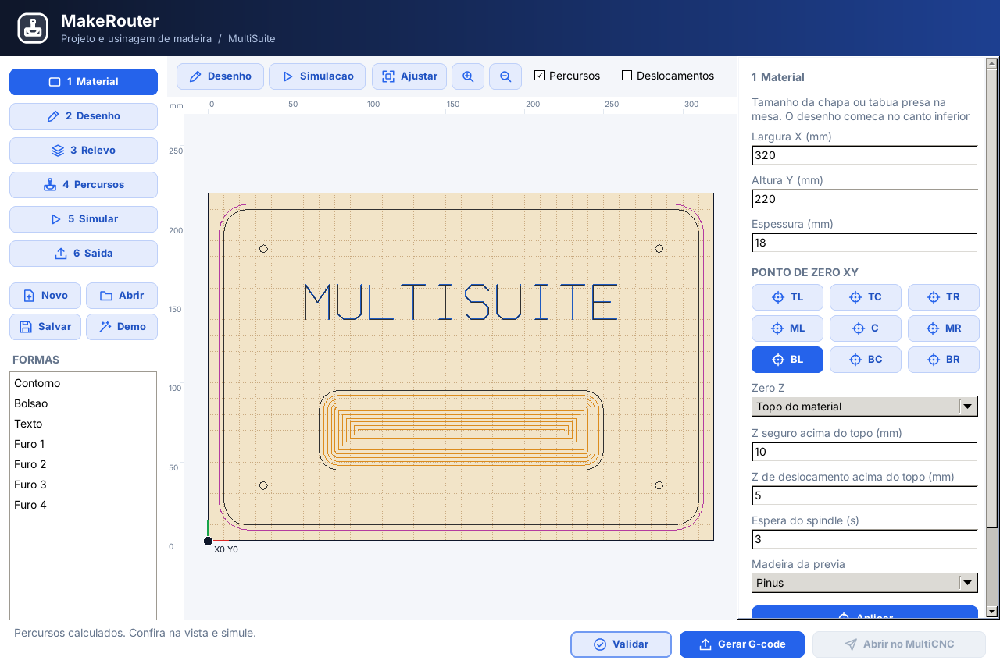
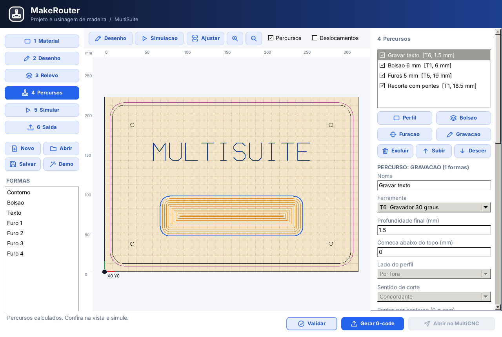
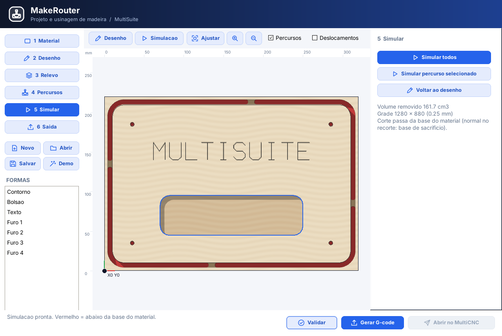
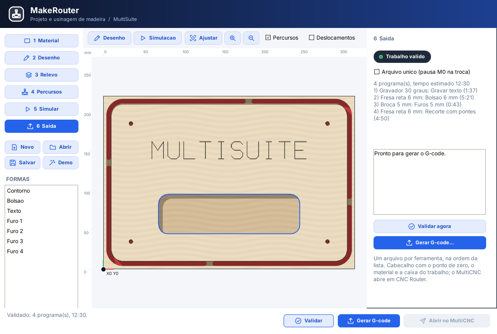

# MakeRouter - Manual do usuário

Versão de referência: **0.1.0.0**. Edição: **13/10/2026**. Windows x64.

[Versão ilustrada em PDF](Manual_do_Usuario_MakeRouter_0.1.0.0_PT-BR.pdf)

## Sumário

1. Fluxo de trabalho e a CNC Router
2. Conheça a interface
3. O conceito de zero virtual
4. Etapa 1: Definição do material bruto
5. Etapa 1: Os 9 pontos de zero XY e referência Z
6. Etapa 1: Alturas de segurança e velocidades globais
7. Etapa 2: Desenho de formas geométricas
8. Etapa 2: Estrelas, arcos e formas complexas
9. Etapa 2: Textos vetoriais e letreiros
10. Manipulação e alinhamento na chapa
11. Camadas de desenho e organização
12. Etapa 3: Introdução a relevos e modelos 3D
13. Etapa 4: Biblioteca de ferramentas de corte
14. Parâmetros de corte e usinagem
15. Etapa 4: Percurso de Perfil (Recorte)
16. Pontes de fixação (Tabs) para sustentação
17. Etapa 4: Percurso de Bolsão (Pocket)
18. Etapa 4: Furação mecânica e bicadas
19. Etapa 4: Gravação de linhas decorativas
20. Gestão da lista de percursos
21. Etapa 5: Simulação 3D da usinagem
22. Verificação de trajetórias e tempo estimado
23. Etapa 6: Validação pré-usinagem
24. Etapa 6: Geração de G-code e contrato MultiSuite
25. Integração direta com o MultiCNC
26. Exercício guiado: Placa entalhada com bolsão
27. Resolução de problemas e diagnóstico
28. Teclas de atalho e especificações técnicas

---

## 01. Fluxo de trabalho e a CNC Router

O MakeRouter é a ferramenta da MultiSuite dedicada ao projeto e fabricação mecânica de peças em madeira (MDF, compensado, madeira maciça), polímeros, resinas e acrílico utilizando fresadoras CNC (Router).

- **1. Preparação do Material (Stock):** Define as dimensões da chapa bruta, espessura e estabelece o ponto de referência de zero relativo ao bloco.
- **2. Desenho Geométrico (CAD 2D):** Cria retângulos, círculos, textos, estrelas e vetores com cotas exatas.
- **3. Modelagem de Relevo (Fase 3D):** Permite atribuir mapas de altura e relevos para acabamentos artísticos.
- **4. Geração de Percursos (CAM):** Seleciona ferramentas (retas, esféricas, V), define passes em profundidade (StepDown), rampa e pontes de fixação.
- **5. Simulação Fotorrealista:** Executa a remoção virtual de material passo a passo, identificando colisões e cortes que tocam a mesa de sacrifício.
- **6. Envio e Execução:** Emite G-code com contrato padronizado e envia com um clique ao MultiCNC para comando da máquina real.

| Aplicação | Especialidade | Relação com a Máquina |
|---|---|---|
| **MakeRouter** | Madeira, móveis, letreiros, rebaixos e cortes 2,5D | Desconhece a máquina real; gera código relativo à chapa. |
| **RouterPCB** | Fresagem e isolação mecânica de placas de circuito impresso | Gera código de isolação, sonda de nível e furação. |
| **MultiCNC** | Operação física da máquina (painel de controle, conexões e eixos) | Controladora direta: aplica o Zero Workpiece e executa. |

---

## 02. Conheça a interface

A interface do MakeRouter segue o padrão visual da MultiSuite, limpa e funcional:

| Área da Tela | Posição | Descrição e Finalidade |
|---|---|---|
| **Cabeçalho** | Topo | Título do projeto, indicador de módulo e atalhos rápidos da suíte. |
| **Barra Lateral** | Esquerda | Acesso às 6 etapas numeradas, botão de carregar exemplo Demo e alternância de vistas 2D/3D. |
| **Área Gráfica** | Centro | Visualizador híbrido de alta performance com réguas milimétricas, grade adaptativa e zoom no cursor. |
| **Painel Contextual** | Direita | Propriedades específicas da etapa ativa (dimensões da chapa, parâmetros de percurso ou ferramentas). |
| **Rodapé de Ações** | Base | Coordenadas X/Y em tempo real, botões Validar, Gerar G-code e Abrir no MultiCNC. |

---

## 03. O conceito de zero virtual

O MakeRouter nunca gera coordenadas absolutas da máquina (nem G53, nem G28 com coordenadas). Todo o projeto é relativo ao **material bruto**:
- **Desacoplamento Completo:** A peça não sabe onde está presa na mesa física da CNC Router.
- **Flexibilidade Total:** Prenda a madeira onde for mais cômodo na mesa de trabalho.
- **Operação no MultiCNC:** O operador leva a ponta da fresa até a marcação na madeira, clica em **Zero Workpiece** (G92 X0 Y0 Z0) e confere com **Frame (Test)**.
- **Contrato de Cabeçalho:** O G-code gerado inclui dimensões do material e ponto de zero nos comentários padronizados.

---

## 04. Etapa 1: Definição do material bruto

Na etapa **1 Material**, você define as características físicas da chapa:

| Campo | Exemplo Típico | Significado e Importância |
|---|---|---|
| **Largura (X)** | 320.0 mm | Comprimento horizontal do bloco de madeira montado na máquina. |
| **Altura (Y)** | 220.0 mm | Largura vertical do bloco de madeira ao longo do eixo Y da mesa. |
| **Espessura (Z)** | 18.0 mm (MDF clássico) | Altura total da chapa; crucial para o cálculo correto da profundidade dos cortes. |
| **Base de Sacrifício** | Ativada (Spoilboard) | Informa que há um mártir de madeira ou MDF embaixo da peça para permitir corte total. |
| **Material Visual** | MDF, Pinus, Maple, Acrílico | Aplica a textura realista correspondente durante a simulação 3D. |

---

## 05. Etapa 1: Os 9 pontos de zero XY e referência Z

A grade de 9 botões permite posicionar o ponto de referência (Datum) em qualquer extremidade:
- **Canto Inferior Esquerdo (BL):** Padrão tradicional para marcenaria e carpintaria.
- **Centro (C):** Excelente para peças circulares, medalhões, entalhes e letreiros simétricos.
- **Topo (TL, TC, TR):** Para esquadros alinhados na borda traseira da máquina.

### Referência de Altura Z:
- **Z no Topo do Material (Padrão):** Z0 na superfície da madeira. Cortes são em Z negativo (ex: Z-5.0).
- **Z na Mesa de Sacrifício:** Z0 na base do mártir. Topo da chapa em +Espessura.

---

## 06. Etapa 1: Alturas de segurança e velocidades globais

| Parâmetro Global | Valor Recomendado | Função e Comportamento Operacional |
|---|---|---|
| **Z Seguro (Safe Z)** | 5.0 a 15.0 mm | Altura em que a fresa se desloca rapidamente (G0) acima da chapa sem perigo de colidir. |
| **Z de Retração** | 2.0 a 3.0 mm | Altura intermediária de alívio rápido ao final de um percurso antes de subir ao Z seguro. |
| **Posição de Retorno** | X0 Y0 Z10 (relativo) | Posição para onde o cabeçote se desloca ao encerrar o trabalho para facilitar a retirada da peça. |
| **Velocidade do Spindle** | 10.000 a 24.000 RPM | Rotação padrão do mandril ou tupia; gravada no comando S do cabeçalho G-code. |
| **Entrada Suave** | Ativada (Rampa) | Desce a fresa inclinada enquanto avança em XY em vez de mergulhar a seco no mesmo ponto. |

---

## 07. Etapa 2: Desenho de formas geométricas

Na etapa **2 Desenho**, você cria os elementos vetoriais paramétricos:

| Forma | Parâmetros Principais | Aplicações Típicas na Carpintaria |
|---|---|---|
| **Retângulo** | Largura, Altura, Raio dos cantos | Tampos de mesa, caixas, gavetas, painéis de móveis e contornos externos. |
| **Círculo** | Diâmetro / Raio | Furos de passagem de cabos, porta-copos, encaixes de dobradiça e flanges. |
| **Elipse** | Raio maior X, Raio menor Y | Molduras decorativas, espelhos ovais e detalhes estéticos de marcenaria. |
| **Polígono Regular** | Número de lados (3 a 12), Raio | Triângulos, hexágonos e octógonos decorativos. |
| **Estrela** | Pontas, Raio externo, Raio interno | Entalhes ornamentais, decorações temáticas e letreiros artísticos. |
| **Arco** | Raio, Ângulo inicial e final | Cortes curvos, rebaixos circulares parciais e cantoneiras. |

---

## 08. Etapa 2: Estrelas, arcos e formas complexas

- **Estrelas:** Controle independente do número de pontas (ex: 5 pontas), raio externo e raio interno.
- **Arcos:** Geração de curvaturas parciais com precisão angular.
- **Contornos Fechados:** Para percursos de bolsão ou perfil externo, certifique-se de que os vetores formem fronteiras fechadas.

---

## 09. Etapa 2: Textos vetoriais e letreiros

1. Clique na ferramenta **Texto** na etapa de desenho.
2. Digite a mensagem desejada (ex: *OFICINA DE MADEIRA*).
3. Defina a **Altura do Texto** em milímetros (ex: 40 mm).
4. O MakeRouter converte as fontes em curvas vetoriais fechadas prontas para usinagem.
5. Permite percursos de gravação em V, letras em alto-relevo ou letras soltas recortadas.

---

## 10. Manipulação e alinhamento na chapa

- **Seleção por Clique:** Clique sobre o vetor para abrir suas propriedades.
- **Seleção Múltipla (Shift + clique):** Adicione ou remova objetos da seleção coletiva.
- **Arrasto:** Mova as peças sobre a chapa com o mouse ou pelas setas do teclado.
- **Centralizar:** O botão **Centralizar** posiciona a forma exatamente no meio geométrico da madeira.
- **Duplicar:** Cria cópias instantâneas para matrizes de peças.

---

## 11. Camadas de desenho e organização

Organize seus projetos complexos em camadas coloridas:
- **Contorno / Recorte:** Vermelho vivo (corte final da peça).
- **Bolsões:** Azul claro (rebaixos internos).
- **Furação:** Verde escuro (furos com broca).
- **Gravação:** Amarelo / Dourado (inscrições decorativas).
- Suporte a ocultar (olho) e travar (cadeado) para evitar movimentos acidentais.

---

## 12. Etapa 3: Introdução a relevos e modelos 3D

Ambiente estruturado para modelagem volumétrica:
- Representação contínua por mapa de alturas (Heightmap).
- Combinações booleanas de relevo: Somar, Subtrair, Máximo e Mínimo.
- Domos convexos, rampas angulares e importação de relevos em escala de cinza.

---

## 13. Etapa 4: Biblioteca de ferramentas de corte

| Tipo de Fresa | Geometria | Aplicação Recomendada em Madeira |
|---|---|---|
| **Fresa Reta (End Mill)** | Cilíndrica com fundo plano (2 cortes) | Recortes externos de chapas, bolsões planos, rasgos e nivelamento. |
| **Fresa Esférica (Ball Nose)** | Ponta arredondada semiesférica | Usinagem 3D, relevos decorativos, canais côncavos e acabamento suave. |
| **Fresa em V (V-Bit)** | Cônica em ponta (30°, 60° ou 90°) | Gravação de textos finos, chanfros nas bordas e marchetaria. |
| **Broca (Drill Bit)** | Ponta helicoidal convencional | Furação profunda para cavilhas e parafusos de montagem estrutural. |

---

## 14. Parâmetros de corte e usinagem

| Parâmetro de Corte | Unidade | Significado e Como Ajustar |
|---|---|---|
| **Passo Vertical (StepDown)** | mm por passada | Profundidade descida por volta. Em MDF, use de 50% a 100% do diâmetro da fresa. |
| **Passo Lateral (StepOver)** | % ou mm | Sobreposição lateral em bolsões. Tipicamente 40% a 50% do diâmetro. |
| **Avanço de Corte (Feed Rate)** | mm/min | Velocidade dos eixos X e Y. Típico: 1200 a 2500 mm/min em madeira macia e MDF. |
| **Avanço de Mergulho (Plunge)** | mm/min | Velocidade de descida do eixo Z. Típico: 300 a 600 mm/min. |
| **Rotação do Spindle (RPM)** | RPM | Velocidade do motor. Típico: 12.000 a 18.000 RPM. |
| **Sentido de Corte** | Concordante / Discordante | Concordante (Climb) gera melhor acabamento superficial. |

---

## 15. Etapa 4: Percurso de Perfil (Recorte)

Corte perimetral ao redor de vetores:
- **Fora (Outside):** Para o contorno final da peça acabada.
- **Dentro (Inside):** Para janelas e aberturas vazadas internas.
- **Na Linha (On Line):** Sem compensação de raio da fresa.
- Suporte a passadas sucessivas em Z com entrada suave em rampa.

---

## 16. Pontes de fixação (Tabs) para sustentação

| Parâmetro da Ponte | Valor Recomendado | Impacto Prático |
|---|---|---|
| **Quantidade de Pontes** | 3 a 6 pontas por peça | Garante que a peça não vibre nem incline durante o recorte final. |
| **Largura da Ponte (Tab Width)** | 4.0 a 8.0 mm | Largura ao longo do perímetro. Deve ser suficiente para suportar o peso da peça. |
| **Altura da Ponte (Tab Height)** | 2.0 a 3.5 mm | Espessura da madeira deixada no fundo. Facilmente cortada com formão manual. |
| **Distribuição Automática** | Equidistante | O algoritmo do MakeRouter distribui as pontes com espaçamento uniforme no contorno. |

---

## 17. Etapa 4: Percurso de Bolsão (Pocket)

Usinagem de cavidades e caixas:

- **Estratégia Offset:** Anéis concêntricos suaves de dentro para fora.
- **Estratégia Zigue-Zague:** Trajetórias em raster com ângulo configurável.
- **Preservação de Ilhas:** Vetores internos são contornados automaticamente sem corte.

---

## 18. Etapa 4: Furação mecânica e bicadas

- **Bicadas (Peck Drilling):** Descidas escalonadas com recuo ao Z seguro para expulsar cavacos e ventilar a broca.
- **Otimização 2-Opt:** Reduz o tempo de viagem do cabeçote entre os furos.
- **Bolsões Circulares:** Furos maiores que o diâmetro da fresa são convertidos em espirais contínuas.

---

## 19. Etapa 4: Gravação de linhas decorativas

Traçado milimétrico sobre vetores com fresa cônica em V ou reta fina:
- Profundidade rasa (0.8 a 2.0 mm) para letreiros e brasões.
- Altas velocidades de avanço para minimizar o tempo de máquina.

---

## 20. Gestão da lista de percursos

- Ativação ou desativação rápida via checkbox.
- Reordenação da sequência de usinagem com botões **Subir** e **Descer**.
- **Ordem segura:** 1º Gravações em V -> 2º Furações -> 3º Bolsões internos -> 4º Recorte externo com pontes.

---

## 21. Etapa 5: Simulação 3D da usinagem

Visualização volumétrica completa da peça usinada:

- Remoção volumétrica realista de madeira.
- Alerta em vermelho indicando corte que atinge a base de sacrifício.
- Inspeção por órbita 3D livre com o mouse.

---

## 22. Verificação de trajetórias e tempo estimado

- Movimentos rápidos G0 em vermelho/amarelo; avanços G1 em ciano/azul.
- Estimativa confiável de tempo de máquina para cotações e orçamentos.
- Metragem total de corte e profundidade máxima atingida.

---

## 23. Etapa 6: Validação pré-usinagem

Checagem obrigatória antes da gravação do G-code:
- Confere se todos os percursos cabem dentro da madeira bruta.
- Verifica se o Z seguro é positivo e suficiente.
- Alerta se o recorte final não possui pontes de sustentação.

---

## 24. Etapa 6: Geração de G-code e contrato MultiSuite

Emissão de código GRBL / RS-274:

- **Arquivo Único:** Insere comando M0 para pausa na troca de ferramenta.
- **Múltiplos Arquivos:** Gera um arquivo numerado por ferramenta.
- Cabeçalho padronizado com dimensões do material e ponto de zero virtual.

---

## 25. Integração direta com o MultiCNC

1. Valide o projeto e clique em **Gerar G-code**.
2. Clique no botão **Abrir no MultiCNC**.
3. O MultiCNC carrega o programa e ajusta a visualização da trajetória.
4. Conecte a fresadora CNC e movimente os eixos até o ponto de zero físico na madeira.
5. Clique em **Zero Workpiece** e faça a checagem de perímetro com **Frame (Test)**.
6. Ligue a tupia e inicie o corte.

---

## 26. Exercício guiado: Placa entalhada com bolsão

1. Abra o MakeRouter e clique no botão **Demo** na lateral.
2. Confira as dimensões na etapa 1 (320 x 220 x 18 mm, Zero BL).
3. Na etapa 4, clique em **Calcular** para gerar as trajetórias.
4. Na etapa 5, clique em **Simular tudo** e acompanhe a usinagem 3D.
5. Na etapa 6, clique em **Validar**, depois em **Gerar G-code** e em **Abrir no MultiCNC**.

---

## 27. Resolução de problemas e diagnóstico

| Sintoma / Falha | Causa Provável | Ação de Correção Recomendada |
|---|---|---|
| Fresa queimando a madeira e soltando fumaça | Avanço muito lento ou RPM do spindle muito alta. | Aumente o Feed Rate no MultiCNC ou reduza a rotação da tupia. |
| A peça se soltou e quebrou a fresa no recorte | Falta de pontes de fixação (Tabs) no perfil externo. | Ative as pontes na etapa de perfil com largura de 6 mm e altura de 3 mm. |
| O corte não atravessou a chapa de madeira | Variação na espessura da chapa ou zero Z calibrado alto. | Aumente a profundidade final em 0.5 mm ou zere a fresa tocando a mesa. |
| Bordas do MDF lascando na face superior | Fresa inadequada girando no sentido incorreto. | Utilize fresa tipo Downcut (corte para baixo) e sentido concordante (Climb). |
| MultiCNC acusa erro de limites de curso | Zero Workpiece foi definido perto do limite da mesa. | Mova a peça para o centro da mesa de trabalho antes de definir o zero. |
| Botão 'Abrir no MultiCNC' está desabilitado | O G-code ainda não foi gerado nesta sessão. | Clique em Validar e depois em Gerar G-code para liberar o botão de envio. |

---

## 28. Teclas de atalho e especificações técnicas

- **Shift + clique:** Seleção múltipla de formas.
- **Delete / Del:** Exclui as formas selecionadas.
- **Roda do mouse:** Zoom interativo no cursor.
- **Botão do meio:** Arrasta a tela (Pan 2D).
- **Botão esquerdo (na vista 3D):** Rotaciona a órbita 3D do bloco.
- **Formato nativo:** `.mrouter` (JSON legível e portável).
- **Precisão:** Ponto flutuante dupla precisão (Double) com Clipper2.
- **Desenvolvido por:** Marcelo Maurin Martins / MaurinSoft para a MultiSuite.
