# MultiCNC - Manual do usuário

Versão de referência: **0.1.0.3**. Edição: **12/10/2026**. Windows x64.

[Versão ilustrada em PDF](Manual_do_Usuario_MultiCNC_0.1.0.3_PT-BR.pdf)


## Sumário

1. Comece por aqui
2. Conheça a interface
3. Escolha a máquina e o perfil
4. Cadastre equipamentos por nome
5. Conecte pela porta serial
6. Conecte por TCP e use o SimuCNC
7. Experimente com o simulador local
8. Abra e confira o G-code
9. Encontre comandos no programa
10. Leia a trajetória e as projeções
11. Ajuste limites e exporte a análise
12. Movimente os eixos manualmente
13. Diferencie homing, HOME e zero da peça
14. Inicie, pause, retome e pare
15. Use o Console e salve o registro
16. Opere a CNC Router e o spindle
17. Configure o perfil do laser
18. Ajuste os parâmetros de laser
19. Passadas, picote e campos adicionais
20. Confira a área com Frame e Outline
21. Selecione a impressora 3D
22. Controle bico e mesa aquecida
23. Configure o joystick
24. Entenda os bloqueios do joystick
25. Compatibilidade e identificação GRBL
26. Trabalhe com as outras ferramentas
27. Exercício guiado sem máquina
28. Resolva problemas de conexão e execução
29. Resolva problemas de posicionamento
30. Atalhos e termos da interface
31. Referências e limites desta edição

## 01. Comece por aqui

O MultiCNC recebe um programa G-code, mostra a trajetória, conecta a controladora e acompanha o envio. Este manual explica o aplicativo de operação da máquina, dentro da MultiSuite.

1. Abra **bin/multicnc.exe**. Em **Config**, selecione CNC Router, CNC Laser ou 3D Printer.
2. Escolha fabricante, modelo, protocolo e interface. Para aprender sem máquina, escolha **Simulador local**.
3. Abra o arquivo em **Open Program...** e confira **Trajetoria e analise**.
4. Clique **Connect Device**. Aguarde a controladora pronta e confira a posição.
5. Na máquina real, estabeleça a referência apropriada e confira o posicionamento. Clique **Start** para iniciar.
6. Acompanhe as respostas no **Console**. Use **Pause**, **Resume** e **Emergency Stop** conforme a necessidade.

> Referência: **MultiCNC 0.1.0.3 para Windows x64**, fontes conferidas no commit 687756e, edição de 12/10/2026. O número do setup da suíte é diferente da versão do aplicativo. Os exemplos das figuras são demonstrativos.

Os rótulos em inglês foram mantidos neste manual para corresponder aos botões reais. A explicação e os procedimentos estão em português. As capturas foram renderizadas pelas telas LCL das fontes desta versão; somente o simulador local foi conectado durante sua preparação.


## 02. Conheça a interface

A janela reúne controles manuais à esquerda, conexão no cabeçalho e o programa de trabalho no centro.

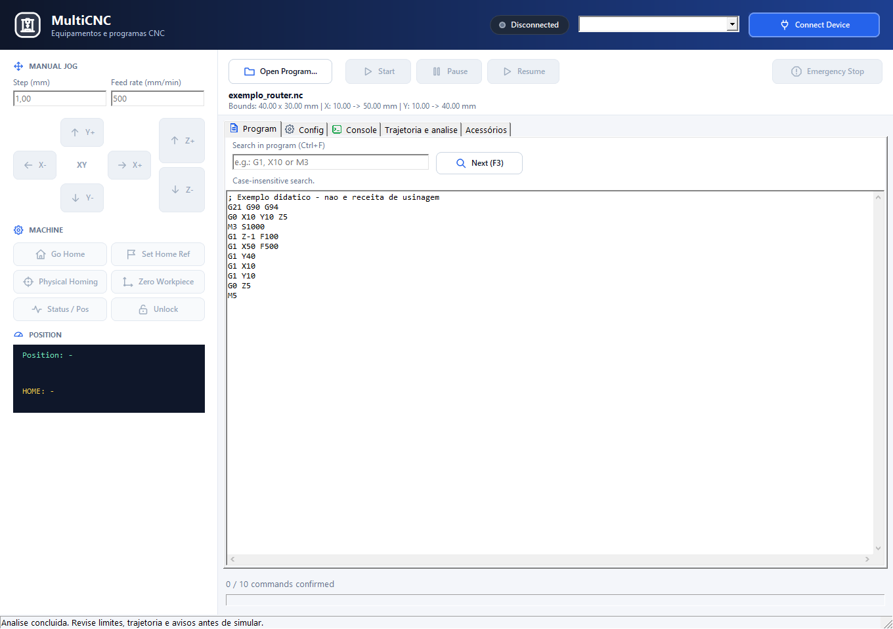

| Área | Uso |
| --- | --- |
| Cabeçalho | Estado da conexão, seleção do equipamento salvo e Connect Device/Disconnect. |
| MANUAL JOG / MACHINE | Passo, avanço, movimentos dos eixos, referências e consulta de estado. |
| Barra de execução | Abrir, iniciar, pausar, retomar e parar; no laser, Frame e Outline. |
| Abas centrais | Program, Config, Console, Trajetoria e analise e Acessórios. |
| Rodapé | Quantidade de comandos confirmados e barra de progresso. |


## 03. Escolha a máquina e o perfil

Em Config, o tipo de máquina determina os parâmetros e comandos disponíveis. Troque de equipamento com a conexão encerrada.

1. Selecione **Machine**: CNC Router, CNC Laser ou 3D Printer.
2. Escolha **Brand** e **Model** no grupo do equipamento.
3. Confira o curso útil e o protocolo sugeridos. Nos perfis de router e laser, ajuste os campos de área/curso à máquina montada.
4. Escolha **GRBL** para a controladora CNC compatível ou **Marlin** para a impressora correspondente. A seleção do perfil pode atualizar protocolo e baud.
5. Revise a conexão antes de salvar ou conectar.


> Selecionar um perfil preenche sugestões do software. Não grava firmware nem configura automaticamente os parâmetros da placa. Confirme a revisão, os eixos e o curso do seu equipamento.


## 04. Cadastre equipamentos por nome

O cadastro evita repetir marca, modelo e conexão a cada sessão.

1. Em **Config**, ajuste a máquina, protocolo, interface, endereço/porta e curso.
2. Em **Equipamentos salvos**, preencha um nome, por exemplo Router Oficina.
3. Clique **Salvar**. Reutilizar o mesmo nome atualiza o cadastro existente.
4. Use **Novo nome** para conservar os parâmetros e cadastrar outro equipamento.
5. Selecione um nome na lista do cabeçalho para restaurar suas configurações. Depois clique **Connect Device**.
6. Para remover, desconecte, selecione o cadastro, clique **Excluir** e confirme.


Os dados ficam em **%LOCALAPPDATA%\Maurinsoft\MultiCNC\multicnc.json**; a versão anterior fica em **multicnc.json.bak**. O cadastro conserva máquina, perfil, protocolo, conexão e curso; no CUSTOM, também as especificações do laser.

> Potência, velocidades, passadas e temperaturas desejadas são ajustes de trabalho. O cadastro atual não deve ser usado como biblioteca de receitas desses parâmetros. Uma COM salva ausente continua selecionada: o programa não troca automaticamente para outro dispositivo.


## 05. Conecte pela porta serial

Use Serial quando a controladora estiver ligada ao computador por USB/serial.

1. Escolha o equipamento e o protocolo em **Config**.
2. Em **Interface**, selecione **Serial**. Abra a lista **COM Port** para atualizar as portas detectadas.
3. Selecione a porta da controladora. Em **Baud Rate**, use a velocidade configurada no firmware.
4. Clique **Connect Device**. Consulte o Console se a porta não abrir.
5. Aguarde a inicialização. No GRBL, a sessão consulta o estado; no Marlin, aguarda o boot antes das consultas de identificação e temperatura.
6. Use **Status / Pos** para consultar posição e estado. Ao terminar o trabalho e com a sessão parada, clique **Disconnect**.


| Se acontecer | Como proceder |
| --- | --- |
| Porta ocupada | Feche o outro aplicativo que usa a mesma COM e reconecte. |
| Porta não aparece | Confira o cabo, alimentação e porta no Gerenciador de Dispositivos; abra a lista novamente. |
| Aguardando controladora | Veja o Console, protocolo e baud. Porta aberta ainda não confirma firmware pronto. |
| Mudou de placa | Desconecte e conecte novamente. A identificação anterior é descartada. |


## 06. Conecte por TCP e use o SimuCNC

TCP permite comunicação com uma controladora acessível por rede ou com o SimuCNC em outro processo.

1. Selecione **TCP** em Interface. Preencha **IP Address** e **TCP Port**.
2. No mesmo computador do SimuCNC, use **127.0.0.1** e porta **9000**, quando estes forem os valores do servidor.
3. No SimuCNC, escolha o mesmo tipo de máquina e protocolo, selecione TCP e clique **Iniciar TCP**.
4. Volte ao MultiCNC e clique **Connect Device**. Confira as respostas no Console.
5. Para outro computador, informe seu IPv4 real e a porta configurada no servidor.

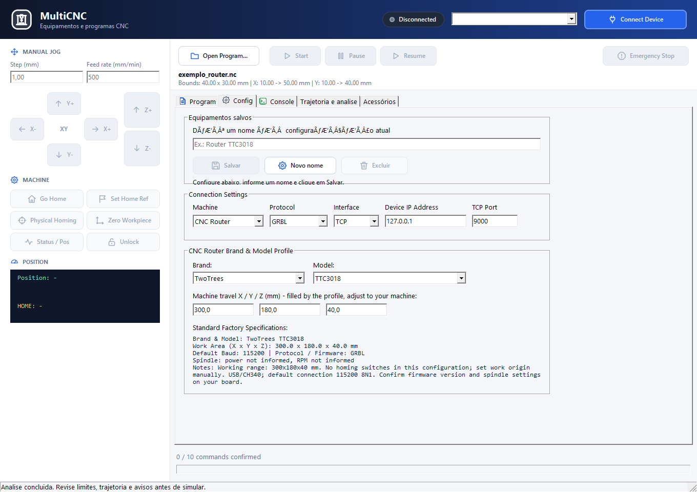

O cliente usa um endereço de destino; **0.0.0.0** pode ser endereço de escuta do servidor, mas não deve ser informado como destino no MultiCNC. A porta aceita valores de 1 a 65535. O modo TCP atual utiliza comunicação bruta, sem HTTP e sem TLS.

> MultiCNC envia e recebe comandos. SimuCNC é uma aplicação separada que simula a máquina e sua visualização. O guia docs/SIMUCNC_TCP.md detalha o servidor, a mesa 3D e a reconexão.


## 07. Experimente com o simulador local

O simulador local está dentro do MultiCNC e permite praticar o fluxo sem abrir uma conexão com equipamento físico.

1. Desconecte a sessão atual, se houver.
2. Escolha o tipo de máquina e protocolo. Em Interface, selecione **Simulador local**.
3. Abra um programa pequeno e revise a análise.
4. Clique **Connect Device**. O Console informa que os movimentos são estimados e não acionam equipamentos.
5. Experimente Start, Pause, Resume, consulta de posição e parada.
6. Clique Disconnect quando terminar.

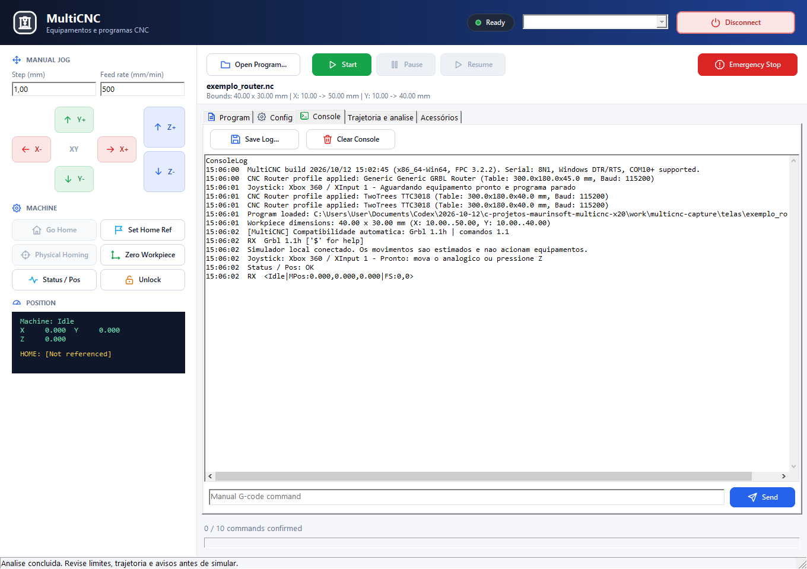

O modo local testa o fluxo de comandos. Não reproduz o resultado físico no material, a qualidade da impressão, colisões ou remoção de material. Ele é diferente da conexão TCP com o SimuCNC.


## 08. Abra e confira o G-code

O MultiCNC executa trajetórias já preparadas por uma ferramenta CAD/CAM ou slicer.

1. Clique **Open Program...** ou pressione **Ctrl+O**. Também é possível arrastar um arquivo para a janela.
2. Selecione o arquivo. Os filtros incluem .nc, .tap, .cnc, .ngc e .gcode; para impressão, também .gco.
3. Confira o nome e os limites exibidos sob a barra de ações.
4. Leia o programa em **Program** e confira a aba de trajetória.
5. Se o arquivo veio de outra ferramenta, confira tipo de máquina, zero, unidades e protocolo antes de iniciar.


O limite por arquivo é **5 MB**. O arquivo precisa conter comandos. Comentários completos, linhas vazias e delimitadores não contam como comandos de execução. O texto exibido conserva comentários e linhas para consulta.

> A aba Program é de leitura. Edite o arquivo na ferramenta de origem ou em um editor e abra-o novamente. Abrir outro arquivo, arrastar um arquivo ou desconectar ficam bloqueados durante execução/pausa.


## 09. Encontre comandos no programa

A busca ajuda a localizar avanços, movimentos, posições e comandos de processo.

1. Abra a aba **Program**. Pressione **Ctrl+F** para focar a busca.
2. Digite um trecho, por exemplo G1, X10, M3 ou M104.
3. Clique **Next (F3)**, pressione F3 ou Enter no campo de busca.
4. Repita para avançar até a próxima ocorrência. Ao chegar ao fim, a busca retorna ao início.

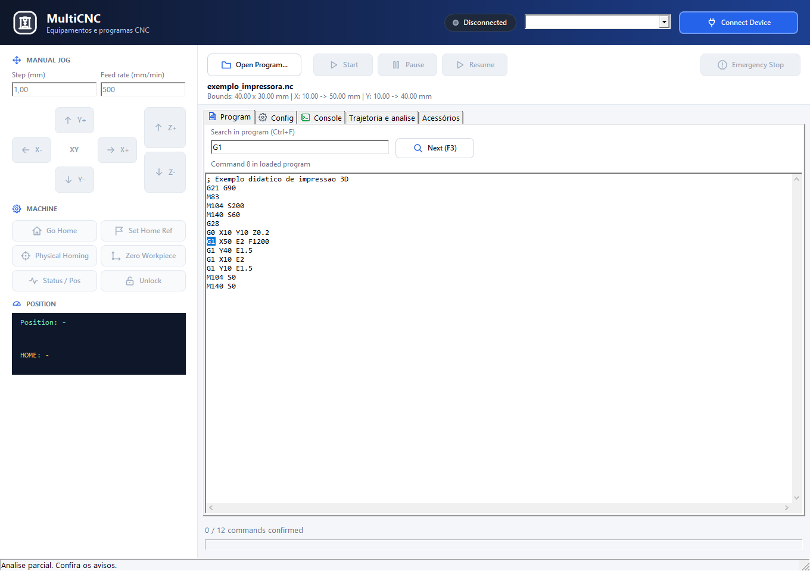

A busca não diferencia maiúsculas de minúsculas. O resultado informa a linha encontrada ou que o texto não existe. A seleção no programa não altera o arquivo nem muda o ponto de início da execução.


## 10. Leia a trajetória e as projeções

A aba Trajetoria e analise mostra uma projeção dos movimentos calculados, com informações de distância, tempo e limites.

1. Abra a aba **Trajetoria e analise**.
2. Escolha **XY** para olhar de cima, **XZ** para relacionar X e profundidade, ou **YZ** para relacionar Y e profundidade.
3. Leia os movimentos, arcos, erros, avisos e limites calculados.
4. Confira os trechos destacados e a lista de avisos antes de executar.

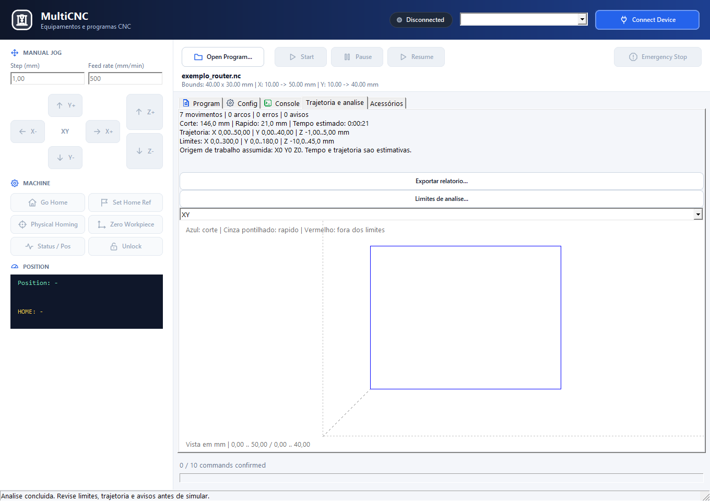

A legenda usa **azul** para corte, **cinza pontilhado** para deslocamento rápido e **vermelho** para fora dos limites de análise. A vista ajusta o desenho à área disponível. Ela não é uma simulação de colisão, de fixação ou de remoção de material.


## 11. Ajuste limites e exporte a análise

Os limites da análise estão no sistema de coordenadas do programa. Eles são diferentes do curso cadastrado no perfil da máquina.

1. Clique **Limites de analise...**. Informe mínimos e máximos X, Y e Z de acordo com o trabalho.
2. Configure também avanço máximo, avanço rápido e acelerações XY/Z quando precisar adequar a estimativa.
3. Aplique os valores e confira a análise recalculada.
4. Leia os avisos por linha. Corrija o programa na origem quando necessário.
5. Clique **Exportar relatorio...** e escolha onde salvar o arquivo de texto.

| Informação | Como interpretar |
| --- | --- |
| Envelope de análise | Faixa de coordenadas esperadas no arquivo. Exemplo: se Z0 é o topo, um corte pode usar Z negativo. |
| Curso do equipamento | Capacidade de deslocamento configurada no perfil; usada pelos controles da sessão. |
| Tempo estimado | Cálculo dos movimentos; não inclui toda espera térmica e não garante tempo físico. |
| Análise parcial | Há comandos cuja posição depende da máquina: homing, G53, G92 ou probe, entre outros. |
| Limites de processamento | Prévia: até 200 mil segmentos. Análise: até 1 milhão; ao atingir o teto, o relatório indica erro e análise parcial. |

> No simulador local, erros da análise bloqueiam Start. Na conexão real, a análise não é uma liberação completa de segurança: revise os avisos, a compatibilidade e o posicionamento. A conferência de curso não substitui a verificação física do conjunto peça/ferramenta.


## 12. Movimente os eixos manualmente

MANUAL JOG controla pequenos deslocamentos quando a máquina está conectada, pronta e fora de um programa em execução ou pausa.

1. Aguarde a máquina ficar pronta e confira a posição em **POSITION**.
2. Em **Step (mm)**, escolha a distância por clique; comece com um passo pequeno.
3. Em **Feed rate (mm/min)**, ajuste o avanço manual.
4. Clique X-/X+ ou Y-/Y+. Use Z-/Z+ somente quando esse eixo estiver disponível no perfil.
5. Clique **Status / Pos** para atualizar a leitura. Se houver recusa, leia o motivo no Console.


O passo da tela aceita 0,01 a 100 mm; o avanço manual aceita 1 a 10000 mm/min. Os valores disponíveis não garantem que a máquina possa executá-los. O perfil limita o curso e determina quais eixos podem ser comandados.

Na impressora 3D, **Go To Position** abre um diálogo para uma posição absoluta X/Y/Z dentro do curso configurado. Durante programas, os comandos manuais de movimento ficam bloqueados.


## 13. Diferencie homing, HOME e zero da peça

Esses comandos têm finalidades diferentes. O zero do programa deve corresponder ao zero usado na preparação da peça.

| Botão | Função |
| --- | --- |
| Physical Homing | Executa a referência física pelos sensores: $H no GRBL e G28 no Marlin. Depende do perfil e da máquina. |
| Set Home Ref | Registra a posição atual como referência HOME, sem movimento; usa G28.1 no fluxo CNC. |
| Go Home | Retorna à referência HOME, conforme o protocolo e a configuração. |
| Zero Workpiece | Define a posição atual como zero de trabalho X/Y/Z no fluxo CNC, usando G92. |
| Status / Pos | Consulta o estado e a posição reportados pela controladora. |
| Unlock | Solicita desbloqueio/reinicialização compatível: $X no GRBL ou M999 no Marlin. |

1. Confira a causa de qualquer alarme antes de usar Unlock.
2. Faça Physical Homing somente em máquina com sensores e configuração compatíveis.
3. Na router ou laser, posicione a ferramenta no zero indicado pelo arquivo e use Zero Workpiece quando apropriado.
4. Se quiser uma referência de retorno, use Set Home Ref e confira os valores apresentados antes de usar Go Home.

> Perfis sem homing desabilitam Physical Homing. Na impressora 3D, Set Home Ref e Zero Workpiece não são exibidos. Não use Go Home como substituto universal de referência física.


## 14. Inicie, pause, retome e pare

A execução envia os comandos e acompanha as confirmações da controladora.

1. Confira o arquivo, a trajetória, o protocolo, o equipamento e o zero de trabalho.
2. Aguarde a conexão pronta e sem alarme. Clique **Start**.
3. Acompanhe os comandos confirmados no rodapé e as respostas no Console.
4. Use **Pause** para suspender e **Resume** para continuar a sessão pausada.
5. Use **Emergency Stop** para interromper. Confira o estado após a parada antes de tentar qualquer nova operação.

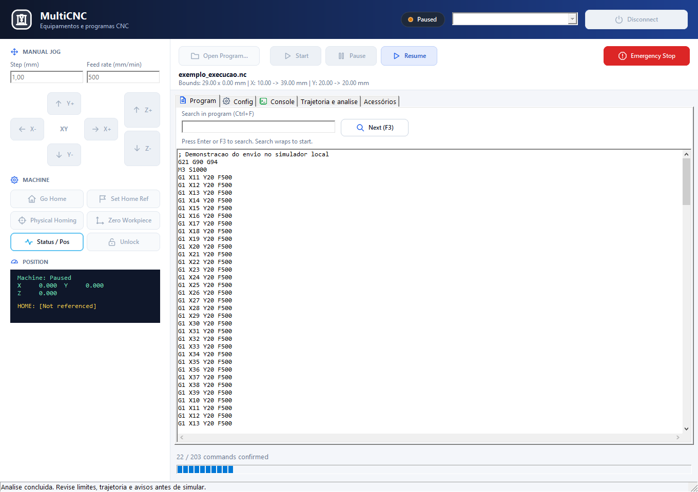

| Estado | Significado |
| --- | --- |
| Ready | Sessão pronta para o trabalho, respeitando disponibilidade e validações. |
| Running / Paused | Programa em execução / suspenso. |
| Program completed | Todas as linhas e comandos finais foram confirmados. |
| Stopped / Error | Sessão interrompida ou erro registrado; consulte o Console. |

> Uma confirmação ok não comprova, sozinha, que o movimento físico terminou. O botão Emergency Stop depende do computador, comunicação e firmware; conserve acesso à parada física da máquina. Uma nova partida começa o programa novamente: não há retomada automática do ponto interrompido.


## 15. Use o Console e salve o registro

O Console reúne identificação, comandos enviados, respostas, erros e recusas.

1. Abra **Console**. Leia mensagens de inicialização e conexão.
2. Para um comando manual, use o campo **Manual G-code command** e clique **Send**, com a sessão pronta e fora de execução/pausa.
3. Confira as linhas TX e RX e o retorno ok, error ou ALARM.
4. Use **Save Log...** para salvar o registro em texto.
5. Use **Clear Console** quando precisar iniciar uma nova coleta visual.


O Console mantém as últimas **1000 linhas**. Salve o registro quando precisar preservar uma ocorrência. Comandos de configuração digitados manualmente têm os efeitos definidos pelo firmware: use-os apenas quando souber o que alteram.


## 16. Opere a CNC Router e o spindle

A router recebe programas de fresagem preparados por MakeRouter, MultiCAM, RouterPCB ou outro CAM compatível.

1. Selecione CNC Router, marca/modelo e o curso útil X/Y/Z. Confira baud e GRBL.
2. Abra o arquivo e confira profundidades, aproximações, zero de trabalho e trajetória.
3. Estabeleça o zero da peça e a referência apropriada à máquina.
4. Para uso manual do spindle, abra **Acessórios** e role até **Router - spindle**.
5. Informe **Rotacao / valor S (RPM)** e use **Ligar spindle** ou **Desligar spindle**.
6. Para executar o trabalho completo, use Start e acompanhe o Console.

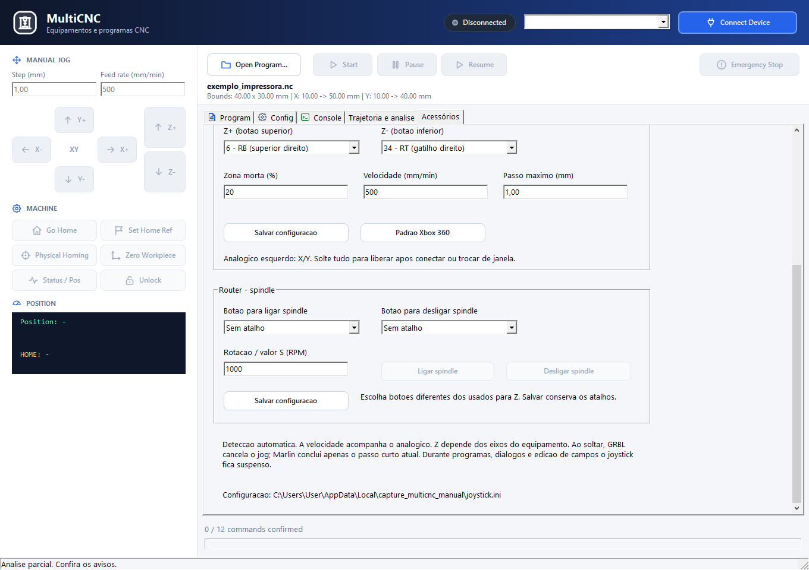

Ligar envia `M3 S<valor>`; desligar envia M5. Os comandos desta área exigem router com GRBL, pronta e fora de execução/pausa. O limite do perfil também pode restringir S. A rotação física depende do spindle e da escala configurada na controladora, inclusive $30.

> O botão permanece disponível independentemente da ativação do joystick, quando a sessão permitir. Soltar um botão do joystick não desliga o spindle: use o comando de desligamento ou a parada apropriada.


## 17. Configure o perfil do laser

Selecione CNC Laser para exibir os controles de laser e os botões de enquadramento.

1. Em Config, escolha **CNC Laser**, marca e modelo.
2. Confira a área útil X/Y e as especificações mostradas no resumo.
3. Para um laser personalizado, selecione **CUSTOM / CUSTOM Laser**.
4. Informe área X/Y, fabricante/modelo e potência óptica nominal em watts. Informe comprimento de onda se conhecido e a presença de sensores de homing.
5. Dê um nome ao equipamento e clique Salvar para conservar os dados CUSTOM.

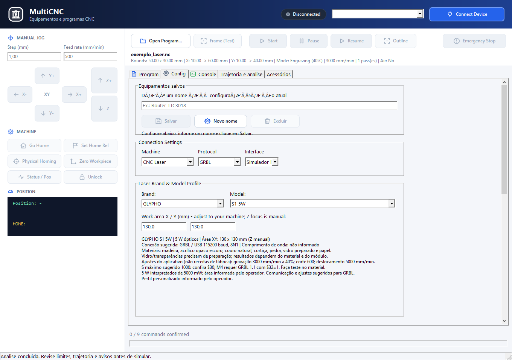

Os perfis incluem Generic, CUSTOM, GLYPHO e fabricantes comerciais do catálogo. Passe o mouse sobre o resumo para consultar a fonte do perfil, quando disponível. Perfis do catálogo trabalham com foco Z manual; Z não fica disponível como jog nesses perfis.

> Potência óptica em W descreve o módulo. Percentual de trabalho e valor S são controles de processo. Não confunda watts ópticos com consumo elétrico nem considere o perfil uma receita de corte para qualquer material.


## 18. Ajuste os parâmetros de laser

Em Config, role até Work Mode, Laser Power e Feed Rates. Confira o que já vem no arquivo antes de alterar o processamento.

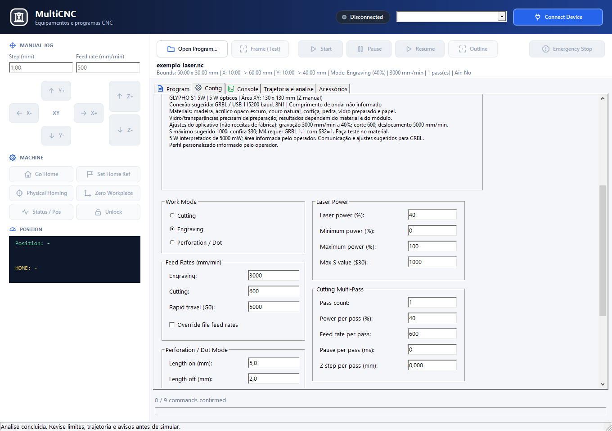

| Grupo | Uso na interface |
| --- | --- |
| Work Mode | Cutting (corte), Engraving (gravação) ou Perforation / Dot (picote). |
| Laser Power | Percentual de potência, mínimo/máximo e Max S value. O Max S deve corresponder à escala da placa. |
| Feed Rates | Avanços de gravação, corte e deslocamento; Override file feed rates solicita alteração dos avanços do arquivo. |
| M4 / M3 | Escolha entre potência dinâmica e constante quando o firmware e sua configuração suportarem. |
| Air Assist | Habilita comandos de ar e permite editar o comando de ligar/desligar, usualmente M8/M9. |

> Nesta versão, o transformador troca M3/M4 conforme o modo, repete passadas e pode acrescentar avanço às linhas reconhecidas. Ele preserva os S existentes no programa: mudar o percentual da tela não reescala universalmente as potências do arquivo. Gere os parâmetros de produção na ferramenta de origem e confira o resultado.


## 19. Passadas, picote e campos adicionais

Alguns campos estão na tela, mas ainda não possuem processamento completo no programa enviado. Esta distinção evita interpretar um ajuste visual como alteração da trajetória.

| Campo | Comportamento em 0.1.0.3 |
| --- | --- |
| Pass count | Repete o programa carregado. Para uma passagem, use 1; a repetição atual considera o contador também fora do modo Cutting. |
| Power/feed per pass | O avanço pode entrar pela opção de override; a potência S original não é substituída de forma geral. |
| Feed rate per pass | O override atual atua em linhas G1/G2/G3 reconhecidas que já possuem F; não substitui todos os formatos possíveis. |
| Wait at pass end / Z step | Em Cutting, acrescenta pausa e descida Z configuradas entre passadas. Perfis sem Z exigem passo Z igual a zero. |
| Perforation / Dot | Os comprimentos ligado/desligado ainda não segmentam automaticamente a trajetória em picotes. |
| Kerf | Não aplica compensação geométrica ao contorno nesta versão. |
| Min/max power, Rapid feed, Pre/Post fire | Não há aplicação completa desses campos ao programa no transformador atual. |

Para picote, compensação de kerf, raster ou potência variável, prepare o G-code no LaserArt/LaserPCB ou CAM apropriado. Evite repetir aquecimentos, referências e retornos contidos no arquivo ao escolher múltiplas passadas.

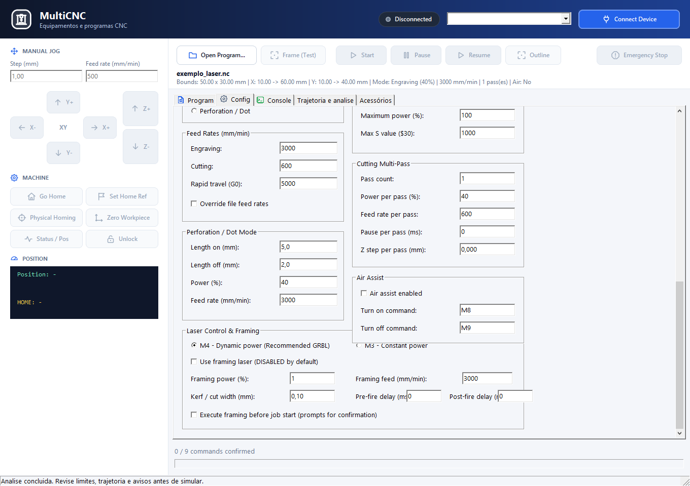


## 20. Confira a área com Frame e Outline

Os dois recursos percorrem uma caixa de enquadramento e preservam o programa original.

| Recurso | Como funciona |
| --- | --- |
| Frame (Test) | Usa os limites do programa e o avanço de framing configurado. O laser de teste fica desligado por padrão, mas pode ser habilitado com potência de teste. |
| Outline | Percorre o retângulo XY com laser desligado por M5, sem movimento Z. Calcula avanço para um alvo nominal de 8 segundos, incluindo a aproximação. |
| Frame before start | Ao habilitar, solicita enquadramento e apresenta confirmação de posicionamento antes de iniciar. |

1. Conecte o laser, abra o programa e aguarde a máquina ociosa e pronta.
2. Confira se a mesa está livre para o trajeto e se os limites calculados são confiáveis.
3. Use **Outline** para contorno com laser desligado ou ajuste o framing e clique **Frame (Test)**.
4. Acompanhe a conclusão pelo estado/Console. Pause, Resume e Emergency Stop continuam disponíveis durante o enquadramento.
5. Confira visualmente a posição do material antes de iniciar o trabalho.

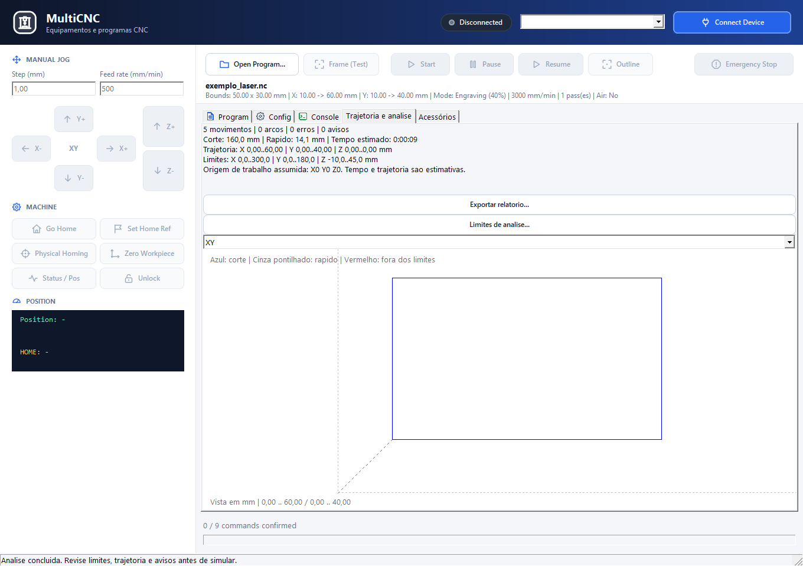

> Aceleração, limites de avanço e comunicação podem prolongar o Outline além de 8 segundos. Em Frame before start, o diálogo não é comprovação de conclusão física: aguarde o contorno e a máquina ociosa. Trajetórias com coordenadas desconhecidas podem ser recusadas pelo Outline.


## 21. Selecione a impressora 3D

O MultiCNC recebe o G-code de impressão já fatiado. O modelo 3D é preparado no MultiSlicer ou em outro slicer.

1. Escolha **3D Printer** em Machine.
2. Selecione marca e modelo. Confira volume, baud, firmware, diâmetro do filamento e limites térmicos apresentados.
3. Use **Marlin** para a impressora compatível. Confira Serial ou TCP.
4. Abra o G-code do slicer e conecte. Aguarde a inicialização e as leituras da controladora.
5. Confira homing e temperaturas do arquivo antes de Start.

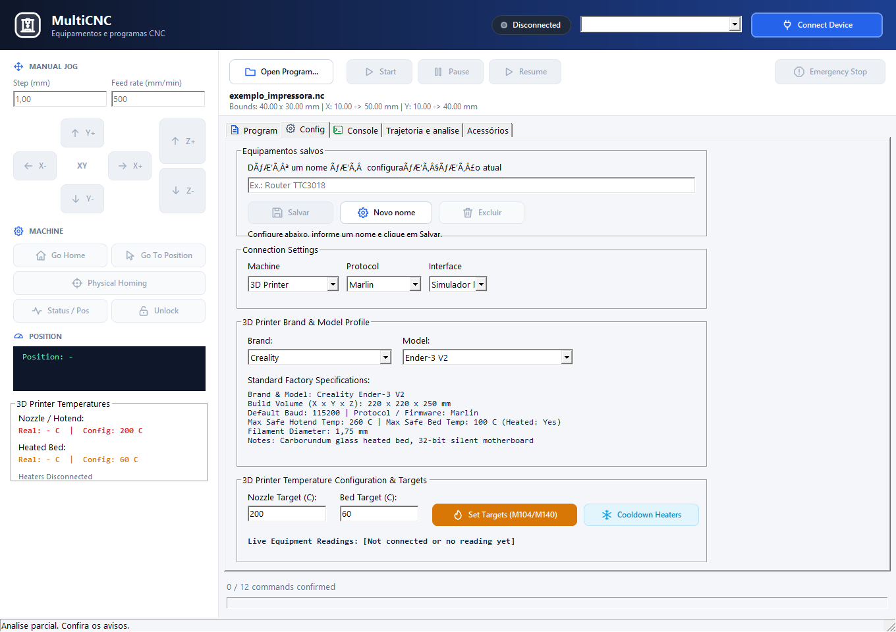

O painel lateral passa a exibir temperaturas reais e configuradas. O movimento absoluto pode ser solicitado por Go To Position. Os botões de zero da peça e Set Home Ref do fluxo CNC deixam de ser mostrados.

> A presença de G-code aceito pelo Marlin não implica suporte a qualquer firmware de impressora. O aplicativo não converte automaticamente comandos entre GRBL e Marlin.


## 22. Controle bico e mesa aquecida

Temperaturas desejadas e leituras reais aparecem separadamente. Configurar um alvo não significa que o aquecimento terminou.

1. Conecte a impressora e aguarde suas leituras.
2. Em Config, ajuste **Nozzle Target (C)** e **Bed Target (C)**.
3. Clique **Set Targets (M104/M140)** para enviar os alvos.
4. Acompanhe valores reais e alvos no painel lateral e na linha Live Equipment Readings.
5. Use **Cooldown Heaters** para enviar alvo zero ao bico e à mesa quando apropriado.


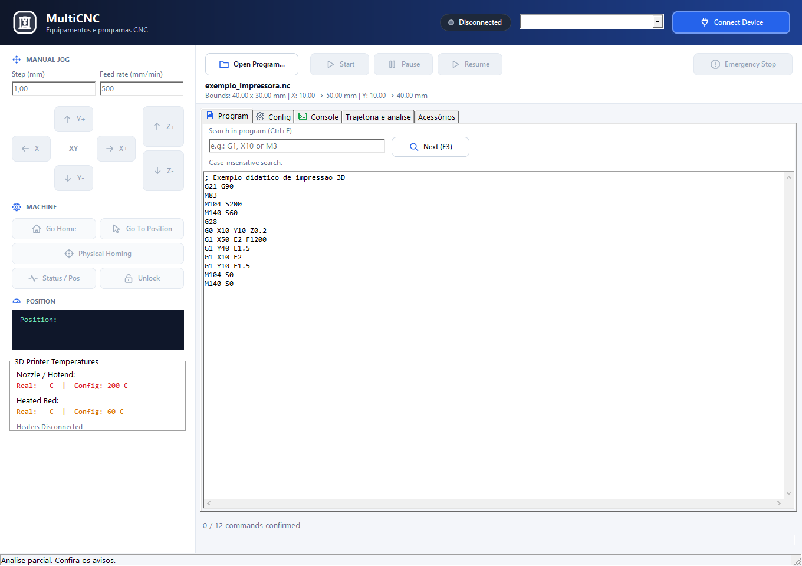

O perfil informa limites térmicos. A interface limita/corrige solicitações que ultrapassem o teto do perfil; modelos sem mesa aquecida desabilitam o alvo correspondente. Sem leitura válida, o painel mostra traços, não uma temperatura medida.

> M104/M140 definem alvos sem esperar a temperatura. O próprio arquivo pode conter M109/M190 para aguardar. O arquivo pode alterar novamente os alvos que você definiu manualmente. Pausar a execução não é equivalente a resfriar os aquecedores.


## 23. Configure o joystick

A aba Acessórios configura o controle para a máquina já conectada. O joystick não escolhe nem conecta o equipamento.

1. Abra **Acessórios** e habilite **Ativar controle por joystick**.
2. Use a descoberta automática ou escolha o controle. Clique Detectar para atualizar.
3. Escolha eixos X/Y, inversões e botões de Z. O padrão Xbox usa analógico esquerdo para XY, RB para Z+ e RT para Z-.
4. Ajuste zona morta, velocidade e passo máximo.
5. Clique **Salvar configuracao**. Centralize o analógico e solte os botões antes de começar.

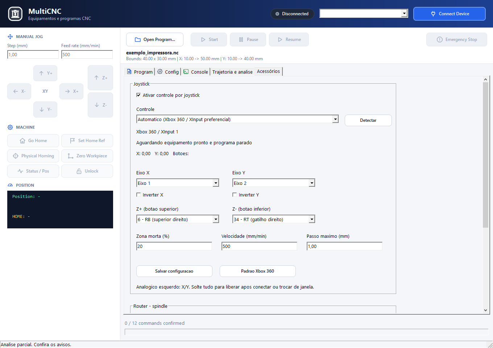

No Windows, há detecção XInput e WinMM. Prefira XInput para Xbox com gatilhos independentes. O padrão é zona morta 20%, velocidade 500 mm/min e passo máximo 1 mm. A velocidade acompanha a inclinação do analógico; Z depende do perfil.


## 24. Entenda os bloqueios do joystick

O controle contínuo exige a janela ativa, máquina pronta e controles liberados em repouso.

| Situação | Comportamento |
| --- | --- |
| Voltou à janela/trocou de controle | Centralize o analógico e solte todos os botões para liberar novamente. |
| Programa executando ou pausado | Movimentos de joystick suspensos. |
| Editando campo ou em diálogo | Controle suspenso para evitar movimento ao preencher parâmetros. |
| Perda de foco/desconexão | Cancela ou suspende o movimento conforme o protocolo. |
| GRBL 1.1 | Jog nativo; soltar solicita cancelamento de jog e sincronização. |
| Marlin | Conclui o passo curto em andamento; aguarda sua conclusão antes do próximo. |
| GRBL anterior a 1.1 | Joystick contínuo indisponível; use os comandos manuais compatíveis. |

Não há fila de vários pulsos do joystick. Um erro ou reinício durante jog exige reconexão para liberar o controle novamente. Os botões de parada existentes continuam disponíveis.

Os atalhos do spindle são configurados no grupo **Router - spindle**: escolha um botão para ligar e outro para desligar, informe S e salve. Use botões diferentes entre si e dos usados para Z. Uma pressão envia um único comando; desligar tem prioridade se os dois forem pressionados.

> As escolhas são aplicadas à sessão e só persistem ao salvar. O caminho do joystick.ini aparece na aba Acessórios. Os atalhos do spindle desta área são exclusivos de router com GRBL em operação manual.


## 25. Compatibilidade e identificação GRBL

Ao conectar, o programa identifica o firmware e adapta os comandos manuais ao conjunto disponível.

O banner, o formato do status e uma consulta $I em repouso ajudam a reconhecer GRBL, grblHAL ou FluidNC. O Console mostra a identificação. Reconectar elimina o estado da placa anterior.

| Controladora | O que muda |
| --- | --- |
| GRBL 1.1 | Movimento manual nativo $J e comandos de tempo real compatíveis. |
| GRBL antigo | Leitura do status antigo e preservação dos erros textuais; não recebe comandos exclusivos da versão 1.1. |
| Jog antigo | Consulta $$ e $G, usa movimento incremental e restaura modos. Requer milímetros, G94 e modos restauráveis. |
| Arquivo incompatível | A verificação recusa comandos conhecidos de impressora, extrusão E e checksum Marlin no perfil GRBL. |
| Perfil sem homing | Recusa $H em operação manual e no programa, conforme a configuração do perfil. |

1. Se o início for recusado, leia a mensagem e a linha indicada no Console.
2. Confira a máquina e o protocolo selecionados.
3. Gere novamente o arquivo para o destino correto ou corrija a configuração quando ela estiver errada.
4. Reconecte após trocar de placa; não reutilize a identificação anterior.

> A identificação não atualiza firmware e não converte o programa entre protocolos. A validação reconhece incompatibilidades conhecidas; não certifica todos os comandos e extensões de qualquer placa.


## 26. Trabalhe com as outras ferramentas

O MultiCNC concentra conexão e execução. A geometria, o fatiamento e os percursos são preparados antes de abrir o trabalho aqui.

| Origem | Fluxo |
| --- | --- |
| LaserArt / LaserPCB | Prepare arte/camadas e G-code para laser; abra ou envie ao MultiCNC. |
| MakeRouter / MultiCAM | Prepare material, ferramenta e percursos de router; exporte o G-code. |
| RouterPCB | Prepare isolamento, furação e recorte; confira o zero indicado para cada etapa. |
| MultiSlicer | Importe o modelo, configure impressão, fatie e exporte G-code para a impressora. |
| MultiSuite | O launcher pode abrir o programa com --project e --file. O arquivo segue pelo mesmo fluxo de leitura/análise. |

Cabeçalhos como **; LaserArt -> MultiCNC** e **; ... -> MultiCNC (CNC Router)** podem selecionar a máquina correspondente quando a sessão estiver desconectada. Cabeçalhos MS-DATUM, MS-STOCK e MS-BOUNDS são lidos e informados no log.

> O cabeçalho não posiciona a máquina nem estabelece o zero automaticamente. Nesta versão, MS-BOUNDS não substitui toda a conferência de curso/offsets e o Frame. Depois de importar, confira novamente o equipamento, a origem e a conexão.


## 27. Exercício guiado sem máquina

Use o simulador local para praticar abertura, análise, execução e pausa.

1. Crie em um editor um arquivo chamado quadrado.nc com o exemplo abaixo.
2. Em Config, selecione CNC Router, GRBL e Simulador local.
3. Abra quadrado.nc. Em Trajetoria e analise, confira XY e os limites: X10..50 e Y10..40 no contorno.
4. Clique Connect Device e Start. Confira o Console e os comandos confirmados.
5. Para praticar Pause/Resume, use um arquivo maior; o exemplo curto pode terminar antes do clique.
6. Desconecte ao terminar. Este exercício não deve ser enviado como receita de usinagem à máquina.

```gcode
; Exemplo didatico - simulador local
G21 G90 G94
G0 X10 Y10 Z5
M3 S1000
G1 X50 F500
G1 Y40
G1 X10
G1 Y10
M5
```

O exemplo mantém Z positivo para explorar a interface. Para conferir profundidade em um projeto real, use a projeção XZ/YZ e ajuste os limites de análise ao zero de trabalho definido no CAM.


## 28. Resolva problemas de conexão e execução

Comece pelo estado no cabeçalho e pelas mensagens do Console.

| Sintoma | Verificação e ação |
| --- | --- |
| Connect Device falha | Confira cabo, alimentação, porta, baud e outro programa usando a COM. Em TCP, confira servidor, IP e porta. |
| Aguardando controladora | Espere o boot e confira protocolo e respostas. Não confunda porta aberta com estado pronto. |
| Start desabilitado | Verifique arquivo com comandos, conexão pronta e ausência de alarme. No simulador, corrija erros da análise. |
| Programa bloqueado | Leia a linha e o comando recusado; confira GRBL/Marlin e gere o arquivo para o equipamento certo. |
| Alarme ou erro durante envio | Interrompa, salve o log e examine a causa. Só desbloqueie/reconecte após corrigi-la. |
| Posição/temperatura com traços | Ainda não existe leitura válida da controladora; consulte conexão e Console. |
| Não abre outro arquivo | Pare a sessão em execução/pausa. Verifique também o limite de 5 MB e se há comandos no arquivo. |
| Não consegue trocar perfil | Desconecte antes de mudar máquina, protocolo, comunicação ou equipamento salvo. |

Envio recusado não deve ser contornado por tentativa de comandos incompatíveis no Console. Preserve o arquivo original e o registro ao investigar um problema.


## 29. Resolva problemas de posicionamento

A análise e os comandos manuais dependem das coordenadas e dos recursos do perfil.

| Sintoma | Verificação e ação |
| --- | --- |
| Trajetória vermelha | Compare o envelope de análise com as coordenadas do arquivo; confira unidades e zero de trabalho. |
| Análise parcial | Veja se existem G53, G92, homing, probe ou transformações que dependem do estado da máquina. |
| Physical Homing indisponível | Confira perfil, sensores e se o recurso está permitido. Perfis sem sensores usam referência manual apropriada. |
| Z não movimenta no laser | Os perfis laser atuais não cadastram Z motorizado; não envie movimentos Z para esses equipamentos. |
| Outline recusado | Aguarde estado Idle e confira se há limites XY confiáveis e programa carregado. |
| Joystick não movimenta | Ative a janela, solte botões/analógico, saia da edição de campos e confira conexão, alarme e protocolo. |
| Spindle não liga pelo atalho | Confira router/GRBL, estado pronto, botão exclusivo e S. Solte os controles antes de pressionar novamente. |
| Laser não muda ao alterar potência | Os S do arquivo não são reescalados universalmente pela tela. Ajuste o processo no programa de origem. |

A prévia não calcula colisões com grampos, a posição real do material, compensações completas de ferramenta ou o resultado do corte. Revise esses elementos no seu fluxo de preparação e operação.


## 30. Atalhos e termos da interface

Use esta página como consulta durante a operação.

| Atalho | Ação |
| --- | --- |
| Ctrl+O | Abrir programa quando a sessão permitir. |
| Ctrl+F | Ir à busca na aba Program. |
| F3 | Próxima ocorrência da busca. |
| Enter na busca | Localizar a próxima ocorrência. |

| Termo | Significado |
| --- | --- |
| Jog / Step | Movimento manual / distância de cada clique. |
| Feed rate / F | Avanço do movimento, geralmente em mm/min. |
| S / spindle | Valor de potência/rotação interpretado pela controladora. |
| Homing | Referenciamento físico pelos sensores. |
| Zero Workpiece | Origem de trabalho da peça. |
| Frame / Outline | Percurso de enquadramento para conferir o posicionamento. |
| TX / RX / ok | Dados enviados / recebidos / confirmação da controladora. |
| Baud | Velocidade da comunicação serial. |

Não há atalho de teclado documentado para parada nesta versão. Use o botão da interface e a parada física apropriada. O painel mantém alguns rótulos e mensagens em inglês; os nomes deste manual seguem esses controles.


## 31. Referências e limites desta edição

Esta edição cobre os controles e fluxos atuais do MultiCNC 0.1.0.3. Os recursos de outros aplicativos são apresentados somente nos pontos de integração.

| Documento no projeto | Assunto |
| --- | --- |
| src/app/README.md | Guia do painel e comportamento da sessão. |
| docs/JOYSTICK.md | Joystick, mapeamento e spindle. |
| docs/OUTLINE.md | Contorno automático do laser. |
| docs/LASER_PROFILES.md | Perfis de laser e fontes do catálogo. |
| docs/SIMUCNC_TCP.md | Servidor TCP e visualização do SimuCNC. |
| docs/CONTRATO_GCODE.md | Cabeçalhos, zero virtual e integração. |
| imgs/manual_multicnc_0_1_0_3/README.md | Catálogo das capturas desta edição. |

As fontes usadas para conferir os procedimentos são mainform.pas, multicnc_session.pas, multicnc_accessories.pas, multicnc_laser_config.pas, multicnc_equipment.pas, os perfis de máquina e os testes de interface do repositório. O manual distingue controles visíveis de processamento ainda incompleto, principalmente nos parâmetros adicionais de laser.

A prévia é geométrica; o progresso acompanha confirmações de comandos. A análise tem limites de tamanho/segmentos, e comandos dependentes da máquina podem produzir análise parcial. A interface não oferece aqui um verificador completo de colisões, um editor de G-code ou retomada por linha após parada.

> As capturas desta edição foram feitas em 12/10/2026 com arquivos demonstrativos e configuração isolada de equipamentos. Nenhuma máquina física foi acionada para produzir o manual. O guia não equivale a validação física do equipamento ou do processo no material.
