# MultiPhysics - Manual do usuário

Versão de referência: **0.2.0.0**. Edição: **19/10/2026**. Windows x64. Distribuído no **setup 014** da MultiSuite.

[Versão ilustrada em PDF](Manual_do_Usuario_MultiPhysics_0.2.0.0_PT-BR.pdf)


## Sumário

1. Comece por aqui
2. O que o MultiPhysics calcula e com que fidelidade
3. Conheça a interface
4. Navegue na vista 3D
5. Projetos e arquivos
6. Etapa 1: Montagem — peças, posição e rotação
7. Importe uma montagem do MultiAssembly
8. Contatos colados entre peças
9. Etapa 2: Materiais
10. Etapa 3: Cargas e fixações
11. Escolha a face certa
12. Etapa 4: Malha
13. Etapa 5: Resolver
14. Etapa 6: Resultados
15. Exporte CSV, relatório HTML e VTK
16. Exercício guiado 1: viga em balanço
17. Exercício guiado 2: suporte de motor aquecido
18. Exercício guiado 3: frequências naturais
19. Exercício guiado 4: a CNC do MultiAssembly sob gravidade
20. Etapa 7: Sistema eletromecânico no tempo
21. Leve as perdas do motor para a análise térmica
22. Etapa 8: Máquina CNC virtual e falhas
23. Etapa 9: Circuitos por netlist
24. Etapa 10: Ambiente, atmosfera e flutuação
25. CalculiX (opcional)
26. Entenda as mensagens e resolva problemas
27. Boas práticas de modelagem
28. Atalhos e termos da interface
29. Referências e limites desta edição

## 01. Comece por aqui

O MultiPhysics simula fisicamente uma montagem antes de fabricar: quanto ela deforma, onde a tensão é maior, quanto esquenta, em que frequências vibra, como um motor responde no tempo e se um casco flutua. Ele faz parte da MultiSuite e conversa com o MultiAssembly. **Ele não comanda máquina nenhuma**: a execução física é do MultiCNC.

Para ver um resultado em menos de um minuto:

1. Abra **bin/multiphysics.exe** (ou o atalho **MultiPhysics** da bandeja da MultiSuite).
2. Clique **Demo** na lateral esquerda. Uma viga de aço 200 × 10 × 20 mm aparece engastada numa ponta, com 100 N na outra.
3. Clique **Resolver** no rodapé.
4. Em poucos segundos a etapa **6 Resultados** abre com o mapa de deslocamento: flecha máxima de cerca de 0,201 mm e o selo **Estática linear: ENGENHARIA** no cabeçalho.

> Referência: **MultiPhysics 0.2.0.0 para Windows x64**, edição de 19/10/2026. As capturas deste manual foram feitas pelo próprio programa (opção `--capture`), com os exemplos que acompanham a instalação.

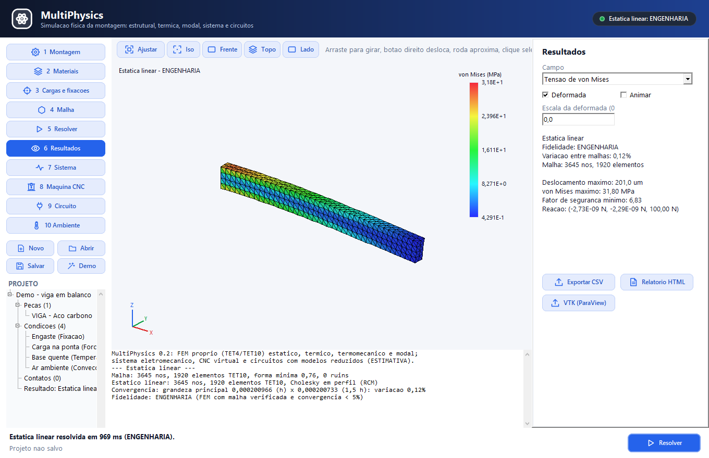

## 02. O que o MultiPhysics calcula e com que fidelidade

Todo resultado traz um rótulo de **fidelidade**. Ele aparece no selo do cabeçalho, no resumo da etapa Resultados, no relatório e no CSV.

| Rótulo | Significado |
|---|---|
| **ENGENHARIA** | Cálculo por elementos finitos (FEM) com malha verificada (nenhum elemento invertido) e estudo de convergência: o programa resolve de novo com elementos 1,5 vez maiores e a grandeza principal variou menos de 5%. |
| **ESTIMATIVA** | Convergência não verificada ou acima de 5%, ou modelos reduzidos (sistema, CNC, fluido, flutuação). Serve para comparar alternativas e pré-dimensionar. |
| **VALIDADO** | Nunca é dado pelo programa. Exige comparação com ensaio, norma ou referência aceita. |

O que cada parte calcula:

| Análise | Resultado | Fidelidade típica |
|---|---|---|
| Estática linear | deslocamento, tensão de von Mises, fator de segurança, reações | ENGENHARIA |
| Térmica permanente | temperatura, calor que entra pelas faces de temperatura fixa | ENGENHARIA |
| Termomecânica | dilatação e tensão térmica | ENGENHARIA |
| Modal | frequências naturais, formas dos modos, massa efetiva | ENGENHARIA |
| Sistema eletromecânico | tensão, corrente, velocidade, temperatura, PWM no tempo | ESTIMATIVA |
| CNC virtual | posição dos eixos, passos perdidos, desarmes | ESTIMATIVA |
| Circuitos | tensões DC e transitório | conferido em casos clássicos |
| Ambiente e flutuação | arrasto, empuxo, atmosfera, calado, estabilidade | ESTIMATIVA (não é CFD) |

O programa **não inventa resultado**: se faltar material, fixação ou geometria, ele recusa o cálculo e diz o que falta.

## 03. Conheça a interface

A janela segue o padrão da MultiSuite (o mesmo do MultiAssembly e do MakeRouter).

- **Cabeçalho:** nome do programa e, à direita, o selo do último resultado, com a análise e a fidelidade (verde = ENGENHARIA, laranja = ESTIMATIVA, vermelho = não resolvido).
- **Lateral esquerda:** as 10 etapas (Montagem, Materiais, Cargas e fixações, Malha, Resolver, Resultados, Sistema, Máquina CNC, Circuito, Ambiente), os botões **Novo**, **Abrir**, **Salvar**, **Demo** e a árvore do projeto (peças com o material, condições, contatos e o último resultado).
- **Centro:** a vista 3D (nas etapas 1 a 6 e 10) ou o gráfico de séries temporais (Sistema, Máquina CNC e Circuito). Embaixo, o **registro**, com tudo o que o solver fez.
- **Direita:** o painel da etapa atual.
- **Rodapé:** a situação (o que acabou de acontecer), o arquivo do projeto e o botão **Resolver**. Durante um cálculo ele vira **Cancelar**.

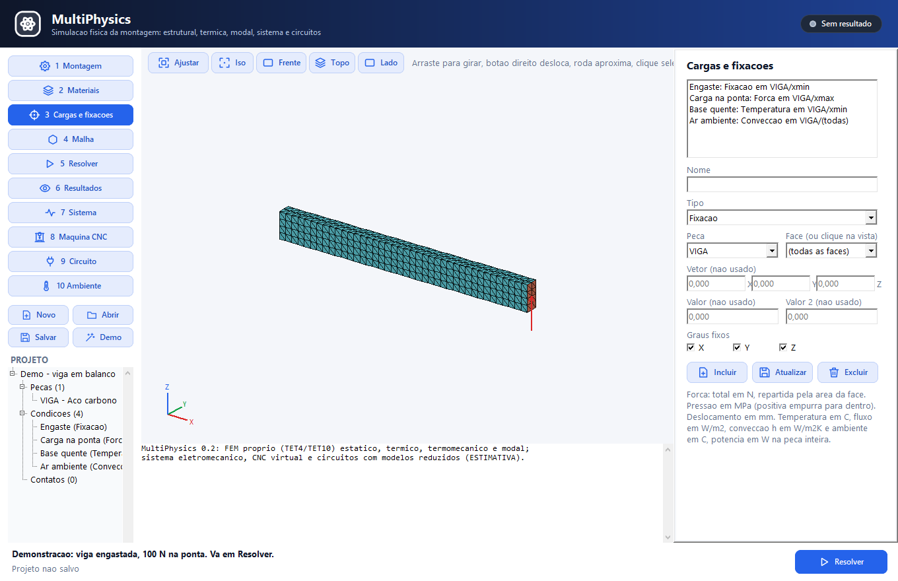

Unidades na tela: milímetros, MPa, °C, newtons e watts. No arquivo do projeto tudo fica em SI (metros, pascals).

## 04. Navegue na vista 3D

| Ação | Mouse |
|---|---|
| Girar | arraste com o botão esquerdo |
| Deslocar | arraste com o botão direito ou o do meio |
| Aproximar / afastar | roda do mouse |
| Selecionar uma face | clique sem arrastar |

Os botões acima da vista reposicionam a câmera: **Ajustar** (enquadra o modelo), **Iso**, **Frente**, **Topo** e **Lado**. Os eixos X (vermelho), Y (verde) e Z (azul) ficam no canto inferior esquerdo. Z aponta para cima.

Na etapa Cargas, as faces com condições ficam coloridas: azul para fixação, laranja para força e pressão, amarelo para temperatura e fluxo, ciano para convecção. A força aparece como uma seta vermelha no centro da face.

## 05. Projetos e arquivos

- **Novo** limpa o projeto (pede confirmação se houver alterações).
- **Abrir** lê um projeto `.mphys`.
- **Salvar** grava o projeto (na primeira vez pergunta o nome).
- **Demo** carrega a viga de demonstração.

O `.mphys` é um arquivo de texto JSON com as peças, a geometria, os materiais, as condições, os contatos, o ambiente e as configurações. Ao fechar a janela com alterações não salvas, o programa pergunta antes de sair.

| Extensão | Conteúdo |
|---|---|
| `.mphys` | projeto do MultiPhysics |
| `.massembly` | montagem do MultiAssembly (importação) |
| `.cir` | netlist de circuito (texto) |
| `.csv` | resultado por nó ou séries temporais |
| `.html` + `.png` | relatório com imagem |
| `.vtk` | malha e campos para o ParaView |
| `.inp` / `.frd` | entrada e resultado do CalculiX |

Os exemplos ficam em `documentation/models/multiphysics` na pasta da instalação.

## 06. Etapa 1: Montagem — peças, posição e rotação

Em **NOVA PECA** escolha a forma e informe as medidas em milímetros:

| Forma | Medidas |
|---|---|
| Caixa | comprimento X, largura Y, altura Z |
| Cilindro | raio, altura e eixo (x, y ou z) |
| Tubo | raio externo, raio interno, altura e eixo |
| Perfil L | aba U, aba V, espessura e comprimento ao longo do eixo |

Dê um **ID** (sem barra) e clique **Adicionar peca**. A peça nasce em aço carbono, na origem.

Para mover uma peça, selecione-a em **PECAS**, informe **Posição X/Y/Z** (mm) e **Rotação X/Y/Z** (graus; aplicadas na ordem X, Y, Z) e clique **Aplicar**. **Suprimida** deixa a peça fora da análise sem apagá-la. **Excluir peca** remove a peça.

Ao selecionar uma peça já malhada, o rodapé mostra a massa, o centro de massa e os momentos de inércia calculados pela malha.

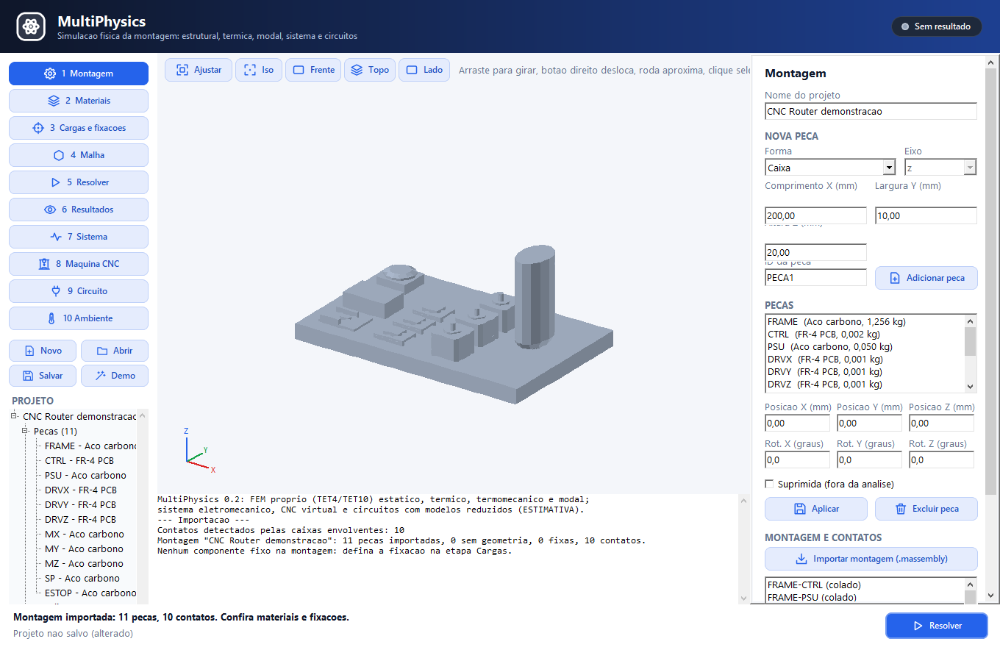

## 07. Importe uma montagem do MultiAssembly

Há dois caminhos:

1. **No MultiAssembly**, clique no botão **MultiPhysics** do rodapé. A montagem é salva e o MultiPhysics abre com ela.
2. **No MultiPhysics**, etapa Montagem, clique **Importar montagem (.massembly)** e escolha o arquivo.

A importação traz cada componente como uma peça, com a mesma geometria e a mesma posição que aparecem na vista do MultiAssembly. Também traz:

- **material sugerido** pelo texto do componente (alumínio, aço inox, FR-4 para placas e drivers, e assim por diante; o padrão é aço carbono);
- **fixação** em todas as faces dos componentes marcados como fixos;
- **gravidade** (−9,81 m/s² em Z);
- **contatos colados** entre peças que se encostam.

O registro lista o que foi importado. Confira os materiais (etapa 2) e as fixações (etapa 3) antes de resolver: na CNC de demonstração, por exemplo, nenhum componente vem fixo, então fixe a face `zmin` da peça `FRAME`.

## 08. Contatos colados entre peças

Cada peça é malhada separadamente. Para que duas peças trabalhem juntas, elas precisam de um **contato colado** (etapa Montagem, lista **MONTAGEM E CONTATOS**):

- **Detectar contatos** cria um contato para cada par de peças cujas caixas envolventes se tocam (folga de até 0,2 mm).
- **Excluir contato** remove o contato selecionado.

No contato colado as faces encostadas (e os volumes que se sobrepõem) se movem juntos: não há atrito, deslizamento nem separação. É o equivalente ao `*TIE` de programas comerciais e serve bem para peças parafusadas, coladas ou soldadas.

As primitivas de uma mesma peça (por exemplo, o corpo e o eixo de um motor) são sempre coladas entre si, sem precisar de contato.

Se uma peça não tiver nem fixação própria nem contato com uma peça fixa, o cálculo é recusado com a mensagem *estrutura sem fixação suficiente*: ela estaria solta no espaço.

## 09. Etapa 2: Materiais

1. Selecione a peça na lista.
2. Escolha o material em **Material da biblioteca** (25 materiais: aços, alumínio, inox, latão, bronze, cobre, titânio, ouro, prata, chumbo, ABS, PLA, PETG, nylon, PVC, PTFE, acrílico, borrachas, vidro, FR-4, silício, alumina e madeira).
3. Se precisar, ajuste **E** (GPa), **Poisson**, **Densidade** (kg/m³), **Condutividade** (W/m·K), **Dilatação** (10⁻⁶/K) e **Escoamento** (MPa).
4. Clique **Aplicar a peca** ou **Aplicar a todas**.

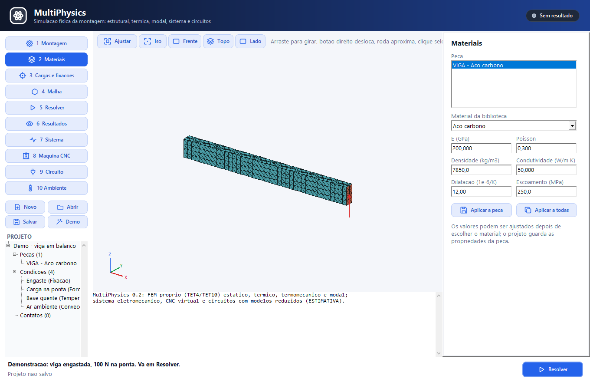

O escoamento é usado no **fator de segurança** (escoamento ÷ tensão de von Mises). Para polímeros e compósitos, use os dados do fornecedor: a biblioteca traz valores típicos.

## 10. Etapa 3: Cargas e fixações

A lista no topo mostra as condições do projeto. Para criar uma:

1. Dê um **Nome** (opcional).
2. Escolha o **Tipo**.
3. Escolha a **Peca** e a **Face** (ou clique na face na vista 3D).
4. Preencha o valor. Os campos que não se aplicam ao tipo ficam desabilitados e o rótulo diz a unidade.
5. Clique **Incluir**. Para alterar, selecione na lista, mude e clique **Atualizar**. **Excluir** remove.

| Tipo | Valor | Observação |
|---|---|---|
| Fixação | graus X, Y, Z fixos | desmarque graus para apoios deslizantes |
| Deslocamento prescrito | vetor em mm | nos graus marcados |
| Força | vetor total em N | repartida pela área das faces |
| Pressão | MPa | positiva empurra a face para dentro |
| Gravidade | vetor em m/s² | vale para o modelo todo |
| Temperatura | °C | na face |
| Fluxo de calor | W/m² | entrando pela face |
| Convecção | h em W/m²K e T ambiente em °C | troca com o ar ou um fluido |
| Potência dissipada | W | gerada no volume da peça inteira |

As condições térmicas valem para as análises térmica e termomecânica; as mecânicas, para a estática, a termomecânica e a modal (onde só as fixações contam).

## 11. Escolha a face certa

Cada forma tem faces com nome fixo:

| Forma | Faces |
|---|---|
| Caixa | `xmin`, `xmax`, `ymin`, `ymax`, `zmin`, `zmax` |
| Cilindro / tubo | `base`, `topo`, `lateral`, `interna` (tubo), `corte0` e `corte1` (setor) |
| Perfil (prisma) | `base`, `topo`, `lado0`, `lado1`, ... (um por lado do polígono) |

No combo **Face**:

- **(todas as faces)** aplica a condição em todas as faces da peça (útil para convecção e para fixar uma peça inteira);
- um nome curto como `xmin` vale para todas as primitivas da peça que tiverem essa face;
- um nome completo `PECA/primitiva/face` escolhe uma face de uma primitiva só (aparece quando a peça tem várias primitivas).

O jeito mais rápido é clicar na face na vista 3D com a etapa Cargas aberta: a peça e a face são escolhidas sozinhas e o rodapé mostra o nome.

## 12. Etapa 4: Malha

- **Tamanho dos elementos (mm):** quanto menor, mais preciso e mais lento. Comece com cerca de metade da menor espessura importante.
- **Elementos quadráticos TET10:** recomendado. O TET4 é rígido demais em flexão e subestima deslocamentos.
- **Estudo de convergência:** necessário para o rótulo ENGENHARIA (dobra o tempo do cálculo).

**Gerar malha** mostra nós, elementos, faces de contorno, a forma mínima e média dos elementos (1 = tetraedro perfeito), quantos estão ruins (forma abaixo de 0,1), invertidos e o volume.

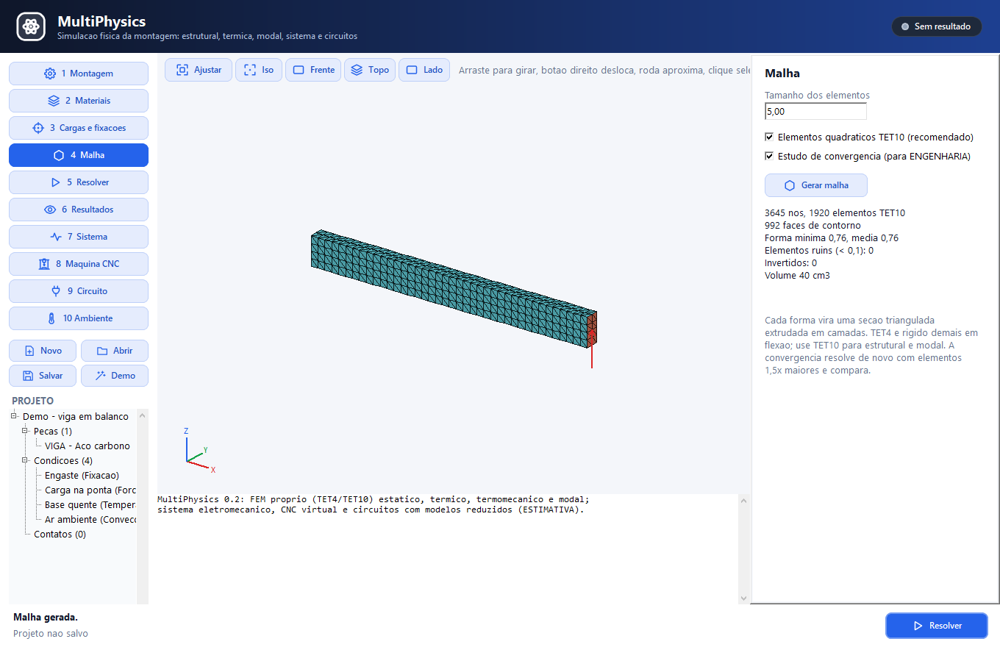

Cilindros são aproximados por polígonos: o volume fica cerca de 1% abaixo com 32 segmentos e melhora com elementos menores.

## 13. Etapa 5: Resolver

1. Escolha a **Análise**: Estática linear, Térmica permanente, Termomecânica ou Modal.
2. Para a modal, informe o número de **Modos**.
3. Escolha o **Solver**: **FEM próprio** (padrão) ou **CalculiX (ccx)**, se instalado (capítulo 25).
4. Clique **Resolver** (aqui ou no rodapé).

O cálculo roda em segundo plano: a janela continua respondendo e o rodapé mostra o tempo decorrido. Clique **Cancelar** para interromper. Ao terminar, o registro mostra a malha, o método usado, a convergência e a fidelidade, e a etapa Resultados abre.

O FEM próprio escolhe sozinho o método: fatoração direta (Cholesky) quando é barata, ou gradiente conjugado em modelos grandes e compactos. Na máquina de referência, um bloco com 60 mil nós TET10 resolve em menos de um minuto.

## 14. Etapa 6: Resultados

- **Campo:** Deslocamento (mm), Tensão de von Mises (MPa), Fator de segurança (limitado a 10 na escala), Temperatura (°C) ou o modo escolhido na análise modal.
- **Deformada:** desenha a peça deformada. A **Escala** 0 é automática (o maior deslocamento vira 8% do tamanho do modelo); informe outro número para exagerar mais ou menos.
- **Animar:** anima a deformada (modos e estática).

O resumo à direita traz a análise, a fidelidade (e o motivo, quando é ESTIMATIVA), a variação entre malhas, o tamanho da malha e os números principais: deslocamento máximo, von Mises máximo, fator de segurança mínimo e reações; temperatura mínima e máxima e o calor pelas faces fixas; as frequências com a massa efetiva em X, Y e Z de cada modo.

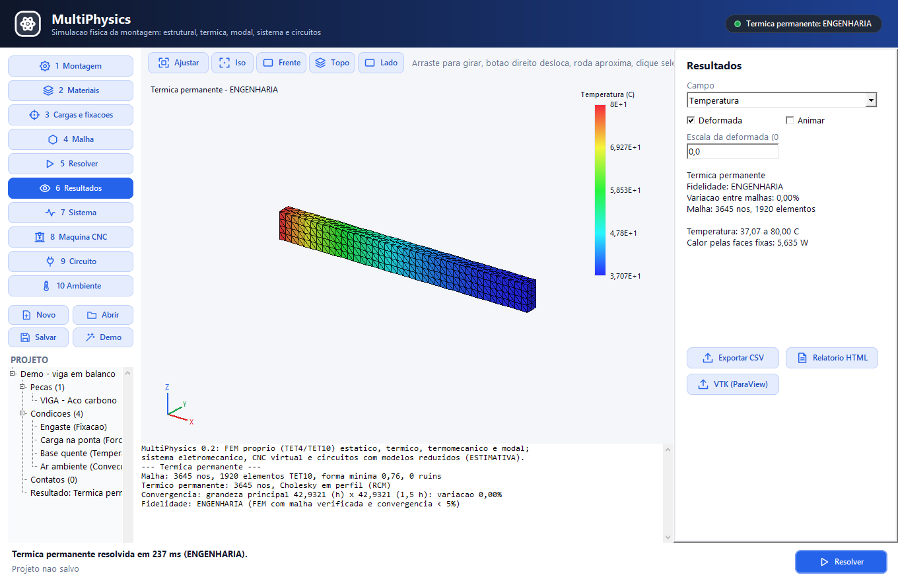

A legenda à direita da vista mostra a escala de cores com o mínimo, o máximo e a unidade.

## 15. Exporte CSV, relatório HTML e VTK

- **Exportar CSV:** uma linha por nó com coordenadas (m), deslocamentos (m), von Mises (Pa) e temperatura (°C), com a fidelidade na primeira linha. No modal, as frequências vão no fim.
- **Relatório HTML:** página com a imagem da vista, o resumo, a lista de peças com massa, as condições de contorno e o registro do solver. A imagem é salva ao lado, com o mesmo nome e extensão `.png`.
- **VTK (ParaView):** malha com o número da peça por elemento e os campos de deslocamento, von Mises e temperatura, para pós-processamento no ParaView.

## 16. Exercício guiado 1: viga em balanço

Abra `viga_balanco.mphys` (ou clique **Demo**).

1. Etapa 3: confira **Engaste** (fixação em `xmin`) e **Carga na ponta** (força de −100 N em Z na face `xmax`).
2. Etapa 4: elementos de 5 mm, TET10 e convergência marcados. **Gerar malha**: 3645 nós, 1920 elementos.
3. Etapa 5: Estática linear → **Resolver**.
4. Etapa 6: o deslocamento máximo é cerca de **0,201 mm**. A teoria de vigas com efeito de cisalhamento dá 0,2016 mm.
5. Troque o campo para **Tensão de von Mises**: cerca de 15 MPa no meio do vão (teoria: 15 MPa) e um pico de cerca de 32 MPa junto ao engaste, causado pela fixação rígida da face.
6. O selo mostra **ENGENHARIA** com variação entre malhas de cerca de 0,1%.

## 17. Exercício guiado 2: suporte de motor aquecido

Abra `suporte_motor_termico.mphys`: um perfil L de alumínio com um motor de aço colado que dissipa 20 W. A base do perfil está a 25 °C e as superfícies trocam calor com o ar a 25 °C (h = 10 W/m²K).

1. Etapa 5: **Térmica permanente** → Resolver. A temperatura vai de 25 °C na base a cerca de 29,3 °C no motor.
2. Etapa 5: **Termomecânica** → Resolver. A mesma temperatura entra como dilatação; com a base parafusada, o deslocamento máximo fica em torno de 0,004 mm e a tensão térmica em torno de 7 MPa.

Experimente reduzir o h para 5 W/m²K (convecção natural fraca) e veja a temperatura subir.

## 18. Exercício guiado 3: frequências naturais

Com a viga aberta, etapa 5: **Modal**, 4 modos → Resolver.

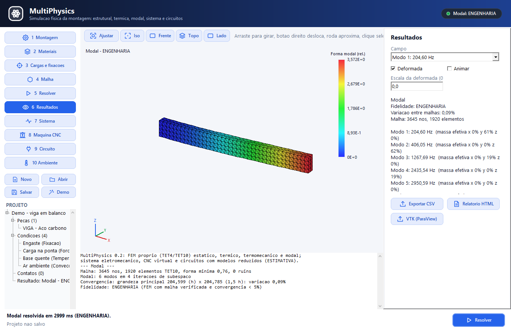

- Modo 1: cerca de **204,6 Hz**, flexão na direção fina (Y). A fórmula da viga em balanço dá 203,8 Hz.
- Modo 2: cerca de **406 Hz**, flexão na direção alta (Z), o dobro do primeiro (a inércia é 4 vezes maior).
- A massa efetiva do modo 1 em Y fica perto de **61%**, como prevê a teoria.

Marque **Animar** para ver cada modo. Uma máquina deve operar longe das frequências naturais: se o spindle gira a 12000 rpm (200 Hz), uma peça com o primeiro modo perto de 200 Hz vai vibrar.

## 19. Exercício guiado 4: a CNC do MultiAssembly sob gravidade

1. Etapa 1: **Importar montagem (.massembly)** → `cnc_demo.massembly`. Onze peças e dez contatos com a estrutura.
2. Etapa 3: inclua uma **Fixação** na peça `FRAME`, face `zmin`.
3. Etapa 4: elementos de 6 mm, desmarque TET10 e convergência para um cálculo rápido.
4. Etapa 5: Estática linear → Resolver.
5. Resultado: o spindle, alto e esbelto, é o que mais se desloca. A reação vertical no resumo é igual ao peso total da montagem.

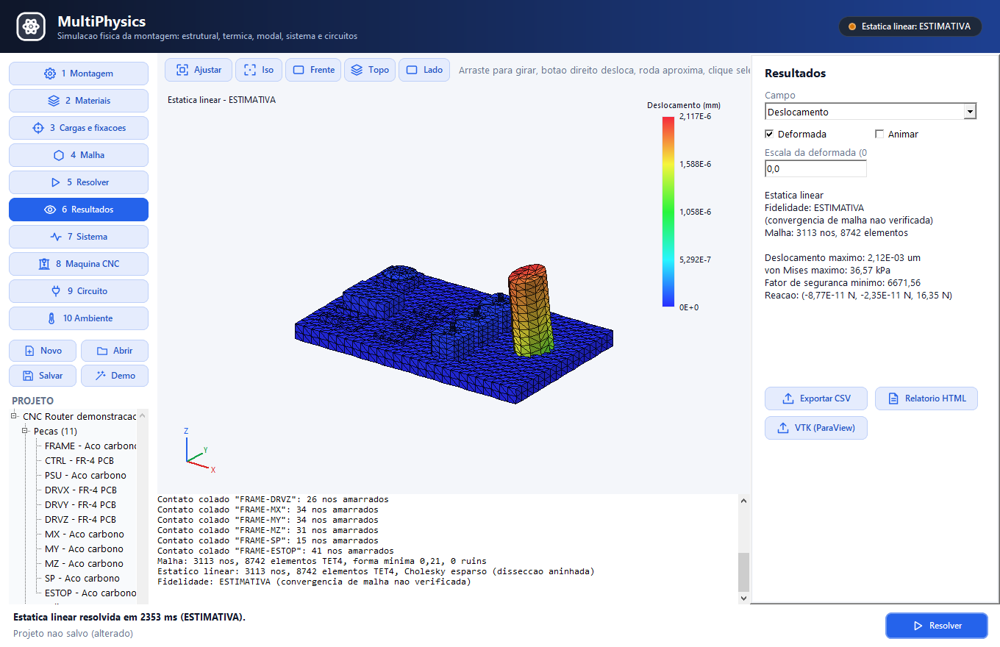

## 20. Etapa 7: Sistema eletromecânico no tempo

Esta etapa simula, passo a passo no tempo, a cadeia **fonte 24 V → driver PWM → motor DC → carga → sensor de velocidade → controlador PI**.

1. **Carregar máquina demonstração** monta o grafo e confere as ligações (o registro lista componentes e conexões).
2. **Ligar** inicia a simulação; **Pausar** congela; **Desligar** zera.
3. O gráfico mostra tensão do barramento, corrente, velocidade, temperatura do motor e PWM. Passe o mouse para ler os valores de um instante.
4. **Exportar CSV** salva as séries.

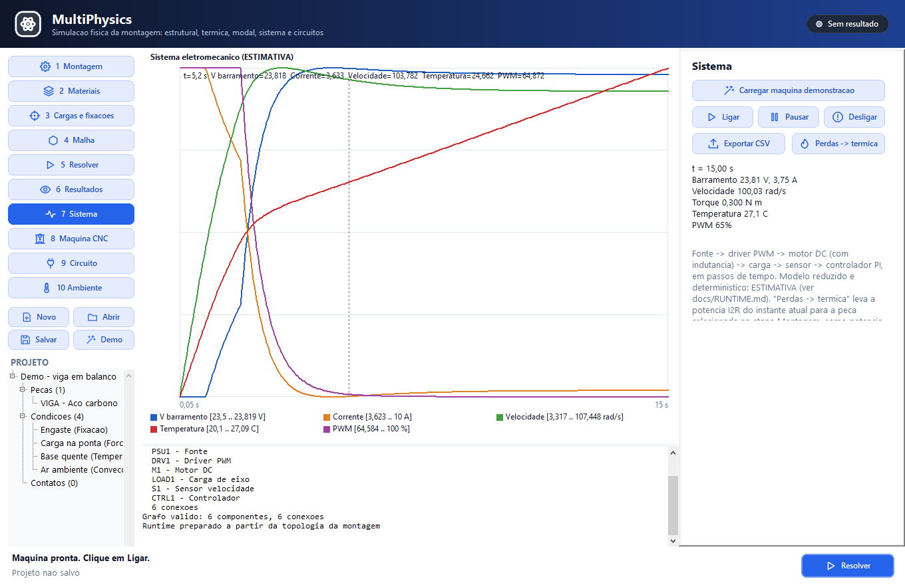

O motor tem indutância (a corrente não muda instantaneamente) e o controlador PI leva a velocidade à referência de 100 rad/s. É um modelo reduzido: ESTIMATIVA.

## 21. Leve as perdas do motor para a análise térmica

Com a simulação do sistema rodando:

1. Na etapa Montagem, selecione a peça que representa o motor.
2. Na etapa Sistema, clique **Perdas → térmica**.
3. Uma condição **Potência dissipada** com as perdas I²R daquele instante é criada (ou atualizada) para a peça.
4. Resolva a **Térmica permanente** para ver a temperatura da carcaça e do suporte.

## 22. Etapa 8: Máquina CNC virtual e falhas

1. **Criar CNC XYZ + spindle:** X 0–300 mm, Y 0–200 mm, Z 0–100 mm, rampa de 500 mm/s², spindle a 12000 rpm.
2. Informe **Alvo X/Y/Z** (mm) e **Velocidade** (mm/s) e clique **Executar movimento**. O gráfico mostra a posição dos eixos e a rotação do spindle; o painel mostra a posição final, os passos perdidos e se algum fim de curso foi atingido.
3. **Homing (X, Y, Z)** procura o fim de curso mínimo de cada eixo e zera a referência.

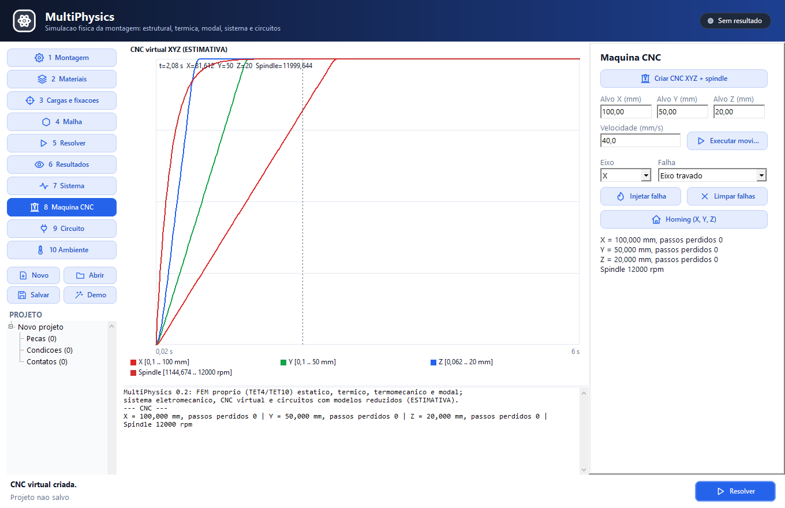

O motor de passo perde torque com a velocidade. Se a carga passar do torque disponível, o eixo **estola**: os passos são perdidos e a posição fica para trás.

Para estudar defeitos, escolha o **Eixo** e a **Falha** e clique **Injetar falha**, depois execute um movimento:

| Falha | Efeito |
|---|---|
| Circuito aberto | o motor fica sem torque e o comando não executa |
| Curto-circuito | corrente alta: desarme por sobrecorrente |
| Eixo travado | estol, passos perdidos, eixo parado |
| Sensor falhou | leitura com erro de 5 mm: o eixo para no lugar errado |
| Fim de curso preso | o homing zera no lugar errado |
| Corrosão / oxidação | o motor aquece mais (resistência maior) |
| Sobrecorrente | desarme |

**Limpar falhas** devolve o eixo ao normal e religa a máquina.

## 23. Etapa 9: Circuitos por netlist

Escreva o circuito como texto, um elemento por linha, e clique **Resolver circuito**.

```
* Filtro RC com degrau de 10 V
V1 in 0 10
R1 in out 1k
C1 out 0 1u
.tran 10u 5m
.probe in out
```

| Linha | Elemento |
|---|---|
| `R1 a b 1k` | resistor |
| `C1 a b 10u` | capacitor |
| `L1 a b 1m` | indutor |
| `V1 a 0 12` | fonte de tensão contínua |
| `V2 a 0 SIN(0 5 50)` | senoide: nível, amplitude, frequência |
| `I1 a b 0.1` | fonte de corrente de a para b |
| `D1 anodo catodo` | diodo |
| `M1 d g s 2 0.5` | transistor NMOS: Vth e K |
| `.tran 10u 5m` | transitório: passo e tempo final |
| `.probe a b` | nós no gráfico |

Sufixos: f, p, n, u, m, k, meg, g. O nó `0` (ou `gnd`) é o terra. Linhas com `*` são comentários.

O ponto de operação (tensões DC) vai para o registro e o transitório para o gráfico. O transitório começa com os capacitores descarregados, como um degrau.

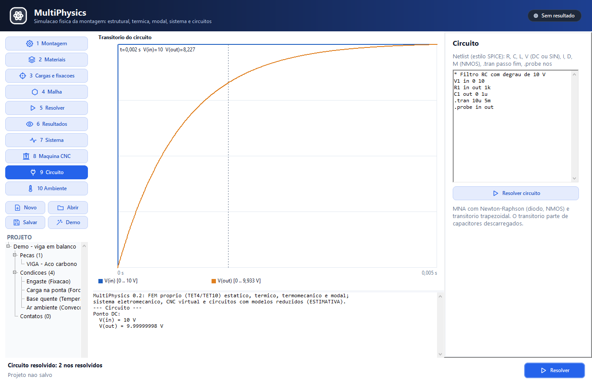

Erros comuns aparecem no rodapé: resistência zero, elemento desconhecido ou nó sem caminho até o terra.

## 24. Etapa 10: Ambiente, atmosfera e flutuação

- **Ambiente:** Ar, Água ou Vácuo.
- **Atmosfera ISA na altitude:** calcula temperatura, pressão, densidade, viscosidade e velocidade do som de 0 a 20 km e passa a usar esse ar.
- **Estimar arrasto e empuxo:** pressão dinâmica, arrasto (com a área e o Cd informados) e empuxo do volume informado. Acima de Mach 0,3 o programa avisa que a hipótese de escoamento incompressível não vale.
- **Teste de flutuação (volume informado):** compara peso e empuxo de um corpo com a massa e o volume dos campos.
- **Flutuação da montagem (calado e GM):** usa a malha e as massas das peças do projeto. Calcula o calado em que o empuxo iguala o peso, o centro de empuxo e a altura metacêntrica **GM**: positiva é estável, negativa tomba.

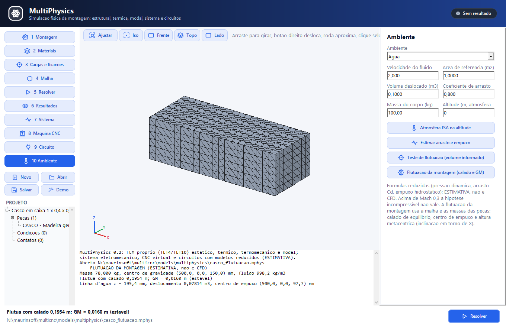

Com `casco_flutuacao.mphys` (caixa de madeira 1 × 0,4 × 0,3 m): calado de cerca de 0,195 m e GM de cerca de 0,016 m, estável. Tudo nesta etapa é ESTIMATIVA: não há CFD, ondas nem superfície livre.

## 25. CalculiX (opcional)

O CalculiX (programa `ccx`) é um solver de elementos finitos gratuito, útil para comparar resultados. Ele **não vem** no instalador.

1. Baixe o CalculiX para Windows (por exemplo, pelo pacote bConverged ou pelo PrePoMax).
2. Na etapa Resolver, clique **...** ao lado de **Executável do CalculiX** e escolha o `ccx.exe`. O caminho fica guardado. Também é possível usar a variável de ambiente `CALCULIX_EXE`.
3. Escolha **Solver: CalculiX (ccx)** e clique Resolver.

O MultiPhysics escreve o mesmo modelo (malha, materiais, contatos colados, cargas) num arquivo `.inp`, executa o ccx e lê o resultado do `.frd`. A fidelidade segue a mesma regra de convergência.

## 26. Entenda as mensagens e resolva problemas

| Mensagem | O que fazer |
|---|---|
| *Projeto incompleto: Peca X sem material* | escolha o material na etapa 2 |
| *Analise estrutural sem fixacao* | inclua ao menos uma fixação |
| *estrutura sem fixacao suficiente (movimento livre)* | alguma peça está solta: fixe-a ou crie um contato com uma peça fixa (Detectar contatos) |
| *Analise termica sem temperatura fixa nem conveccao* | inclua uma temperatura ou uma convecção |
| *condicao nao encontrou a face* | a face não existe naquela peça: escolha de novo pelo combo ou clicando na vista |
| *contato nao encontrou faces encostadas* | as peças não se tocam: confira posição e rotação |
| *PCG nao convergiu* | modelo mal condicionado: aumente o tamanho dos elementos ou revise contatos e fixações |
| *ESTIMATIVA (variacao de X% entre malhas)* | refine a malha (elementos menores) e resolva de novo |
| *Informe o executavel do CalculiX* | indique o `ccx.exe` ou volte ao FEM próprio |
| Cálculo demorado | use elementos maiores, desmarque a convergência para testes rápidos ou clique Cancelar |

## 27. Boas práticas de modelagem

- **Comece grosso, refine depois.** Elementos grandes para conferir condições e ordem de grandeza; refine só quando o modelo estiver certo.
- **Fixações rígidas criam picos de tensão** junto à face fixa. Leia a tensão um pouco afastada da fixação, ou use apoios (desmarque graus) quando o vínculo real permite deslizar.
- **Use TET10 em flexão e modal.** O TET4 só é bom em tração e compressão pura.
- **Confira a reação.** A soma das reações deve igualar as cargas aplicadas (e o peso, com gravidade).
- **Confira as unidades.** Pressão em MPa, força total em N, potência em W.
- **ENGENHARIA não é VALIDADO.** Para decisões de segurança, compare com ensaio ou norma.

## 28. Atalhos e termos da interface

| Termo | Significado |
|---|---|
| Engaste | fixação de todos os graus de uma face |
| von Mises | tensão equivalente comparada com o escoamento |
| Fator de segurança | escoamento ÷ von Mises; abaixo de 1 o material escoa |
| Modo | forma de vibração livre numa frequência natural |
| Massa efetiva | fração da massa que participa de um modo numa direção |
| Contato colado | ligação sem deslizamento entre peças |
| TET4 / TET10 | tetraedro de 4 nós (linear) / 10 nós (quadrático) |
| Convergência | comparação entre duas malhas para saber se o resultado ainda muda |
| Calado | profundidade submersa de um corpo flutuante |
| GM | altura metacêntrica; positiva = estável |

Linha de comando: `multiphysics.exe --file projeto.mphys` abre um projeto; `--file montagem.massembly` importa uma montagem.

## 29. Referências e limites desta edição

Limites do MultiPhysics 0.2:

- elementos de lados retos (cilindros aproximados por polígonos);
- material linear elástico e pequenos deslocamentos (sem plasticidade nem flambagem);
- contato só colado (sem atrito, folga ou separação);
- geometria por primitivas (caixa, cilindro, tubo, cone, setor, prisma); arquivos STL do MultiCAD ainda não viram malha;
- sem CFD nem interação fluido-estrutura; fluido e flutuação são estimativas;
- sistema, CNC e circuitos são modelos reduzidos e determinísticos.

Conferência: os testes automáticos da Central de Testes comparam o FEM com soluções analíticas (barra em tração, viga em balanço, parede térmica, aleta, tensão térmica, frequências e massa efetiva), o contato colado com peças inteiras, a montagem importada com o peso total, o circuito RC, os modelos do motor e da CNC e a flutuação de um casco em caixa.

Mais detalhes técnicos em `multiphysics/docs/MANUAL.md`, `multiphysics/docs/RUNTIME.md` e `multiphysics/docs/TAREFA.md`.
