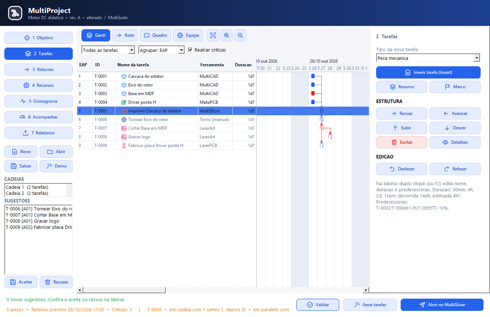
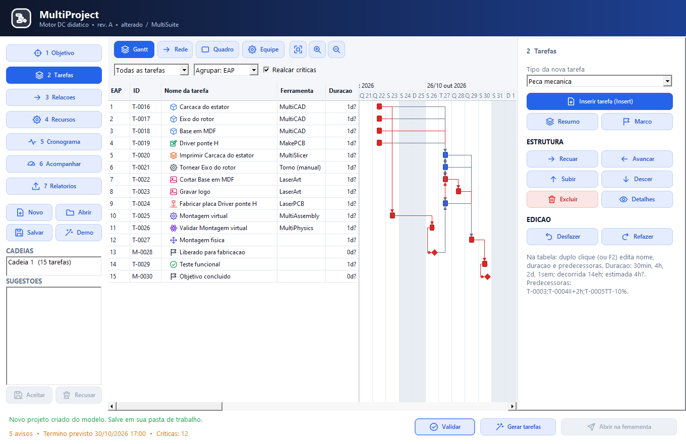

# MultiProject — guia rápido

Versão 0.2 · Windows 64 bits · 22/10/2026. Incluído no setup 016.

## Começar pelo objetivo

Abra o MultiProject pela bandeja, no grupo **PLANEJAR**. Em **Objetivo**, preencha
o nome, a descrição, o escopo e os critérios de sucesso, um por linha. Clique em
**Aplicar** e salve o projeto `.mproj` na pasta em que pretende trabalhar.

O botão **Novo a partir de modelo...**, na página Objetivo, abre os modelos
**Peça impressa**, **Placa eletrônica** e **Motor DC**. O projeto criado recebe
IDs novos e não herda resultados nem arquivos de fabricação do modelo. Salve-o
com outro nome na sua pasta de trabalho.

## Definir as tarefas de projeto

Em **Tarefas**, insira peças mecânicas e placas. Abra **Detalhes** para definir a
descrição, a especificação técnica e os critérios funcionais de cada tarefa.
Para uma peça, escolha também o **Processo**: impressão 3D, router, corte laser
ou torno.

Na tabela da especificação técnica, alguns campos orientam as sugestões:

| Campo | Uso |
|---|---|
| `gravacao` | Nome da gravação a fazer depois da fabricação da peça, por exemplo `logo` |
| `componentes` ou `bom` | Lista ou indicação dos componentes a comprar para a placa |
| `carga`, `temperatura`, `rotacao`, `tensao`, `corrente` | Orientam os estudos estático, térmico, modal e de circuito |
| `revisar_tarefa` | ID da peça ou placa a revisar quando um critério de validação ou teste for reprovado; vários IDs podem ser separados por `;` |

## Gerar, conferir e decidir as sugestões

Clique em **Gerar tarefas**. As novas tarefas entram como **Sugeridas** e aparecem
na lista **SUGESTÕES**, à esquerda. O identificador da regra aparece ao lado do ID.
Duplo clique abre os detalhes da sugestão.

Selecione uma ou várias sugestões e clique em **Aceitar** ou **Recusar**. Use Ctrl
ou Shift para selecionar várias. **Sem nenhuma seleção, a decisão vale para todas
as sugestões da lista.** Aceitar muda para Planejada; recusar mantém o registro
como Cancelada. **Ctrl+Z** desfaz a decisão inteira, inclusive os vínculos da liberação.

Rodar as regras de novo não duplica tarefas já propostas, aceitas ou recusadas.
O filtro **Geradas por regra** mostra a origem das tarefas; **Sugeridas** mostra
somente as decisões ainda pendentes.

## A sequência de trabalho

1. A peça com processo definido gera a sugestão de fabricação. A placa gera
   fabricação e, quando a especificação indica componentes, compra.
2. Peças e placas prontas de um subsistema geram montagem virtual. As montagens
   dos subsistemas prontas permitem gerar a montagem do objetivo.
3. Uma montagem pronta gera validação e recebe os critérios funcionais dos projetos.
4. A validação concluída, com os critérios aprovados ou dispensados, gera
   **Liberado para fabricação**. Aceite o marco e conclua-o para liberar o início
   das fabricações. Cada fabricação também depende do arquivo do seu projeto.
5. Fabricações concluídas geram montagem física. Quando há um arquivo MultiAssembly
   vinculado com etapas do manual, suas verificações entram no checklist da montagem
   física; o arquivo original é preservado.
6. Montagem física concluída gera teste funcional com os critérios do objetivo.
   Teste aprovado gera o marco **Objetivo concluído**.

Uma reprovação gera uma tarefa nova de revisão para o ID indicado em
`revisar_tarefa`, levando a evidência do critério reprovado. Os trabalhos anteriores
continuam no plano e o grafo permanece sem ciclos.

Em **Objetivo**, a opção **Exigir liberação antes de fabricar** vem ligada.
Ao desligá-la e aplicar, os vínculos de liberação das fabricações futuras são
removidos; as dependências com os projetos continuam. Tarefas em andamento ou
concluídas são preservadas. Ligar novamente restaura as dependências futuras.

## Abrir e acompanhar os arquivos

Na página da tarefa, **Abrir na ferramenta** abre o arquivo vinculado ou propõe um
caminho para um documento novo. MultiCAD e MakePCB mostram a especificação da
tarefa; **Ctrl+S** salva no destino proposto. Nas outras ferramentas, copie o
caminho mostrado e use-o ao salvar.

Use **Vincular arquivo...** para associar um arquivo existente e **Verificar
arquivo** para conferir seu estado. O MultiProject acompanha alterações ao voltar
à janela e a cada dois segundos enquanto ela está ativa. Uma alteração depois de
pronto pede revisão e marca as sucessoras diretas que consomem o arquivo como
desatualizadas. O aviso mostra a cadeia afetada.

Há verificadores para peças MultiCAD, placas MakePCB com DRC/Gerber/Excellon,
G-code compatível com o tipo de máquina e folha de torno. Os formatos sem
verificador específico permanecem **não verificados**; sua aprovação não é presumida.

O G-code de fabricação abre no **MultiCNC**. Posicionar o zero, fazer Frame e executar
são ações do operador no MultiCNC.

## Gerar a folha de torno

Selecione uma tarefa **Usinagem de torno** e clique em **Gerar folha de torno...**.
A folha Markdown inclui o desenho de referência, material, dimensões, operações,
ferramenta, rotação, avanço e cotas de controle.

Os campos técnicos `operacoes` (separadas por `;`), `ferramenta`, `rotacao_rpm`,
`avanco_mm_rot` e `cota_controle` preenchem a tabela. O que não foi especificado
fica como **A definir**. Complete e confira a folha antes da operação manual.
Ao salvar, a folha fica vinculada à tarefa. Um arquivo existente só é substituído
depois da confirmação no diálogo de salvamento.

## Exemplos e modelos

| Arquivo | Conteúdo |
|---|---|
| `multiproject/examples/motor_dc_inicial.mproj` | As quatro tarefas de projeto para praticar a geração em etapas |
| `multiproject/examples/motor_dc.mproj` | Plano completo do motor, com 15 tarefas e 21 vínculos |
| `models/multiproject/peca_impressa.mproj` | Projeto, validação e fabricação de peça impressa |
| `models/multiproject/placa_eletronica.mproj` | Projeto, compra de componentes e fabricação de placa |
| `models/multiproject/motor_dc.mproj` | Modelo do plano completo do motor |
| `models/multiproject/folha_torno_eixo.md` | Folha de processo do eixo, com os parâmetros ainda a preencher |

Os exemplos distribuídos têm tarefas **Planejadas** e critérios **Pendentes**.
Nenhum deles representa uma fabricação ou validação real já concluída.
Na instalação, os modelos estão em `models/multiproject`; o guia e os exemplos
também ficam na documentação offline.
