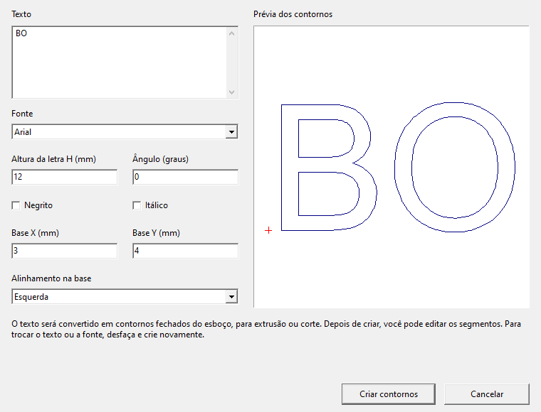
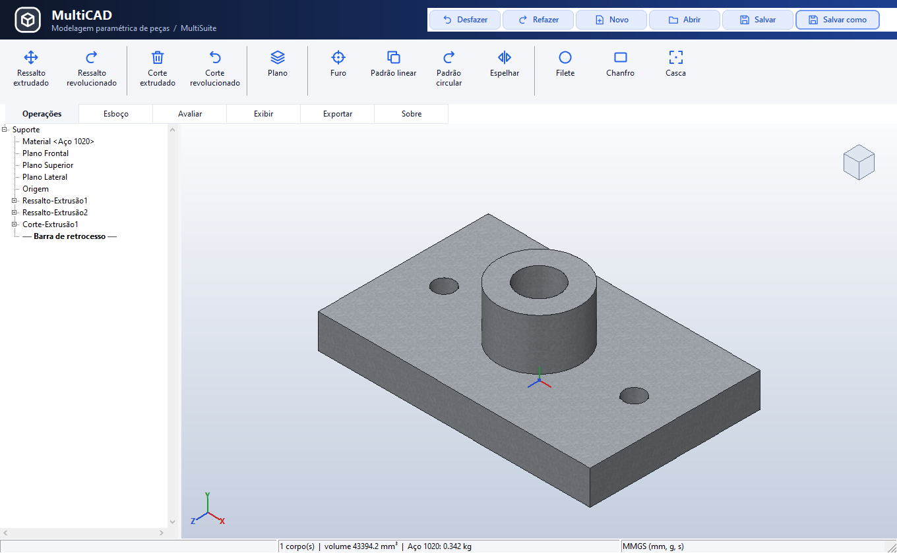
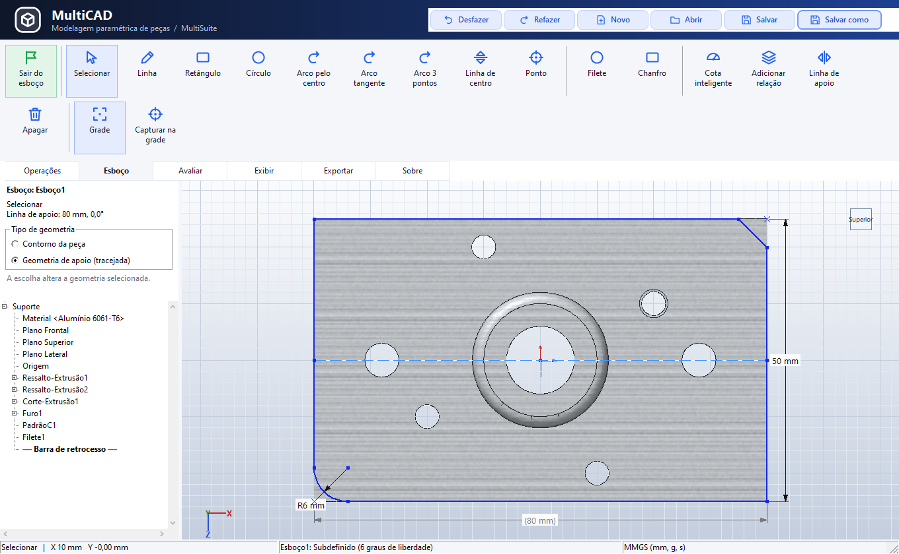
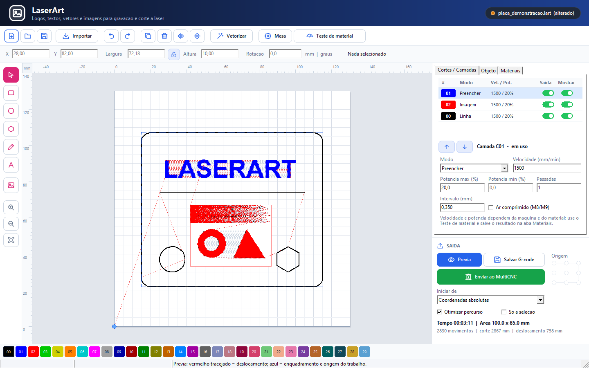

# Capturas da MultiSuite

Índice das imagens desta pasta, com links para os guias das ferramentas. As capturas
registram a interface no momento em que foram feitas; os recursos atuais estão nos
respectivos guias. Os projetos e parâmetros mostrados são exemplos.

## MultiCNC e SimuCNC

| Arquivo | Resolução | Conteúdo |
|---|---|---|
| [multicnc_novo_layout.png](multicnc_novo_layout.png) | 1180 × 738 | Controle, programa G-code, jog e estado da máquina |
| [simucnc_router_ao_vivo.png](simucnc_router_ao_vivo.png) | 1300 × 738 | Router simulado conectado por TCP, peça e G-code recebido |
| [tres_maquinas_3d.png](tres_maquinas_3d.png) | 1782 × 422 | Vistas 3D da impressora, router e laser simulados |

[Visão geral](../README.md) · [Conexão TCP do SimuCNC](../docs/SIMUCNC_TCP.md)

## MultiCAD 0.0.8.4 - manual do usuário

[Manual ilustrado em português (PDF)](../docs/Manuals/Manual_do_Usuario_MultiCAD_0.0.8.4_PT-BR.pdf) · [Catálogo das capturas atuais](manual_multicad_0_0_8_4/README.md)

Capturas produzidas em 12/10/2026: Texto vetorial, Trim, esboços, operações 3D, materiais, estilos, seção e painéis. O manual tem 34 páginas e 16 figuras e toma como referência a versão **0.0.8.4**.

## MultiCAD 008 - capturas históricas

Capturas reais da interface do MultiCAD 0.0.8.0, geradas em 11/10/2026 com peças de exemplo, sem retoques e preservando as cores e o layout do programa.

Estas imagens são anteriores ao Texto vetorial (0.0.8.4), ao Aparar/Trim (0.0.8.3)
e à remoção do botão duplicado de linha de apoio. Consulte o [guia atual do MultiCAD](../multicad/README.md)
para esses comandos; `Multicad03.png` registra a interface antiga do esboço.

| Arquivo | Resolução | Conteúdo |
|---|---|---|
| [Multicad01.png](Multicad01.png) | 1360 × 840 | Peça 3D em aço, com ressalto e furos |
| [Multicad02.png](Multicad02.png) | 1360 × 840 | Furo roscado e padrão circular em alumínio |
| [Multicad03.png](Multicad03.png) | 1360 × 840 | Esboço cotado, linha de apoio, filete e chanfro |
| [Multicad04.png](Multicad04.png) | 1360 × 840 | Corte extrudado com ajuste de profundidade pelo mouse |
| [Multicad05.png](Multicad05.png) | 1360 × 840 | Vista em seção da peça e seus furos |
| [Multicad06.png](Multicad06.png) | 1360 × 840 | Seleção da aresta e prévia do filete 3D |
| [Multicad07.png](Multicad07.png) | 1360 × 840 | Aparência e material PLA azul |
| [Multicad08.png](Multicad08.png) | 1360 × 840 | Aparência e material madeira (pinus) |

## MultiSlicer

| Arquivo | Resolução | Conteúdo |
|---|---|---|
| [multislicer_material.png](multislicer_material.png) | 1280 × 860 | Modelo na mesa, filamento, temperaturas e ventilação |
| [multislicer_previa.png](multislicer_previa.png) | 1280 × 860 | Prévia por camada de um anel: saia, paredes e topo/fundo |
| [multislicer_qualidade.png](multislicer_qualidade.png) | 1280 × 860 | Configuração de qualidade |
| [multislicer_suporte.png](multislicer_suporte.png) | 1280 × 860 | Configuração de suportes |

As entregas publicadas das etapas 0 a 6 possuem também capturas em
[`screenshots`](../screenshots): [modelo](../screenshots/multislicer_modelo.png),
[mesa 3D](../screenshots/multislicer_mesa3d.png),
[qualidade](../screenshots/multislicer_qualidade.png) e
[suportes e aderência](../screenshots/multislicer_suporte.png). O executável de
referência sincronizado é o MultiSlicer **0.0.6.0**.

[Guia e capturas do MultiSlicer](../multislicer/README.md#capturas-da-interface)

## MakePCB

| Arquivo | Resolução | Conteúdo |
|---|---|---|
| [Makepcb01.png](Makepcb01.png) | 1389 × 868 | Impressão da arte final em escala 1:1 |
| [Makepcb02.png](Makepcb02.png) | 1389 × 868 | Esquema e galeria de símbolos |
| [Makepcb03.png](Makepcb03.png) | 1389 × 868 | Editor de componentes |
| [Makepcb04.png](Makepcb04.png) | 1389 × 868 | Editor de componentes com encapsulamento SOIC |
| [Makepcb05.png](Makepcb05.png) | 1540 × 700 | Componentes SMD na face inferior e arte final |
| [Makepcb06.png](Makepcb06.png) | 1389 × 868 | Seleção múltipla na placa |

[Guia e galeria do MakePCB](../makepcb/README.md)

## MakeRouter

| Arquivo | Resolução | Conteúdo |
|---|---|---|
| [Makerouter01.png](Makerouter01.png) | 1280 × 860 | Material, dimensões da chapa e ponto de zero |
| [Makerouter02.png](Makerouter02.png) | 1280 × 860 | Preparação dos percursos |
| [Makerouter03.png](Makerouter03.png) | 1280 × 860 | Simulação da usinagem |
| [Makerouter04.png](Makerouter04.png) | 1280 × 860 | Saída do trabalho |
| [Makerouter05.png](Makerouter05.png) | 1280 × 860 | Desenho e formas do projeto |

[Guia e galeria do MakeRouter](../makerouter/README.md)

## RouterPCB

| Arquivo | Resolução | Conteúdo |
|---|---|---|
| [Routerpcb01.png](Routerpcb01.png) | 1240 × 850 | Isolação da placa |
| [Routerpcb02.png](Routerpcb02.png) | 1240 × 850 | Recorte com pontes |
| [Routerpcb03.png](Routerpcb03.png) | 1240 × 850 | Nivelamento por sondagem |
| [Routerpcb04.png](Routerpcb04.png) | 1240 × 850 | Saída dos programas |

[Guia e galeria do RouterPCB](../routerpcb/README.md#telas)

## LaserArt 0.02.1 - manual do usuário

[Manual ilustrado em português (PDF)](../docs/Manuals/Manual_do_Usuario_LaserArt_0.02.1_PT-BR.pdf) · [Catálogo das 16 capturas atuais](manual_laserart_0_02_1/README.md)

Capturas de 12/10/2026: ferramentas, composição, texto, formas, imagens, dithering, vetorização, camadas, preenchimento, materiais, prévia, origens, mesa e teste de material. O manual tem 30 páginas e 19 figuras.

## Capturas do LaserPCB e LaserArt

Capturas reais das interfaces, geradas em 10/10/2026 com projetos de exemplo. Mantêm o padrão de nomes das imagens da suíte.

| Arquivo | Resolução | Conteúdo |
|---|---|---|
| [Laserpcb01.png](Laserpcb01.png) | 1440 × 960 | Placa, cobre, trajetórias e parâmetros por camada |
| [Laserpcb02.png](Laserpcb02.png) | 1440 × 960 | Posicionamento e distribuição de cópias |
| [Laserpcb03.png](Laserpcb03.png) | 620 × 640 | Criação de placa e prévia Top/Bottom |
| [Laserpcb04.png](Laserpcb04.png) | 610 × 340 | Mesa com equipamento salvo no MultiCNC |
| [Laserart01.png](Laserart01.png) | 1440 × 960 | Composição vetorial de exemplo |
| [Laserart02.png](Laserart02.png) | 1440 × 960 | Texto selecionado e parâmetros da camada |
| [Laserart03.png](Laserart03.png) | 610 × 340 | Mesa com equipamento salvo no MultiCNC |

As imagens principais Laserpcb01 e Laserart01 também são incorporadas ao setup 007. As galerias completas estão nos guias do [LaserPCB](../laserpcb/README.md) e do [LaserArt](../laserart/README.md). Os valores e desenhos exibidos são exemplos de apresentação.

## Bandeja — registros históricos

Estas capturas mostram versões anteriores da bandeja, com entradas como MultiPCB,
Abrir MultiSuite e Central de Testes. A lista e os comandos atuais estão no
[guia da MultiSuite Bandeja](../multisuite/README.md).

| Arquivo | Resolução | Conteúdo |
|---|---|---|
| [both.png](both.png) | 840 × 768 | Painel antigo e busca por ferramentas laser |
| [Makerouter_bandeja.png](Makerouter_bandeja.png) | 388 × 813 | Entrada MakeRouter na bandeja antiga |
| [Routerpcb_bandeja.png](Routerpcb_bandeja.png) | 388 × 813 | Entrada RouterPCB na bandeja antiga |
