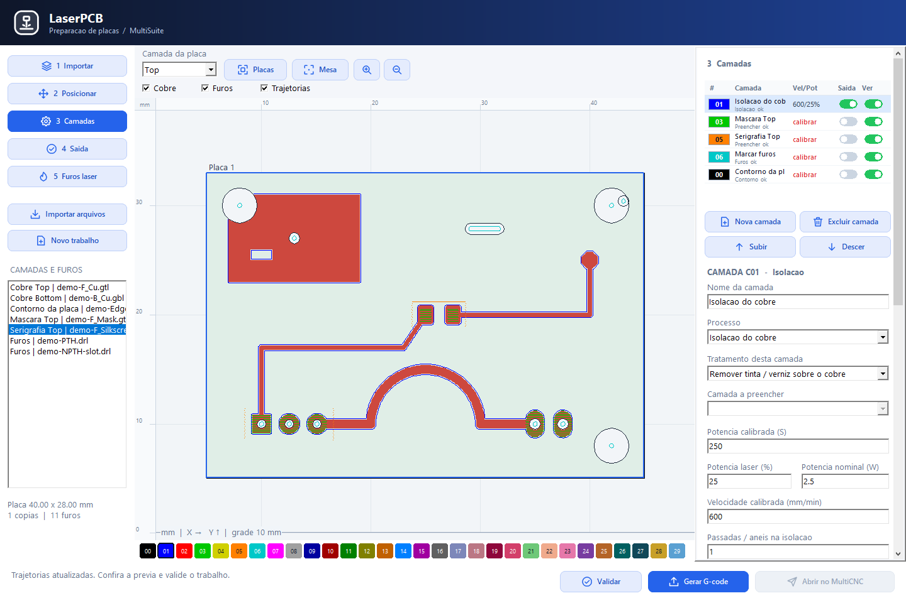
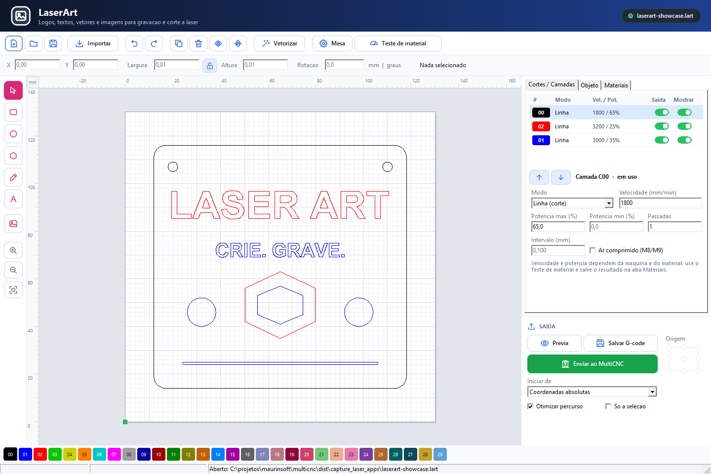

# Instalador Windows MultiSuite 016

Windows 64 bits, Git, Python 3.9+, Lazarus/Free Pascal 64 bits e Inno Setup 6 ou 7.

## Gerar

    installer\windows\build_release.bat -Version 0.16 -SetupSeq 016

O script procura as ferramentas nas pastas usuais. Os caminhos podem ser definidos
por LAZBUILD, FPC, PYTHON e ISCC. MULTICNC_CHATGPT_DIR aponta para as dependencias
AI/AISerial quando estiverem fora da pasta CHATGPT ao lado do repositorio.

A publicacao exige arvore Git limpa. Para gerar e testar um setup local antes do
commit, acrescente -AllowDirty; o manifesto registra source_dirty=true.

O build compila os 14 executaveis, copia a biblioteca de componentes 3D do MultiAssembly
(models\components\mec, instalada junto com o MultiAssembly), executa os testes de console, inclui relatorio de testes e
documentacao, valida a arquitetura amd64 e gera manifesto, relatorio e SHA256SUMS.
Os executaveis atualizados ficam em bin. setup_multcnc_016.exe fica em setup e bin; a copia de staging
e os logs ficam em dist. Feche os aplicativos da suite antes de substituir bin.

## Gerar no Linux (compilacao cruzada)

    ISCC=/caminho/ISCC.exe installer/windows/build_release_wine.sh 0.16 016

Mesmos passos do build_release.ps1: compila os executaveis win64 com o FPC/Lazarus do
Linux (units x86_64-win64 da RTL e dos pacotes instaladas), roda os testes de console
win64 no Wine (MULTICNC_TEST_RUNNER=wine), gera as imagens com prepare_images.py
(Pillow) e o instalador com o ISCC.exe do Inno Setup 6.3+ no Wine (32 e 64 bits). O script
mapeia Times New Roman para DejaVu Serif no Wine (teste de fontes do MultiCAD).

## Conteudo e inicializacao

Inclui MultiSuite Bandeja, MultiProject, MultiCAD, MultiAssembly,
MultiPhysics, MultiCAM, MultiSlicer, MakePCB, MakeRouter, RouterPCB, LaserPCB,
LaserArt, MultiCNC, SimuCNC.

O multisuite_tray.exe e somente um painel de atalhos ao lado do relogio, com o padrao visual restaurado.
Clique no icone para abrir os programas; o menu de contexto oferece Abrir painel e Sair.
Inclui MultiCAD, SimuCNC e os demais aplicativos disponiveis. O painel permite buscar
aplicativos; nao inclui o hub MultiSuite separado ou opcoes de configuracao no menu. O executavel multisuite.exe nao faz parte
do pacote Windows. MultiPCB tambem foi retirado. A atualizacao remove as copias
antigas desses executaveis e seus atalhos.

A instalacao basica inclui MultiCNC, bandeja e documentacao. A tarefa "Iniciar a MultiSuite
Bandeja com o Windows" vem marcada por padrao e registra multisuite_tray.exe
--tray no Run do usuario. Pode ser desmarcada na instalacao ou desativada nas
configuracoes de inicializacao do Windows. A desinstalacao remove esse registro.

## Imagens

prepare_images.ps1 gera os bitmaps temporarios a partir de imgs, preservando as
proporcoes das capturas. A abertura mostra tres_maquinas_3d.png; durante a copia
dos arquivos aparecem multicnc_novo_layout.png, Makepcb01.png, Makerouter01.png
simucnc_router_ao_vivo.png, Laserpcb01.png, Laserart01.png e ms_preview3d.png (MultiSlicer). As imagens sao incorporadas ao setup e nao dependem
da pasta imgs existir no computador de destino.

## Validacao e publicacao

Nao distribuir um instalador se o build falhar. Compilacao e testes de console
nao substituem verificacao interativa da instalacao ou ensaio com hardware.
Projetos e relatorios pertencem ao usuario, fora de Program Files.
Publicar uma GitHub Release/tag continua uma etapa separada.
## Setup 010

[Instalador Windows x64](../../setup/setup_multcnc_011.exe) · [Notas e validação](../../docs/SETUP_011.md) · [Galeria de imagens](../../imgs/README.md)

| LaserPCB | LaserArt |
|---|---|
|  |  |

## Documentação e DLL no setup 010

O componente de documentação cria a pasta **Documentacao MultiSuite** na Área de
Trabalho, com o índice offline e atalhos para os três manuais PDF. O conteúdo é
preparado por `tools/stage_documentation.py`, incluindo guias e imagens.

`mcad_occt.dll` é obrigatória no staging e instalada ao lado de `multicad.exe`.
O manifesto rejeita ausência ou arquitetura incorreta da DLL. O MultiSlicer
incluído é 0.1.0.0; sua imagem de prévia 3D aparece durante a instalação.

Use `-SkipBinUpdate` para gerar o setup sem substituir os aplicativos de `bin`
que estejam em uso. Essa opção mantém todos os aplicativos recompilados dentro
do instalador e ainda salva o setup em `setup` e `bin`.

## Conteúdo atualizado do setup 010

Inclui MultiCAD 0.0.8.5, MultiSlicer 0.1.0.0, MultiCNC 0.1.0.5 e a DLL
OpenCascade 7.6.3. Os 12 modelos de CNC Router ficam em
`documentation/models/cnc_router`, acompanhados do catálogo, instruções e relatório.
Os manuais PDF mantêm as versões de referência indicadas nas capas.

Os pacotes ZIP de drivers guardados em `imgs` no repositório não são imagens de
documentação e não são instalados automaticamente. Os hashes dos setups anteriores
são preservados em `setup/SHA256SUMS`.

O SimuCNC e obrigatorio nas instalacoes completa, basica e personalizada. O setup tambem e publicado com o nome por versao `setup_multcnc_0.16.exe` (mesmo conteudo de `setup_multcnc_016.exe`).
