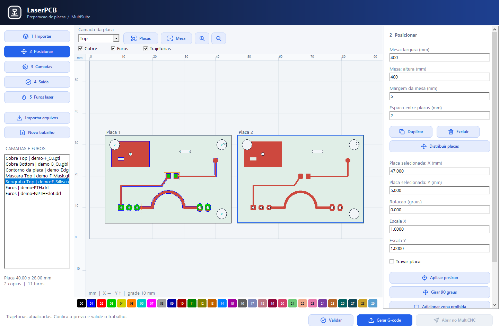
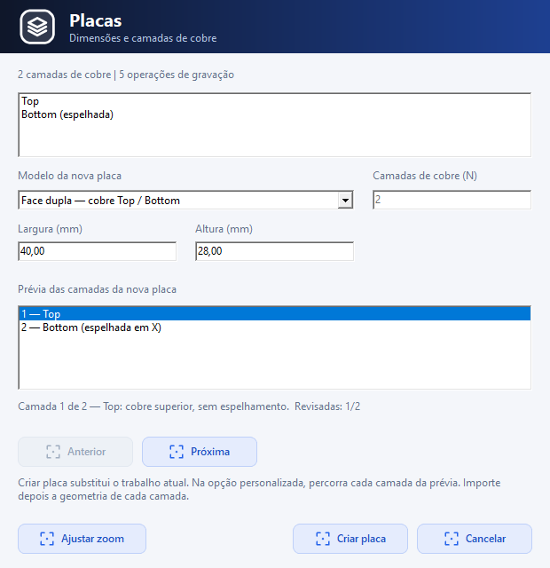
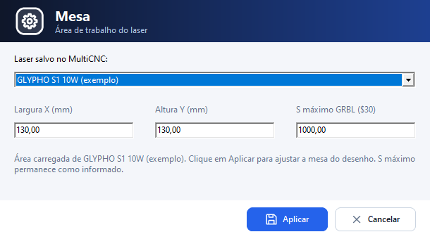

# LaserPCB

Prepara placas para laser com SVG, Gerber e Excellon e gera trajetórias de marcação, retirada de material e furos para CNC Laser. A conexão, o Frame e a execução pertencem ao MultiCNC.

## Capturas da interface

Exemplos reais de preparação de uma placa. As capturas mostram o estado da interface na geração das imagens; os parâmetros exibidos pertencem ao exemplo.


| Posicionamento das cópias | Criação da placa e pilha de cobre |
|---|---|
|  |  |



## Fluxo da interface

1. **Placa:** crie a placa com dimensoes e faces de cobre, ou importe Gerber/SVG e Excellon. Confira a funcao dos arquivos, mesa, margem e posicao inicial. Duplicacao, distribuicao, rotacao e alinhamento ficam nesta etapa; nao ha outra etapa de posicionamento da placa depois. O botao Placas permite 1 a 64 camadas de cobre, com Bottom espelhada na preparacao do laser. Mesa usa os equipamentos salvos no MultiCNC.
2. **Posicionar componentes:** escolha um footprint da biblioteca compartilhada e clique na placa. Arraste para mover, gire ou vire Top/Bottom. A colocacao de SMD acompanha a face ativa. Abra e salve projetos PCB `.mpcb` com componentes, ligacoes e trilhas.
3. **Trilhas:** use **Ligar terminais** para declarar as conexoes, **Trilha** para desenhar manualmente e **Rotear automaticamente** para completar ligacoes pendentes. Informe largura minima e folga em mm. O roteamento preserva as trilhas existentes e informa as conexoes sem caminho. Desfazer/refazer e verificacao eletrica ficam nesta etapa. A edicao e o roteamento atendem Top/Bottom; camadas internas continuam disponiveis por importacao. Vias em dupla face precisam de ligacao fisica entre as faces.
4. **Camadas e laser:** a tabela **Cortes / Camadas** mantem os processos, cores, Saida e Ver. Ajuste potencia, velocidade, tratamento, passadas e feixe. **Aplicar na camada de cobre** permite associar uma operacao a uma face especifica ou reutiliza-la na face ativa. A previa, a validacao, a estimativa e o G-code consideram a face selecionada; gere cada face separadamente. Marcar centros, contornos e aneis dos furos tambem ficam nesta etapa. Camadas novas comecam sem calibracao.
5. **Validar e gerar:** confira largura, folga, curto-circuitos e ligacoes pendentes nos projetos editaveis, alem das trajetorias, calibracao e ocupacao da mesa. Gere o G-code e abra no MultiCNC. Mudancas no circuito, parametros ou posicao invalidam o envio anterior.

Placas prontas importadas em Gerber/SVG seguem de **Placa** diretamente para **Camadas e laser**. Gerber nao contem necessariamente a lista de ligacoes do circuito; sua validacao e de fabricacao/CAM. O editor nao trata o cobre importado como uma placa vazia para roteamento. Uma pasta exportada pelo MakePCB pode ser aberta com `laserpcb --file <pasta>`.

As cores, os paineis e a disposicao geral da interface permanecem os mesmos. As operacoes laser sao distintas das camadas fisicas de cobre.


## Processos

| Entrada/processo | Resultado |
|---|---|
| SVG / Vetores | Linhas, polígonos, retângulos, elipses, curvas e arcos, com unidades, viewBox e transformações |
| Gerber / Isolação | Anéis ao redor do cobre, compensados pelo raio do feixe |
| Gerber / Remoção | Varredura na área da placa sem cobre |
| Gerber / Preencher camada | Varredura da camada de origem, incluindo máscara ou serigrafia |
| Gerber / Contorno da placa | Linha sobre o contorno (marcação ou corte de material fino) |
| Excellon / Marcar furos (laser) | Centro, contorno ou corte de cada furo/rasgo pelo laser |

Na isolação, passadas são anéis de offset; o G-code percorre cada anel uma vez. Nos demais processos, passadas repetem as trajetórias daquela camada. A compensação é recalculada depois da escala, mantendo o diâmetro físico do feixe. O espelhamento Bottom não modifica a geometria importada.

Gerber requer contorno fechado. Contornos internos e furos são excluídos da placa. O CAM recorta cada segmento na máscara, sem ligar trechos através de furos. A borda recebe recuo de meio feixe. Precisão depende da resolução raster; o limite é 16 milhões de pixels por máscara.

## Limites e parâmetros

Potência, velocidade e diâmetro do feixe precisam de calibração da máquina/material. Confira S-max com `$30` e modo laser com `$32=1` no MultiCNC. Não há presets universais de potência/velocidade. Mesa carrega os W ópticos do equipamento salvo, quando informados, sem alterar a janela compartilhada do LaserArt. Em Camadas, os W também podem ser informados manualmente. A conversão nominal usa W do laser × percentual / 100 e S-max × percentual / 100; não é uma medição da saída nem garante o mesmo resultado em lasers diferentes.

A opção **Tabela de referências (web)** apresenta dados publicados com fonte e parâmetros ausentes identificados. Consulte [REFERENCIAS_LASER.md](docs/REFERENCIAS_LASER.md). Só referências com watts e velocidade conhecidos podem ser aplicadas explicitamente à camada; dados de sistemas UV industriais não viram presets para diodos azuis.

A validação bloqueia trajetórias vazias, parâmetros inválidos, S arredondado para zero, potência acima de S-max, placas fora da mesa, colisões e zonas proibidas. Recursos de importação ignorados geram avisos e bloqueiam exportação. SVG com texto, imagens, referências `use`, máscaras ou recortes precisa ser convertido para vetores suportados.

Colisão e nesting usam caixas envolventes conservadoras, inclusive após rotação livre. Zonas proibidas reservam espaço para as placas; os deslocamentos rápidos entre trajetórias não são roteados ao redor dessas zonas. Confira os movimentos no MultiCNC.

Alinhamento manual usa dois fiduciais, com coordenadas do arquivo original e coordenadas medidas em mm. O solver aplica escala, rotação e translação; considera origem e espelhamento Bottom. A câmera continua indisponível.

Perfis JSON preservam feixe, potência óptica nominal em watts, potência S, velocidade, S-max, passadas e tipo de processo laser. A sessão completa de camadas e posicionamento não é salva pelo perfil.

## Compilação e testes

Requer Lazarus/LCL e FPC. O SVG reutiliza `laserart/src/core/laserart_svgimport.pas`; o visual reutiliza `multisuite_controls` e `multisuite_icons`.

```bash
lazbuild laserpcb/src/app/laserpcb.lpi
lazbuild --ws=nogui laserpcb/tests/test_pipeline.lpi
./laserpcb/tests/test_pipeline
lazbuild --ws=gtk2 laserpcb/tests/test_ui.lpi
xvfb-run -a ./laserpcb/tests/test_ui /tmp/laserpcb-ui
```

A automação `LaserPCB CI` testa o núcleo e a interface nativa em Linux/Windows e disponibiliza o executável Windows como artefato. Os testes cobrem SVG, exportações repetidas, parâmetros, transformações, nesting, polaridade Gerber, Excellon, recorte e compensação após escala.
## Segurança
Parâmetros de potência/velocidade não são universais. Devem ser calibrados para a máquina, material e processo. O LaserPCB não habilita laser automaticamente.

## Raster moderno (laserart_rasterizer)
Independente da LCL (`TGrayImage`): ajustes de brilho/contraste/gama, sete algoritmos de dithering (Floyd-Steinberg, Jarvis, Stucki, Atkinson, Sierra, Burkes, Bayer) com varredura serpentina, ou escala de cinza com potência variável entre `PowerMin` e `PowerMax`. O G-code usa `M4` (potência acompanha a velocidade real), runs de mesma potência em uma linha, overscan com `S0`, varredura bidirecional e salto de áreas brancas. O exportador de jobs (`laserpcb_gcode`) também passou a gerar saída modal.

## Componentes compartilhados com o MakePCB

O botão **Componentes**, ao lado de Mesa, abre a mesma galeria de footprints e o mesmo editor de criação usados pelo MakePCB. A biblioteca do usuário é compartilhada em `%LOCALAPPDATA%\makepcb\makepcb_componentes.json` no Windows. **Importar biblioteca** lê conjuntos JSON no formato `makepcb-library`; os componentes criados pelo editor ficam disponíveis também no MakePCB ao reabrir o programa.

Escolha um componente na galeria e clique na placa, ou use **Adicionar escolhido**. Arraste para posicionar, ajuste X/Y em mm, rotação de 90 em 90 graus e face Top/Bottom. **Aplicar na placa** transforma pads, contornos e furos em geometria de cobre, serigrafia e marcação para o laser. O CAM preserva os Gerbers e Excellons importados e aplica o espelho Bottom configurado para a placa. Pads passantes aparecem nas faces externas; pads SMD ficam na face escolhida, sem criar cobre nas camadas internas.

**Salvar conjunto** na janela da biblioteca continua gravando um conjunto de componentes e posicoes. **Abrir conjunto** importa apenas os componentes e substitui a montagem em edicao, mantendo as dimensoes atuais. Para preservar o circuito completo, use **Abrir projeto PCB** e **Salvar projeto PCB** nas etapas 2/3: estes comandos mantem ligacoes, trilhas, areas, footprints personalizados, dimensoes e a definicao das faces de cobre. O arquivo PCB nao salva a sessao de operacoes laser nem o posicionamento das copias na mesa.

Reabrir a janela Componentes preserva as trilhas e ligacoes existentes. **Cancelar** descarta as alteracoes dessa janela; itens salvos na biblioteca permanecem disponiveis.

Teste da integração: `lazbuild laserpcb/tests/test_components.lpi`, seguido de `laserpcb/tests/test_components.exe` no Windows.

O teste `test_workflow.lpi` cobre as cinco etapas, o tema, desenho manual, desfazer/refazer, roteamento Top/Bottom, persistencia do circuito e operacoes laser por face.
