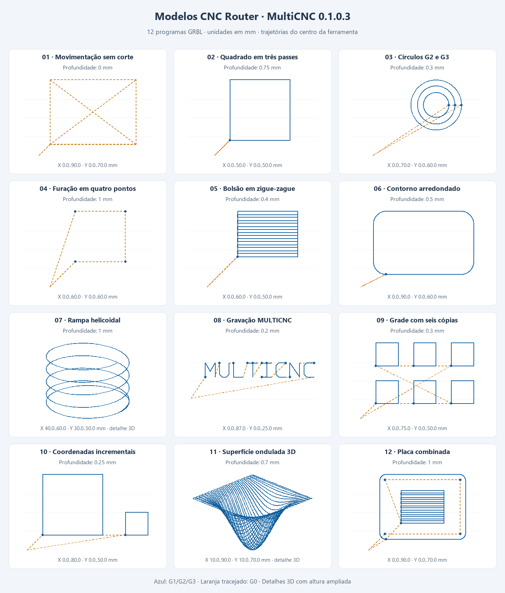

# Modelos de teste — CNC Router / MultiCNC

12 programas G-code originais para testar o **MultiCNC 0.1.0.3**, com protocolo
**GRBL 1.1**. Criados em **13/10/2026**, em domínio público **CC0-1.0**.
Os modelos servem para prévia, análise e execução no simulador local; não precisam
de STL, CAD ou fontes instaladas.

## Escolher um modelo

| Arquivo | O que permite testar | Profundidade máxima |
|---|---|---|
| [01_movimentacao_sem_corte.nc](01_movimentacao_sem_corte.nc) | Conferir eixos, envelope e deslocamentos G0; spindle desligado. | 0 mm |
| [02_quadrado_40x40.nc](02_quadrado_40x40.nc) | Contorno de 40 × 40 mm no centro da ferramenta, com três passes Z. | 0.75 mm |
| [03_circulos_g2_g3.nc](03_circulos_g2_g3.nc) | Três círculos com diâmetros de percurso 20, 30 e 40 mm, horário/anti-horário. | 0.3 mm |
| [04_furacao_quatro_pontos.nc](04_furacao_quatro_pontos.nc) | Quatro mergulhos em etapas de 0,25 mm, com retração explícita; sem ciclos fixos. | 1 mm |
| [05_bolsao_ziguezague.nc](05_bolsao_ziguezague.nc) | Raster de 40 × 30 mm com espaçamento de 2 mm e contorno por nível. | 0.4 mm |
| [06_contorno_arredondado.nc](06_contorno_arredondado.nc) | Percurso de 80 × 50 mm, quatro cantos de raio 10 mm e dois passes. | 0.5 mm |
| [07_rampa_helicoidal.nc](07_rampa_helicoidal.nc) | Hélice de diâmetro de percurso 20 mm, quatro voltas e um círculo final. | 1 mm |
| [08_gravacao_multicnc.nc](08_gravacao_multicnc.nc) | Texto de traço simples, altura de 10 mm; não depende de fontes instaladas. | 0.2 mm |
| [09_grade_seis_copias.nc](09_grade_seis_copias.nc) | Seis quadrados de percurso 15 × 15 mm em grade 3 × 2. | 0.3 mm |
| [10_coordenadas_incrementais.nc](10_coordenadas_incrementais.nc) | Dois quadrados (40 e 15 mm) com G91 e retorno explícito a G90. | 0.25 mm |
| [11_superficie_ondulada_3d.nc](11_superficie_ondulada_3d.nc) | 4.141 pontos XYZ em raster; teste de prévia, fila, progresso, pausa e retomada. | 0.7 mm |
| [12_placa_combinada.nc](12_placa_combinada.nc) | Furação, bolsão e contorno na mesma origem, com retrações entre operações. | 1 mm |

As dimensões descritas são as trajetórias do **centro da ferramenta**. O diâmetro
da fresa altera as dimensões usinadas. Não há compensação G41/G42, escolha de
ferramenta, cálculo de tolerâncias ou preparação CAM para produção.

## Como usar no MultiCNC

1. Abra o MultiCNC e selecione **CNC Router**, protocolo **GRBL** e comunicação
   **Simulador local**. Clique em **Connect Device**.
2. Use **Open Program...** para abrir um dos arquivos `.nc` desta pasta.
3. Em **Trajetória e análise**, confira os percursos nas projeções XY/XZ/YZ,
   as dimensões, os avanços e o tempo estimado.
4. Em **Limites de análise...**, use X de **0 a 100 mm**, Y de **0 a 80 mm** e
   Z de **-2 a 10 mm** para reproduzir a validação deste catálogo. O envelope
   padrão 300 × 300 × 100 mm também comporta esses exemplos.
5. Clique em **Start** e acompanhe o Console e as confirmações. O simulador
   local não depende de uma porta COM e não aciona equipamento.
6. Para testar **Pause** e **Resume**, prefira
   `11_superficie_ondulada_3d.nc`. Os arquivos pequenos podem terminar muito
   rapidamente no simulador. Para observar a geometria em uma mesa 3D, use
   também o [SimuCNC por TCP](../../docs/SIMUCNC_TCP.md), selecionando Router/GRBL
   nos dois aplicativos.

O simulador local confirma o envio, mas não interpreta toda a física ou remoção
de material. A prévia é a referência geométrica dos percursos neste catálogo.

## Origem, movimentos e parâmetros

- Milímetros (`G21`), plano XY (`G17`), avanço em mm/min (`G94`) e origem de
  trabalho **G54**. X0/Y0 ficam no canto de referência, Z0 na superfície.
- Z de retração **+5 mm**; o modelo sem corte também sobe a **+10 mm**.
  Os percursos ficam dentro de X0..90 e Y0..70 mm, incluindo o retorno à origem.
- Os exemplos de corte solicitam **M3 S8000**, aguardam **G4 P2** e terminam
  com **M5**. RPM, avanços e profundidades são valores ilustrativos para simulação,
  sem especificação de material ou ferramenta. O modelo 01 usa somente G0 e
  mantém o spindle desligado.
- Os arquivos iniciam em absoluto (`G90`) e usam centros de arco incrementais
  (`G91.1`). O modelo 10 muda para `G91` durante os quadrados e restaura `G90`.
- Não redefinem o zero com G92, não executam homing e não alteram parâmetros
  `$` do firmware. A furação usa movimentos explícitos G0/G1, sem ciclos G81/G83.

Para usar em uma máquina física, prepare e confira o zero G54, o espaço acima
das fixações, a ferramenta, o material e os parâmetros do seu equipamento.
Mesmo o modelo sem corte move os eixos. Não execute os modelos de usinagem sem
adaptar esses parâmetros. Nenhum arquivo foi enviado a hardware durante a criação.

## Validação realizada

Os 12 arquivos novos passaram pelo **mesmo analisador de trajetória do MultiCNC**,
com envelope X0..100/Y0..80/Z-2..10, análise completa, **zero erros e zero avisos**.
Todos passaram pela verificação de compatibilidade GRBL e pelo envio em sessão
Router/GRBL com transporte simulado e confirmações adiadas. Todas as linhas foram
confirmadas. Pausa e retomada do modelo 11 também foram verificadas.

[Relatório CSV](relatorio_validacao.csv) · [Catálogo JSON](catalogo.json)

O relatório usa `;` como separador e ponto decimal. Os tempos são estimativas
do analisador; a execução real depende do equipamento. Esta validação não constitui
ensaio de usinagem física.

## Exemplo anterior

[`square_grbl.nc`](square_grbl.nc) foi preservado como demonstração histórica.
Esse arquivo redefine o zero com G92 e pode mostrar análise parcial. Ele não faz
parte dos 12 programas novos nem do relatório de validação acima.

## Referências

[Manual do MultiCNC](../../docs/Manuals/Manual_do_Usuario_MultiCNC_0.1.0.3_PT-BR.pdf) ·
[Comandos suportados pelo GRBL](https://github.com/gnea/grbl/blob/master/README.md)
