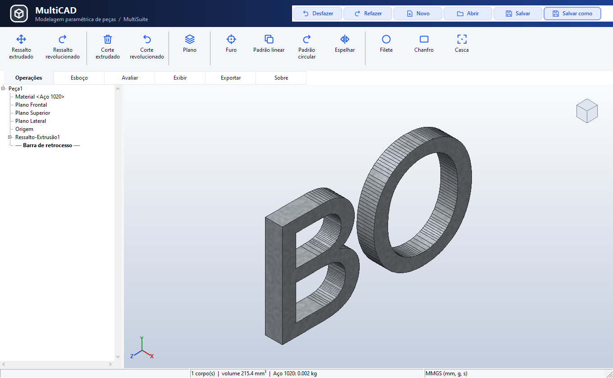
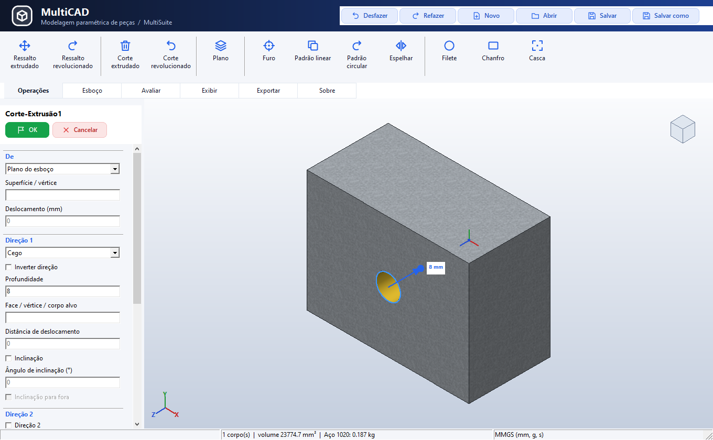
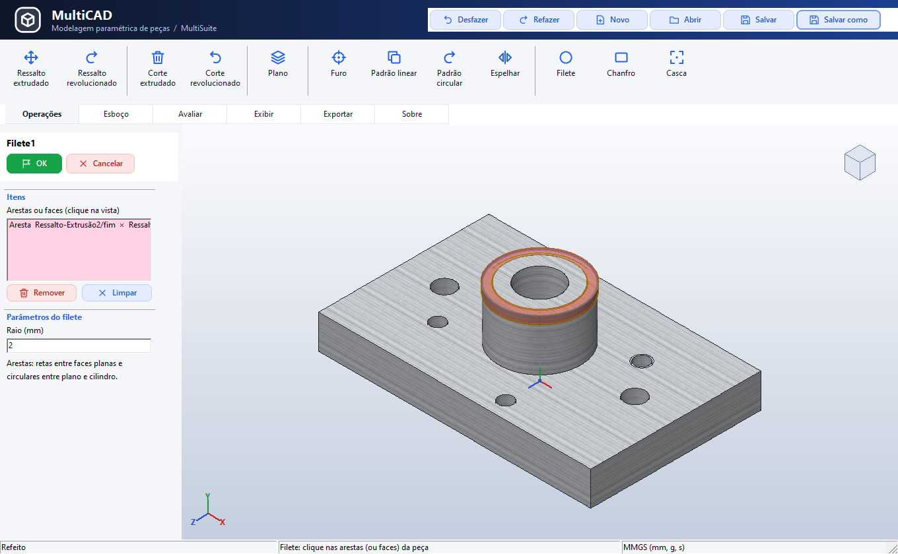

# MultiCAD

> **Estado (12/10/2026, versão 0.0.8.4):** já dá para abrir o `bin/multicad.exe`,
> criar esboços com cotas e relações (no plano ou numa face), fazer ressalto e corte
> extrudados ou revolucionados, planos de referência, editar pela árvore e pelo
> PropertyManager, ver em 5 estilos e em seção, salvar em `.mcad`, medir, exportar STL
> (em pé para o MultiSlicer) e DXF. Inclui furo, padrões, espelho, Aparar (Trim)
> e texto convertido em contornos vetoriais do esboço. Exemplo: `examples/suporte.mcad`.
> Plano e pendências em [docs/TAREFA.md](docs/TAREFA.md).

O **MultiCAD** é o CAD **paramétrico de peças mecânicas** da suíte. O fluxo de referência é o do
**SolidWorks 2014**, sem copiá-lo:

1. escolher um plano (frontal, superior, lateral) ou uma face da peça;
2. desenhar o *sketch* com linhas, arcos e círculos, presos por **restrições** (coincidente,
   horizontal, paralelo, tangente...) e **cotas** que comandam a forma;
3. transformar o *sketch* em sólido com **operações** (*features*): ressalto extrudado, corte
   extrudado, revolução, furo, filete, chanfro, casca, padrões e espelhamento;
4. mudar qualquer cota e ver a peça **reconstruir** pela **árvore de operações**, como o
   FeatureManager.

O resultado é a geometria da peça, que as outras ferramentas usam para fabricar, montar e
simular. O MultiCAD **nunca** gera G-code nem fala com a máquina.

## Manual do usuário

[Manual ilustrado em português - MultiCAD 0.0.8.4 (PDF)](../docs/Manuals/Manual_do_Usuario_MultiCAD_0.0.8.4_PT-BR.pdf)

34 páginas com procedimentos de uso, parâmetros, exercício guiado e 16 figuras da interface atual. As [capturas de 0.0.8.4](../imgs/manual_multicad_0_0_8_4/README.md) incluem Texto vetorial, Trim, operações, materiais e painéis.



<a id="capturas-da-interface"></a>

## Capturas históricas da interface

As imagens abaixo registram o MultiCAD **0.0.8.0**, em 11/10/2026. A versão atual
tem **Aparar (Trim)** no lugar de Filete do esboço, **Texto** e um único seletor de
linha de apoio; esses comandos não aparecem nas oito capturas históricas abaixo. As capturas atuais estão no catálogo do manual indicado acima.

| Peça e operações | Esboço e cotas (interface anterior) |
|---|---|
|  |  |
| Ajuste da profundidade do corte | Prévia do filete no sólido |
|  |  |

| Imagem | Referência |
|---|---|
| [Multicad01](../imgs/Multicad01.png) | Peça 3D em aço, com ressalto e furos |
| [Multicad02](../imgs/Multicad02.png) | Furo roscado e padrão circular em alumínio |
| [Multicad03](../imgs/Multicad03.png) | Esboço cotado na interface 0.0.8.0 |
| [Multicad04](../imgs/Multicad04.png) | Corte extrudado com ajuste de profundidade pelo mouse |
| [Multicad05](../imgs/Multicad05.png) | Vista em seção |
| [Multicad06](../imgs/Multicad06.png) | Filete 3D e seleção de aresta |
| [Multicad07](../imgs/Multicad07.png) | Aparência e material PLA azul |
| [Multicad08](../imgs/Multicad08.png) | Aparência e material madeira (pinus) |

[Índice completo das imagens da suíte](../imgs/README.md)

## Onde entra na suíte

```text
MultiCAD (peça) ──> MultiAssembly (montagem) ──> MultiPhysics (simulação)
     │
     ├── STL ────────> MultiSlicer ───────────────> MultiCNC (impressora 3D)
     ├── DXF (perfil) > MakeRouter / MultiCAM ─────> MultiCNC (CNC Router)
     └── STEP ───────> outros CADs (fase opcional, com OpenCascade)
```

| Ferramenta | Papel | Diferença para o MultiCAD |
|---|---|---|
| **MultiCAD** | peça mecânica sólida, paramétrica, com histórico | — |
| **MakeRouter** | madeira e letreiros: desenho 2D, relevo e percursos no mesmo programa | não tem sólido B-rep nem histórico de operações |
| **MultiCAM** | simulação da máquina e CAM de peças mecânicas | recebe a geometria do MultiCAD |
| **MultiAssembly** | junta peças, placas, motores e sensores | usa as peças do MultiCAD |
| **MakePCB** | placas de circuito | outra linha de projeto |

## Telas previstas (padrão visual da suíte)

- **Esquerda:** árvore de operações (planos, origem, *sketches*, operações), com a barra de
  retrocesso para editar no meio do histórico, suprimir e reordenar.
- **Centro:** vista 3D (orbitar, deslocar, zoom, vistas padrão e isométrica, cubo de vistas)
  com seleção de faces, arestas e vértices. No modo *sketch*, a vista gira para o plano e
  mostra a grade, as relações e as cotas.
- **Direita:** propriedades da operação ou do *sketch* selecionado (como o PropertyManager).
- **Topo:** abas de comandos, como o CommandManager: *Sketch*, Operações, Avaliar (medir,
  propriedades de massa) e Exportar.
- **Rodapé:** estado do *sketch* (sub/totalmente definido), unidade (mm) e coordenadas.
- **Vistas como no SolidWorks:** Y para cima, Ctrl+1..8, F, barra de espaço, cubo de vistas,
  barra de vista, cinco estilos de exibição e seção dinâmica.

## Requisitos métricos

Só sistema métrico (mm, graus, kg), materiais com densidade, roscas ISO (M2 a M24),
furos de passagem e rebaixos por tabela, ajustes ISO 286 (H7/g6), tolerância geral ISO 2768,
tolerâncias geométricas, acabamento Ra e desenho técnico ABNT/ISO no 1º diedro. Detalhes em
[docs/ARCHITECTURE.md](docs/ARCHITECTURE.md), seções 6A e 6B.

## Documentação

- [docs/TAREFA.md](docs/TAREFA.md): decisões, fases, critérios de pronto e riscos.
- [docs/ARCHITECTURE.md](docs/ARCHITECTURE.md): modelo de dados, núcleo geométrico, solver de
  restrições, reconstrução, vista 3D e exportação.
- [docs/AI_GUIDE.md](docs/AI_GUIDE.md): responsabilidades e limites, para quem for alterar o
  código.
O núcleo CAD não envia comandos diretamente para máquinas.

## Paramétrico de verdade
- **Solver de restrições** (`multicad_constraint_solver`): horizontal, vertical, coincidente, paralelo, perpendicular, igual, distância, raio, ângulo e fixo, resolvidos por Levenberg-Marquardt a partir do desenho aproximado.
- **Graus de liberdade**: após resolver, o posto da Jacobiana classifica o sketch como subrestrito, totalmente restrito, redundante ou conflitante.
- **Sólidos** (`multicad_mesh`): perfis fechados (linhas encadeadas e círculos) com furos, triangulação por *ear clipping*, extrusão em malha fechada e exportação **STL** binário e **3MF**, que o MultiSlicer importa diretamente.

## Ajustar a profundidade com o mouse

Referência visual: [corte e alça de profundidade — Multicad04](../imgs/Multicad04.png).

Ao criar ou editar **Ressalto extrudado** ou **Corte extrudado**, arraste a alca da seta na vista 3D. A medida em mm, o campo Profundidade e a peca reconstruida acompanham o movimento. Soltar o mouse mantem a previa; confirme com **OK** ou descarte a edicao com **Cancelar**.

O arraste usa passos de 0,1 mm; segure **Shift** para passos de 0,01 mm. **Esc** durante o arraste restaura a medida anterior ao gesto; depois de soltar, Esc cancela a edicao completa. O campo numerico continua aceitando medidas e expressoes. Arrastar substitui a expressao da profundidade por uma medida direta.

As alcas acompanham a direcao invertida, a Direcao 2 e o Plano medio (medida total). Condicoes automaticas como **Passante** ou **Ate a superficie** continuam determinadas pela geometria e nao oferecem uma profundidade manual. Quando o eixo aponta para a camera, uma seta tracejada na tela permite o ajuste sem mudar a vista.

Regressao: `test_multicad` verifica projecao, eixo, volume e malha fechada; `test_extrude_ui` exercita os eventos de mouse, sincronia do campo, previa, OK/Cancelar/Esc e persistencia `.mcad`.


## Diagnostico e selecao de esbocos (11/10/2026)
- Ao sair de um esboco, a arvore e a vista 3D selecionam o esboco finalizado.
  Extrusao/corte respeita uma selecao explicita antes do ultimo esboco lembrado;
  abrir ou criar outra peca limpa esse historico de selecao.
- O executavel 0.3.1.0 cria/acrescenta `%LOCALAPPDATA%\Maurinsoft\MultiCAD\multicad.log`
  antes de criar a janela. Cada sessao tem data/hora e PID; cada registro e fechado
  imediatamente. O historico nao e apagado ao abrir novamente.
- Registra comandos, selecoes, parametros, alteracoes de esboco, arraste de profundidade,
  OK/Cancelar, reconstrucao/cache, estados de erro/aviso, arquivos, entradas invalidas,
  dialogos e excecoes (classe, mensagem, endereco e pilha quando disponivel).
  Falhas de gravacao do proprio log nao interrompem o CAD; ficam disponiveis em Sobre.
- O CommandManager segue a referencia SolidWorks 2014: icones acima dos textos,
  grupos separados e abas retangulares abaixo dos comandos, mantendo a paleta MultiSuite.
  Menus classicos Arquivo/Editar/Exibir/Inserir/Ferramentas/Sobre usam os mesmos comandos.
- A aba **Sobre** acompanha o CommandManager.
  **Sobre o MultiCAD** mostra a versao lida do recurso do executavel, compilacao e
  caminhos; **Abrir log** abre o arquivo no visualizador associado do Windows.
- A janela principal usa `Application.CreateForm`, para fechar o processo com a janela.
- `tests/test_log.lpi`: criacao, preservacao de sessoes, erros/excecoes, caminhos sem permissao.
- `tests/test_selection_ui.lpi`: regressao da selecao antiga, prioridade de selecao explicita,
  esboco ativo, comando bloqueado, aba Sobre, informacoes de versao e diagnostico.


## Visibilidade do perfil e clique nos comandos (0.3.2.0)
- O esboco da extrusao/corte/revolucao em edicao permanece visivel, mesmo consumido,
  ocultado manualmente ou atras/dentro do solido. A visibilidade temporaria termina
  no OK/Cancelar; a preferencia de ocultacao do usuario e preservada.
- Um esboco selecionado e desenhado sobre o solido, permitindo reconhecer o contorno
  antes de iniciar a operacao. A geometria e a direcao da extrusao nao sao alteradas.
- ShowTab oculta os controles antigos e usa Application.ReleaseComponent: nao libera
  o botao ainda em uso por WMLButtonUp. Regressao reproduzida com mensagens nativas
  de pressionar/soltar, incluindo troca de ferramenta e corte direto do modo esboco.
- O log continua escrito e fechado a cada registro; nao forca FlushFileBuffers em
  cada linha no Windows, evitando pausas perceptiveis durante cliques/reconstrucoes.
- Teste: tests/test_sketch_visibility_ui.lpi (perfil sobre solido, visibilidade
  temporaria, esboco selecionado e ciclo real de clique).

## Aviso de operacao com erro (0.3.3.0)
- PMOK atualiza os caches da vista imediatamente depois de RB.Rebuild e antes
  de abrir o dialogo de confirmacao. A reconstrucao substitui as malhas; o
  dialogo processa eventos de pintura e nao pode usar os enderecos anteriores.
- Responder Nao mantem a edicao aberta; Sim aceita a feature marcada com erro.
  Cancelar restaura os parametros. Nenhum desses caminhos usa malhas liberadas.
- Teste: tests/test_cut_failure_ui.lpi, com pintura durante o dialogo,
  respostas Nao/Sim, restauracao e correcao posterior. Excecoes da aplicacao
  fazem o teste falhar, inclusive antes do retorno do dialogo.
- Esta correcao nao altera o algoritmo BSP: o caso de furos cilindricos cruzados
  registrado em 11/10/2026 ainda pode falhar na booleana. A ultima geometria
  valida continua disponivel para corrigir os parametros ou cancelar a edicao.

## Cancelar edicao de planos e eixos (0.3.4.0)
- LoadParams invalida o referencial calculado do plano e a geometria do eixo,
  mesmo quando Cancelar restaura parametros identicos. O cache da reconstrucao
  guarda corpos, nao esses dados derivados: so e reutilizado se FrameValid/Valid
  tambem estiver valido. Caso contrario, recalcula a referencia e seus dependentes.
- Isso evita plano marcado como correto, mas recusado ao iniciar um esboco ou
  criar um plano deslocado. Referencias realmente perdidas continuam gerando erro.
- Testes: TestReferenceCacheRestoration no nucleo e test_plane_cancel_ui.lpi,
  cobrindo Cancelar sem/com alteracoes, plano dependente, novo esboco e reabrir.

## Cota inteligente e referencias entre esbocos (0.3.5.0)
- Durante a colocacao de uma cota de reta ou entre pontos, a posicao do cursor
  escolhe a direcao: acima/abaixo entre as coordenadas X = horizontal; ao lado
  entre as coordenadas Y = vertical; fora dos dois intervalos = comprimento real.
  Retas horizontais/verticais conservam seu eixo valido. A previa muda antes do
  clique final; o texto da previa nao intercepta esse clique. Cotas ja colocadas
  continuam conservando seu tipo quando o texto e arrastado.
- Na ferramenta de cota, extremidades, pontos medios de retas e centros de
  esbocos anteriores visiveis podem servir para posicionar o esboco ativo.
  As referencias sao projetadas no plano ativo e aparecem com a geometria
  anterior tracejada, usando as mesmas cores da interface.
- reference_point guarda sketch:<id>/<entidade>.<ponto> em um ponto de construcao
  local constante no solver. A reconstrucao atualiza sua projecao antes de resolver
  o esboco. O vinculo entra em Dependencies, persiste no .mcad e nao altera a
  geometria fonte. Fonte posterior, suprimida, com erro ou ponto perdido gera
  erro explicito; nao ha reconexao por indice de entidade. Escape remove proxies
  sem restricoes. A selecao de novas referencias ignora esbocos ocultos/futuros.
- Testes: test_smart_dimension (X/Y/alinhada, valor dirigente, projecao em outro
  plano, atualizacao associativa, persistencia, referencia perdida e Escape) e
  test_smart_dimension_ui (cliques reais, previa, selecao de outro esboco,
  valor numerico, ocultacao e reabertura). Incluidos na CI Linux/Windows.

## Painel contextual do esboco (0.3.6.0)
- O painel mostra a ferramenta ativa, selecao e orientacao correspondente.
  Cota, Filete e Chanfro ocultam o seletor de tipo de linha. Selecionar mostra
  esse controle somente com geometria editavel selecionada; ferramentas de
  desenho mantem a escolha normal/apoio, com termos de geometria para curvas.
- UpdateSketchPanel sincroniza os botoes existentes com Session.Tool, inclusive
  ao voltar a Selecionar por Esc, sem reconstruir os comandos durante o evento.
- Textos usam a largura disponivel; a orientacao ocupa a area liberada pelo
  seletor oculto. Mantidos paleta, dimensoes do painel e posicao da arvore.
- test_smart_dimension_ui cobre troca pelos botoes, Esc, selecao de linha,
  Filete/Chanfro/Circulo e retorno a Linha, alem dos testes existentes de cotas.

## Versao 008 (0.0.8.0)
- Consolida as correcoes de cotas X/Y/alinhadas, referencias entre esbocos,
  painel contextual, profundidade por mouse, selecao de perfis e log em AppData.
- Integra os commits da fila ate a633192: furos, padroes, espelho, desfazer/refazer,
  filete/chanfro/casca no solido e vista sem piscadas.
- Executavel Windows: bin/multicad.exe; identificacao em Sobre: 0.0.8.0.
- Corrige a conservacao de area da aproximacao do arco de filete, mantendo
  os pontos de tangencia e passando a verificacao de volume analitico.

## Correcao do filete em varias arestas (0.0.8.1)
- As ferramentas de filete/chanfro de um corpo sao aplicadas na mesma arvore
  BSP. A superficie e triangulada e soldada ao final, evitando a perda
  acumulada de fragmentos finos nas intersecoes entre arredondamentos.
- Mantida a validacao de malha fechada e orientada. Booleanas comuns e
  operacoes de uma unica aresta mantem o caminho existente; o calculo
  sequencial anterior continua como alternativa se o conjunto falhar.
- O log registra BLEND.SEQUENCE.START/END/FALLBACK, com quantidade de
  ferramentas, triangulos, volume e eventual erro.
- test_blend_sequence reproduz o caso da 008: bloco 50 x 30 x 26,9 mm com
  dois cortes e filete R2 nas 12 arestas. Verifica fechamento, superficies
  persistentes, volume analitico dos quatro filetes verticais, ordem de
  selecao, raio menor, persistencia e rejeicao de entradas invalidas.

## Padroes de geometria no esboco (0.0.8.2)
- A aba Esboco oferece Padrao linear e Padrao circular durante a edicao.
  Selecione a geometria com Selecionar (Ctrl soma entidades) e abra o comando.
- Linear: quantidades incluindo o original e espacamentos nos eixos X/Y do
  plano ativo. Quantidade 1 desativa a direcao; espacamento negativo inverte.
- Circular: quantidade, centro X/Y e angulo total. Uma volta de 360 graus
  distribui as instancias sem repetir o original; angulos parciais incluem
  o ponto final. Angulo negativo inverte o sentido.
- Cria linhas, circulos, arcos e pontos independentes e editaveis, conservando
  geometria normal/de apoio e linhas de centro. Nao cria vinculo parametrico
  com a entidade original, nem duplica suas cotas ou referencias externas.
- Cancelar nao altera o esboco. O conjunto entra como uma unica etapa em
  Desfazer/Refazer e persiste no arquivo .mcad. Validacao precede a criacao;
  ate 10000 novas entidades por comando. Eventos SKETCH.PATTERN registrados.
- Os padroes de operacoes 3D existentes continuam na aba Operacoes. Mantidos
  cores, controles e estrutura do CommandManager; adicionados os dois botoes
  no espaco existente da aba Esboco.
- test_sketch_pattern e test_sketch_pattern_ui verificam coordenadas, tipos
  de entidades, limites, perfis extrudaveis, dialogos, cancelamento, historico,
  e persistencia, inclusive num plano lateral.

## Linhas de apoio no esboco
- A escolha normal/apoio fica no painel do componente Linha; o comando
  duplicado na barra de ferramentas foi removido.
- Geometria de apoio e linhas de centro aparecem somente ao editar seu
  proprio esboco. Ao sair, nao sao desenhadas nem selecionaveis na vista 3D,
  mesmo com o esboco selecionado ou na previa de extrusao/corte/revolucao.
- Nao sao oferecidas como geometria de fundo ou referencias de captura em
  outro esboco. Continuam salvas no .mcad e disponiveis ao reabrir o editor.
- Os perfis e a exportacao DXF continuam ignorando a geometria de apoio.
- test_sketch_visibility_ui cobre o seletor do componente, desenho no
  esboco ativo, saida/reentrada, previa e referencias entre esbocos.

## Texto vetorial no esboco (0.0.8.4)
- Em um esboco aberto, clique em **Texto**, digite o conteudo e escolha uma
  fonte instalada, altura em mm, negrito/italico, alinhamento e angulo.
  X/Y indicam a base do texto no plano do esboco. A altura corresponde a
  letra H; acentos e descendentes podem ultrapassar essa medida.
- A previa mostra os contornos que serao criados. **Criar contornos** converte
  o texto em segmentos ordinarios e editaveis do esboco. Depois de confirmar,
  para trocar conteudo/fonte/tamanho, desfaça a insercao e crie novamente.
  Ctrl+Z/Ctrl+Y removem/restauram a insercao inteira.
- Usa as curvas da fonte (GDI unhinted no Windows, Cairo no Linux), sem
  rasterizacao. Beziers sao discretizadas com tolerancia de corda de ate
  min(0,01 mm, altura/2000), mais ate 0,0001 mm na limpeza dos contornos.
  Clipper2 une sobreposicoes de fontes compostas, preservando vazados.
- Saia do esboco e use Ressalto ou Corte extrudado. Letras como A/B/O
  mantem seus vazados. Os vetores ficam no .mcad e nao precisam da fonte
  instalada para reabrir ou reconstruir; tambem seguem a exportacao DXF.
- Limite: 200 caracteres e 20000 pontos por insercao. Fontes sem contornos
  ou com caracteres ausentes sao recusadas no Windows. Perfis invalidos
  sao recusados antes de alterar o esboco. No Linux, a selecao de glifos
  usa a substituicao de fontes do Cairo. Texto sobre curva e objeto de
  texto parametrico nao fazem parte desta versao.
- Referencia de fluxo: [Sketch Text - SolidWorks 2014](https://help.solidworks.com/2014/english/SolidWorks/sldworks/c_Sketch_Text.htm?id=24.11.17),
  incluindo o uso de contornos para extrusao/corte e a conversao em entidades.
- `test_sketch_text`: fontes, altura fisica, estilos, alinhamento, UTF-8,
  cedilha/acentos, vazados, perfis, persistencia, ressalto e corte (Pascal/OCCT).
  `test_sketch_text_ui`: comando real, previa, validacao/cancelamento atomico,
  selecao, desfazer/refazer, reabertura e criacao de solido.

## Aparar retas no esboco (0.0.8.3)
- Aparar (Trim), com icone de tesoura, substitui Filete na aba Esboco.
  O filete das operacoes sobre o solido continua disponivel na aba Operacoes.
- Selecione Aparar e clique no trecho de reta a remover. O corte vai ate
  as intersecoes mais proximas do proprio esboco, inclusive com circulos e
  arcos. Um trecho interno deixa duas retas; uma ponta encurta a reta.
  Sem intersecoes, o clique remove a reta inteira. Arcos e circulos servem
  de limites, mas o alvo deste comando e sempre uma reta.
- O trecho que sera removido aparece em vermelho sob o cursor, sem captura
  na grade. Cliques consecutivos continuam aparando; Esc termina. Cada
  clique pode ser desfeito/refeito com Ctrl+Z/Ctrl+Y.
- Conserva os Ids e relacoes dos extremos que permanecem, remapeando o
  extremo final quando a reta se divide. Cotas de comprimento e relacoes
  a extremos removidos sao eliminadas para nao restaurarem o trecho pelo
  solver. Os novos extremos recebem coincidencia com a geometria que
  delimitou o corte. Geometria fixa continua fixa nas partes conservadas.
- Linhas de apoio podem ser aparadas durante a edicao do proprio esboco;
  suas partes conservam o tipo. Geometria de outros esbocos nao e cortada.
- test_sketch_trim cobre intersecoes, restricoes, persistencia e extrusao;
  test_sketch_trim_ui cobre previa, cliques reais, repeticao, desfazer/refazer,
  Esc e reabertura. Ambos entram na CI Windows/Linux.
