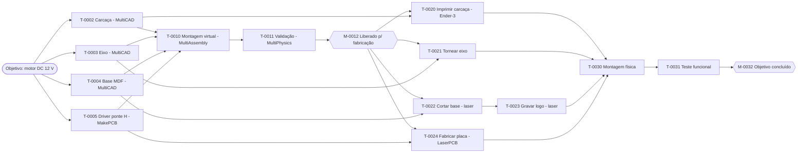

# MultiProject — gerenciador de projetos mecânicos e eletrônicos

> **Estado:** primeira versão no setup 015 (21/10/2026): fases 0 a 4 prontas (documento
> `.mproj`, grafo de tarefas com vínculos TI/II/TT/IT, calendários, cronograma pelo caminho
> crítico, tela no padrão da suíte e registro na MultiSuite) e os recursos da fase 7
> (pessoas, máquinas e materiais, atribuições, superalocação, nivelamento e vista Equipe).
> As próximas etapas estão em [docs/TAREFA.md](docs/TAREFA.md).

## Vínculo com ferramentas (fontes de 22/10/2026)

Na página da tarefa, **Vincular arquivo** associa o documento; **Verificar arquivo**
mostra o diagnóstico. **Abrir na ferramenta** propõe um caminho dentro do projeto
salvo e envia as especificações e entradas em `<artefato>.task.json`. MultiCAD e
MakePCB mostram essas especificações e Ctrl+S usa o caminho proposto por `--new`.

O MultiProject acompanha tamanho, data e SHA-1 ao voltar à janela e a cada 2 segundos
com ela ativa. Alterações em arquivos prontos pedem revisão e desatualizam as
sucessoras diretas que os consomem; o aviso mostra toda a cadeia. Concluir exige
artefato verificado para os tipos que o usam. G-code de fabricação abre no MultiCNC
com `--file`; posicionamento e execução ficam no MultiCNC.

Testes Win64 concluídos; regressão Linux da fase 5 pendente. Esta mudança ainda não
foi incorporada ao setup 015.

## Regras e modelos (fase 6)

**Gerar tarefas** propõe fabricação, compra, montagem, validação, liberação e
fechamento pelas regras A01 a A08. Aceite ou recuse uma ou várias propostas na
lista **SUGESTÕES**; Ctrl+Z desfaz o lote. A origem é preservada no `.mproj`, e
repetir a geração não duplica as sugestões, inclusive as recusadas.

A página **Objetivo** oferece **Novo a partir de modelo...** e a opção de exigir
liberação antes de fabricar. Na página de uma tarefa de torno, **Gerar folha de
torno...** prepara e vincula a folha Markdown a partir da especificação técnica.

- [Guia rápido](../docs/Manuals/MultiProject_Guia_Rapido.md)
- [Motor DC inicial](examples/motor_dc_inicial.mproj) e [plano completo](examples/motor_dc.mproj)
- [Modelos de projeto](../models/multiproject/README.md)

## Recursos e conflitos

- **Pessoas** (os usuários da equipe, com função e e-mail), **máquinas** (router, laser,
  impressora 3D, torno; importadas do cadastro do MultiCNC), **materiais** e **IA**, cada um
  com unidades máximas (100% = uma pessoa ou máquina) e calendário.
- Atribuição na página da tarefa, na coluna **Recursos** do Gantt (`Ana; Ender-3; Bruno[50%]`,
  como no Project) ou arrastando a barra na vista **Equipe**.
- O **Validar** confere máquina × tipo de tarefa: impressão pede impressora, corte e arte
  laser pedem laser, placa aceita laser ou router.
- **Superalocação**: quando um recurso tem mais trabalho que as unidades no mesmo período, o
  aviso diz o recurso, o período e as tarefas ("Ana superalocado de 26/10/2026 08:00 a 12:00:
  T-0002, T-0003 e T-0004 ao mesmo tempo"). A vista Equipe hachura o período em vermelho.
- **Nivelar recursos** (etapa 5) atrasa as tarefas pela prioridade e pela margem até cada
  recurso fazer uma coisa por vez; **Limpar nivelamento** volta às datas originais.

O **MultiProject** é a porta de entrada da MultiSuite para quem quer **construir algo**, e
não apenas desenhar uma peça. O usuário define um **objetivo** (por exemplo, *construir um
motor*). Uma pessoa ou a IA divide esse objetivo em **tarefas**: peças mecânicas, placas
eletrônicas, montagem, validação, fabricação e teste. Cada tarefa se liga às outras por um
**grafo de dependências** e, quando for o caso, a um **arquivo de outra ferramenta da suíte**.

A referência funcional é o **Microsoft Project** (EAP, vínculos, caminho crítico, recursos,
linha de base e acompanhamento). Não é uma cópia: o MultiProject segue o padrão visual e a
divisão de papéis da MultiSuite e acrescenta o que o Project não tem, que é saber **qual
ferramenta faz cada tarefa e quando o arquivo dela está pronto**.

## Papel na suíte

| O MultiProject faz | O MultiProject não faz |
|---|---|
| Objetivo, EAP, tarefas, grafo, cronograma, recursos, custos e acompanhamento | Modelar peça (MultiCAD), desenhar placa (MakePCB), montar (MultiAssembly) |
| Abre a ferramenta certa para cada tarefa e vincula o arquivo gerado | Gerar percurso, fatiar ou simular |
| Sugere as tarefas seguintes (montagem, validação, fabricação) | Enviar comando para máquina: isso é só do MultiCNC |
| Usa as máquinas cadastradas no MultiCNC como recursos | Alterar o cadastro de máquinas |

## Tipos de tarefa e ferramenta vinculada

| Tipo de tarefa | Ferramenta | Arquivo vinculado |
|---|---|---|
| Peça mecânica | MultiCAD | `.mcad` |
| Eletrônica (placa) | MakePCB | `.mpcb` + pasta Gerber/Excellon |
| Montagem (ligação entre as peças) | MultiAssembly | `.massembly` |
| Teste e validação | MultiPhysics | `.mphys` |
| Impressão 3D | MultiSlicer → MultiCNC | `.mslice` + G-code |
| Usinagem CNC Router | MakeRouter (madeira e similares) ou MultiCAM (peça mecânica) → MultiCNC | `.mrouter` ou G-code |
| Corte laser | LaserArt (camada de corte) → MultiCNC | `.lart` + G-code |
| Arte laser (gravação) | LaserArt → MultiCNC | `.lart` + G-code |
| Usinagem de torno | sem ferramenta na suíte: folha de processo manual ([D7](docs/TAREFA.md#decisões-para-o-marcelo)) | desenho + folha de processo |
| Impressão de placa | LaserPCB ou RouterPCB → MultiCNC | G-code |
| Montagem física, teste funcional, compra, tarefa geral, marco | nenhuma | checklist e anotações |

## Exemplo: construir um motor DC didático

O exemplo gerado contém **15 tarefas e 21 vínculos**, incluindo a entrega de arquivos do projeto à fabricação.
As quatro tarefas de projeto correm **em paralelo**. A montagem virtual só começa quando
todas ficam prontas (vínculo término-início). As fabricações correm em paralelo **em
máquinas diferentes**. A gravação do logo vem **encadeada** depois do corte da base, porque as
duas usam o mesmo laser e a mesma chapa. O MultiProject gera sozinho as tarefas de montagem,
de validação e de fabricação; o usuário confirma cada uma antes de entrar no plano.

## Documentação

| Documento | Conteúdo |
|---|---|
| [../docs/MULTIPROJECT.md](../docs/MULTIPROJECT.md) | Especificação consolidada na pasta `docs` da suíte |
| [docs/TAREFA.md](docs/TAREFA.md) | Decisões, etapas de implementação, critério de pronto e riscos |
| [docs/REQUISITOS.md](docs/REQUISITOS.md) | Requisitos funcionais: Microsoft Project item a item e requisitos próprios da suíte |
| [docs/ARCHITECTURE.md](docs/ARCHITECTURE.md) | Modelo de dados, grafo, cronograma, formato `.mproj`, integração e IA |
| [docs/LAYOUT.md](docs/LAYOUT.md) | Tela no padrão da MultiSuite: etapas, vistas, painel e rodapé |
| [docs/AI_GUIDE.md](docs/AI_GUIDE.md) | Regras para IA que alterar este módulo |
