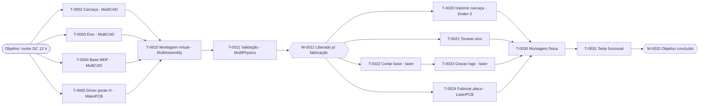

# MultiProject — gerenciador de projetos mecânicos e eletrônicos

> **Estado:** especificação (fase 0, 20/10/2026). Ainda não há código; as decisões e etapas
> estão em [docs/TAREFA.md](docs/TAREFA.md).

O **MultiProject** é a porta de entrada da MultiSuite para quem quer **construir algo**, e
não apenas desenhar uma peça. O usuário define um **objetivo** (por exemplo, *construir um
motor*). Uma pessoa ou a IA divide esse objetivo em **tarefas**: peças mecânicas, placas
eletrônicas, montagem, validação, fabricação e teste. Cada tarefa se liga às outras por um
**grafo de dependências** e, quando for o caso, a um **arquivo de outra ferramenta da suíte**.

A referência funcional é o **Microsoft Project** (EAP, vínculos, caminho crítico, recursos,
linha de base e acompanhamento). Não é uma cópia: o MultiProject segue o padrão visual e a
divisão de papéis da MultiSuite e acrescenta o que o Project não tem, que é saber **qual
ferramenta faz cada tarefa e quando o arquivo dela está pronto**.

## Papel na suíte

| O MultiProject faz | O MultiProject não faz |
|---|---|
| Objetivo, EAP, tarefas, grafo, cronograma, recursos, custos e acompanhamento | Modelar peça (MultiCAD), desenhar placa (MakePCB), montar (MultiAssembly) |
| Abre a ferramenta certa para cada tarefa e vincula o arquivo gerado | Gerar percurso, fatiar ou simular |
| Sugere as tarefas seguintes (montagem, validação, fabricação) | Enviar comando para máquina: isso é só do MultiCNC |
| Usa as máquinas cadastradas no MultiCNC como recursos | Alterar o cadastro de máquinas |

## Tipos de tarefa e ferramenta vinculada

| Tipo de tarefa | Ferramenta | Arquivo vinculado |
|---|---|---|
| Peça mecânica | MultiCAD | `.mcad` |
| Eletrônica (placa) | MakePCB | `.mpcb` + pasta Gerber/Excellon |
| Montagem (ligação entre as peças) | MultiAssembly | `.massembly` |
| Teste e validação | MultiPhysics | `.mphys` |
| Impressão 3D | MultiSlicer → MultiCNC | `.mslice` + G-code |
| Usinagem CNC Router | MakeRouter (madeira e similares) ou MultiCAM (peça mecânica) → MultiCNC | `.mrouter` ou G-code |
| Corte laser | LaserArt (camada de corte) → MultiCNC | `.lart` + G-code |
| Arte laser (gravação) | LaserArt → MultiCNC | `.lart` + G-code |
| Usinagem de torno | sem ferramenta na suíte: folha de processo manual ([D7](docs/TAREFA.md#decisões-para-o-marcelo)) | desenho + folha de processo |
| Impressão de placa | LaserPCB ou RouterPCB → MultiCNC | G-code |
| Montagem física, teste funcional, compra, tarefa geral, marco | nenhuma | checklist e anotações |

## Exemplo: construir um motor DC didático

As quatro tarefas de projeto correm **em paralelo**. A montagem virtual só começa quando
todas ficam prontas (vínculo término-início). As fabricações correm em paralelo **em
máquinas diferentes**. A gravação do logo vem **encadeada** depois do corte da base, porque as
duas usam o mesmo laser e a mesma chapa. O MultiProject gera sozinho as tarefas de montagem,
de validação e de fabricação; o usuário confirma cada uma antes de entrar no plano.

## Documentação

| Documento | Conteúdo |
|---|---|
| [../docs/MULTIPROJECT.md](../docs/MULTIPROJECT.md) | Especificação consolidada na pasta `docs` da suíte |
| [docs/TAREFA.md](docs/TAREFA.md) | Decisões, etapas de implementação, critério de pronto e riscos |
| [docs/REQUISITOS.md](docs/REQUISITOS.md) | Requisitos funcionais: Microsoft Project item a item e requisitos próprios da suíte |
| [docs/ARCHITECTURE.md](docs/ARCHITECTURE.md) | Modelo de dados, grafo, cronograma, formato `.mproj`, integração e IA |
| [docs/LAYOUT.md](docs/LAYOUT.md) | Tela no padrão da MultiSuite: etapas, vistas, painel e rodapé |
| [docs/AI_GUIDE.md](docs/AI_GUIDE.md) | Regras para IA que alterar este módulo |
