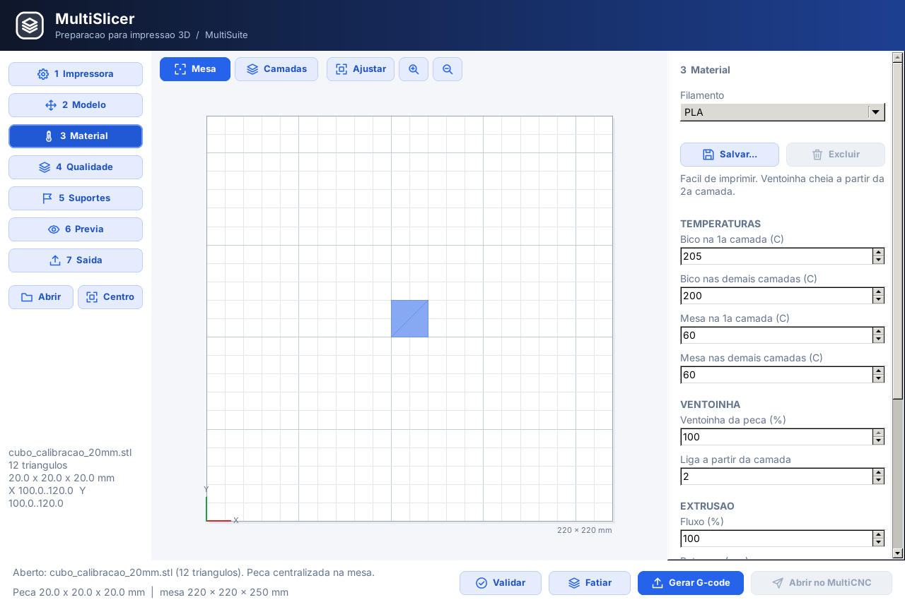
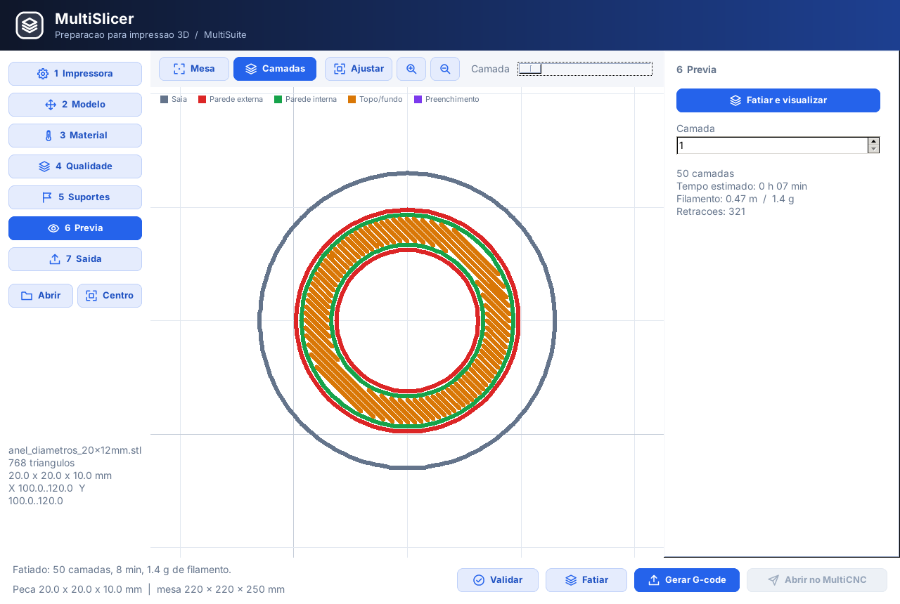
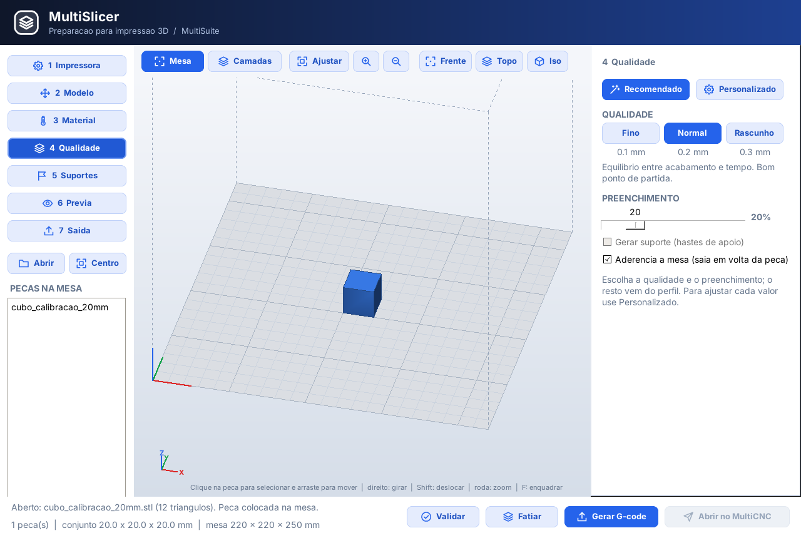
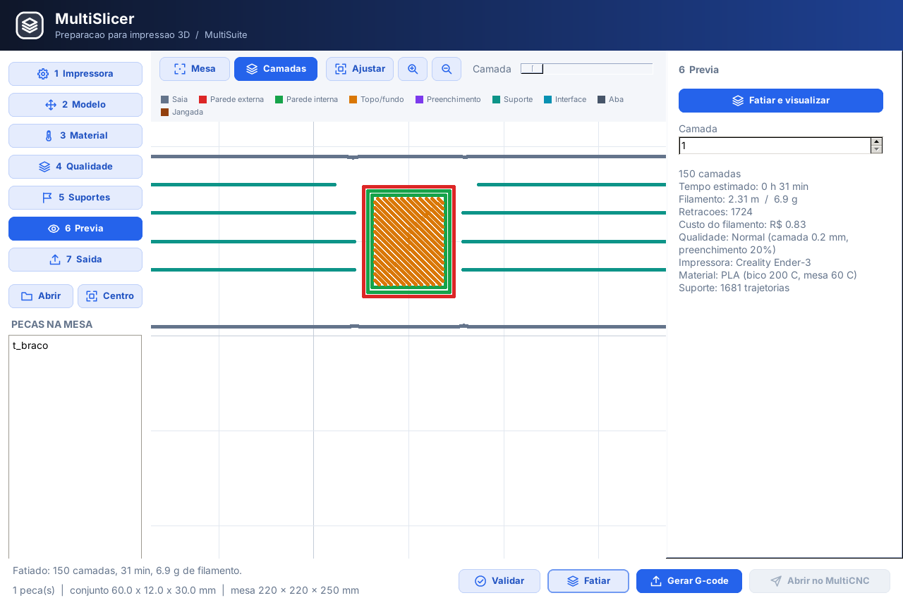
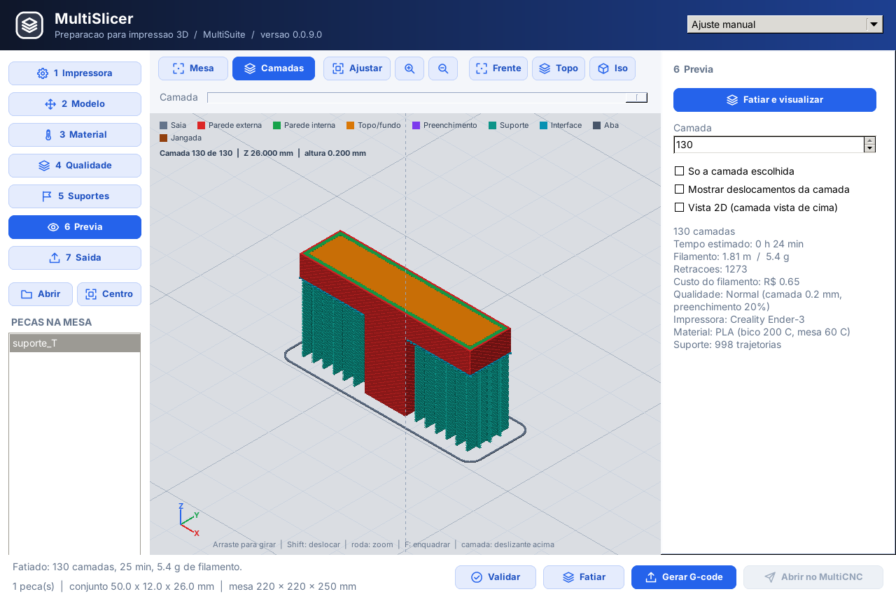
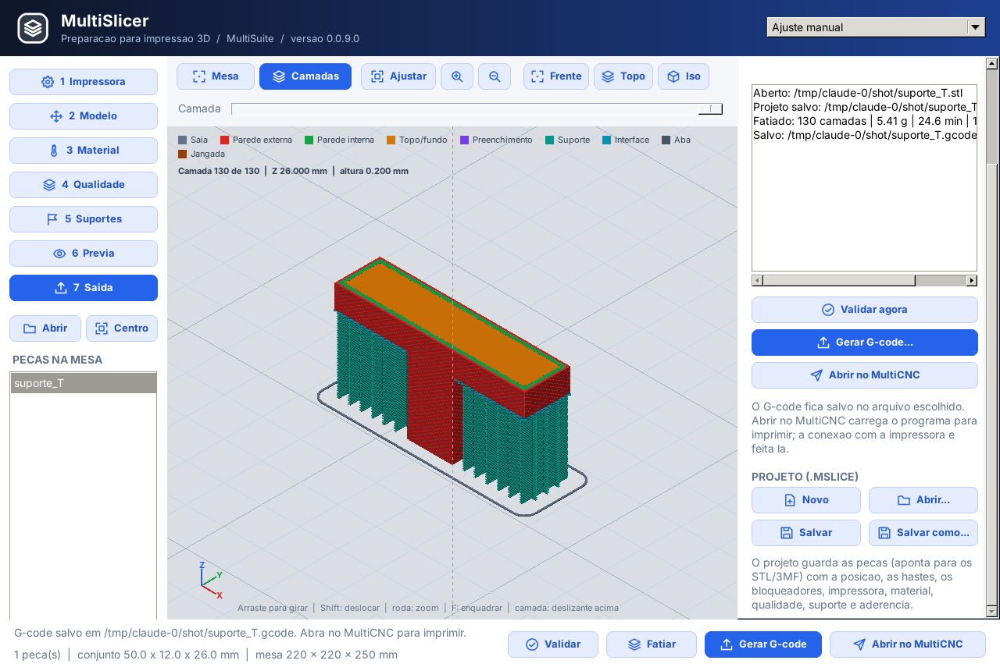
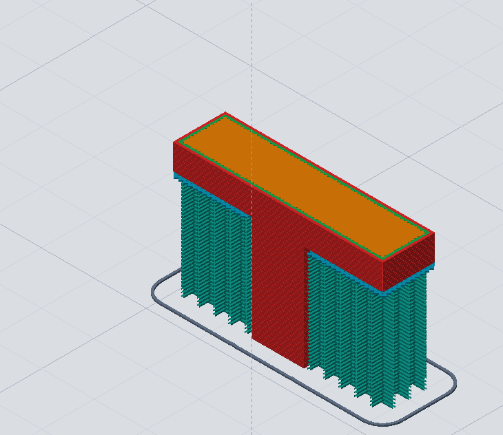
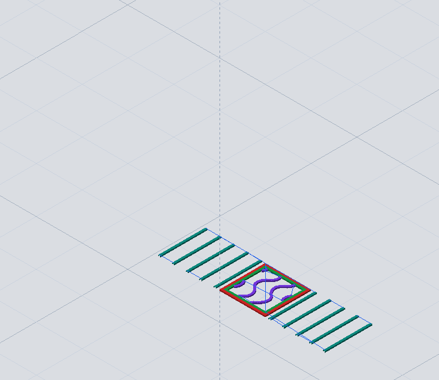

# MultiSlicer

[Manual ilustrado em português (PDF)](../docs/Manuals/Manual_do_Usuario_MultiSlicer_0.1.0.0_PT-BR.pdf) · [Versão em texto](../docs/Manuals/Manual_do_Usuario_MultiSlicer_0.1.0.0_PT-BR.md)

Fatiador para impressão 3D integrado ao ecossistema MultiCNC.

> **Estado (13/10/2026, versão 0.1.0.0):** todas as etapas do plano entregues: perfis,
> equipamento do MultiCNC com catálogo por marca e modelo, cena com várias peças, posicionamento,
> qualidade, suportes e aderência, prévia 3D, fatiamento em segundo plano, projeto `.mslice`,
> conferência da malha e envio ao MultiCNC, que reconhece o arquivo, seleciona a impressora 3D e
> confere o volume (MultiCNC 0.1.0.4). Executáveis em `bin/`.
> Plano e histórico: [docs/PLANO_TAREFAS.md](docs/PLANO_TAREFAS.md).

## Capturas da interface

As capturas em `imgs` mostram a configuração do material e a prévia dos percursos
por camada. Os modelos e valores exibidos são exemplos.

| Material e modelo na mesa | Prévia por camada |
|---|---|
|  |  |

- [Configuração de material](../imgs/multislicer_material.png): seleção do filamento,
  temperaturas da primeira camada e das demais, ventilação e fluxo.
- [Prévia do fatiamento](../imgs/multislicer_previa.png): camada selecionada,
  legenda dos percursos, estimativas de tempo e consumo de filamento.

As capturas das entregas publicadas também estão em `screenshots`:

| Qualidade | Suportes e aderência |
|---|---|
|  |  |

| Prévia 3D (0.0.9.0) | Projeto e saída |
|---|---|
|  |  |

[Fatiando com progresso e Cancelar](../screenshots/multislicer_fatiando.png) · [Modelo](../screenshots/multislicer_modelo.png) · [Mesa 3D](../screenshots/multislicer_mesa3d.png) · [Material](../screenshots/multislicer_material.png) · [Prévia](../screenshots/multislicer_previa.png)

[Índice completo das imagens da suíte](../imgs/README.md)

## Fatiamento e prévia 3D na versão 0.0.7.0

Selecione a impressora no campo de equipamento no topo da janela. As impressoras
salvas no MultiCNC aparecem nessa lista; marca e modelo completam o perfil pelo
catálogo. A opção **Ajuste manual** permite configurar uma impressora personalizada.

Depois de posicionar o modelo e ajustar material, qualidade e suportes, clique em
**Fatiar**. A barra no rodapé informa a fase e o progresso. O processamento ocorre
em segundo plano; **Cancelar** ou Esc interrompe o cálculo e preserva a prévia
anterior. Ao mudar parâmetros, refaça o fatiamento antes de usar a saída.

Na etapa **Prévia**, use o deslizante para selecionar a camada. A vista 3D usa a
mesma câmera da mesa e diferencia paredes, preenchimento, superfícies sólidas e
suportes por cores. Ative a opção de mostrar somente a camada para inspecionar seu
interior. A prévia e a exportação usam o mesmo resultado do fatiamento. O deslizante
de movimento dentro da camada e as marcas de retração ainda estão previstos.

| Trajetórias acumuladas com suportes | Inspeção de uma camada |
|---|---|
|  |  |

## Projeto, arquivos e envio ao MultiCNC (0.0.9.0)

- **Abrir:** botão Abrir, Ctrl+O, linha de comando ou **arrastar** STL, 3MF ou `.mslice`
  para a janela. Peças vindas do MultiCAD ("Abrir no MultiSlicer") entram pelo contexto
  da suíte.
- **Conferência da malha:** ao abrir, normais invertidas são corrigidas sozinhas; malha
  aberta ou não manifold e peça muito pequena (provável polegada) ou enorme aparecem no
  rodapé e no registro. **Polegadas para mm (x 25,4)** fica na etapa Modelo, em Escalar.
- **Projeto `.mslice`** (etapa Saída, Ctrl+S): peças com posição, rotação, escala, espelho
  e trava, hastes, bloqueadores, impressora, material, qualidade, suporte, aderência e
  equipamento. O projeto aponta para os STL/3MF (caminho relativo e absoluto): a pasta
  pode ser movida inteira. O título mostra o nome e `*` quando há alterações; o programa
  pergunta antes de descartar.
- **G-code:** nome sugerido pelo projeto. A primeira linha é
  `; MultiSlicer -> MultiCNC (Impressora 3D)`, seguida das linhas `; MS-...` do contrato da
  suíte (máquina `printer3d`, caixa das peças, impressora, material, temperaturas, tempo e
  filamento) e do cabeçalho lido por OctoPrint/Moonraker.
- **Abrir no MultiCNC** gera o G-code antes, se preciso, e abre o MultiCNC com ele. O MultiCNC
  seleciona Impressora 3D (Marlin), mostra no log impressora, material, temperaturas, tempo e
  filamento e avisa se as peças não cabem no volume do equipamento.

## Degrau inicial Z da impressora (novo parâmetro)

Na etapa **1 Impressora**, o campo **Degrau inicial Z (mm)** permite deslocar o trabalho inteiro para cima em relação ao zero da máquina. O valor é armazenado no perfil da impressora (JSON: `print_start_z`) e é **0,00 mm** para perfis existentes que não possuam o campo.

- Exemplo: degrau de **3,00 mm**, primeira camada de **0,20 mm**: o primeiro percurso da peça será emitido em **Z=3,20 mm** (sem raft); as demais camadas também recebem **+3,00 mm**.
- A geometria original, a altura de camada, a extrusão por milímetro e o espaçamento dos suportes não mudam. Quando há raft, o deslocamento é aplicado depois da sua construção, abrangendo todas as camadas.
- O G-code inclui `; MS-PRINT-START-Z: 3.00`, os comentários `;Z:` e os movimentos em Z já deslocados. O limite de altura disponível diminui pelo mesmo valor.
- Defina o campo no perfil da impressora, salve o perfil e refaça o fatiamento. O valor não modifica o firmware e não substitui Z-offset de calibração, homing ou nivelamento da mesa.

**Atenção à segurança:** utilize um valor positivo apenas quando o referencial de impressão exigir uma elevação física correspondente. Sem apoio na altura indicada, a extrusão ocorrerá no ar. G-code inicial personalizado que altere o zero (`G92 Z...`), use offsets ou execute purga na superfície original deve ser revisado separadamente; o degrau altera os movimentos de impressão gerados pelo fatiador, não corrige automaticamente comandos Z escritos pelo usuário.

**Estado:** implementação de código publicada na branch `fila`; compilação, prévia gráfica, serialização completa de projetos e ensaio em impressora física ainda exigem validação. Não interpretar esta descrição como certificação de funcionamento real.

## Fluxo
STL/3MF -> conferência da malha -> cena (posição/escala/rotação) -> camadas -> paredes/topo-fundo/preenchimento/suportes/aderência -> prévia 3D -> G-code com contrato da suíte -> MultiCNC.

## Separação
MultiSlicer prepara o trabalho. MultiCNC conecta e controla a impressora.

## Primeira base (histórico)
- modelo geométrico de triângulos
- importação STL ASCII
- perfil de impressora/material
- cálculo de planos de camada
- interseção triângulo/plano
- segmentos 2D por camada
- exportação G-code inicial
- aplicação Lazarus inicial

Essa lista registra o ponto de partida. A versão 0.0.7.0 inclui contornos fechados, perímetros, preenchimento, suportes e retração, conforme o pipeline abaixo.

## Pipeline moderno (multislicer_pipeline)
`TModernSlicer.Slice(malha, configuração, saída)`:
- alturas fixas ou **adaptativas** (degrau máximo `CuspHeight` em superfícies inclinadas; camadas terminam exatamente nas faces planas);
- corte no meio da camada, contornos fechados com furos;
- perímetros (internos antes do externo), costura alinhada atrás, saia;
- topo/fundo sólidos retilíneos ±45° detectados por camada e infill **gyroid** (ou retilíneo);
- extrusão relativa (`M83`) pelo modelo de cordão arredondado, retração só quando o deslocamento cruza perímetros, *arc fitting* nos perímetros;
- sabores **Marlin** (`M73`, `M486`, `M900`) e **Klipper** (`EXCLUDE_OBJECT`, `SET_PRINT_STATS_INFO`, `SET_PRESSURE_ADVANCE`);
- cabeçalho `;TIME:` / `;Filament used:` reconhecido por OctoPrint, Moonraker, Mainsail e Fluidd.

Importação: STL binário/ASCII (`TSTLImporter.Load`) e **3MF** (`T3MFImporter`).

## Suportes e aderência

Na página **Suportes**, escolha automático, somente manual ou desligado. Ajuste o
ângulo de saliência, a densidade, as folgas XY/Z e as camadas de interface. A vista
3D destaca as saliências; **Adicionar hastes** permite clicar na peça para inserir
apoios manuais, e os bloqueadores excluem regiões do suporte automático.

Escolha **tocando a mesa** ou **em toda parte**, conforme a posição dos apoios.
Em aderência, selecione nenhuma, saia, aba (brim) ou jangada (raft). Depois de
alterar os parâmetros, refaça o fatiamento e confira os percursos na prévia antes
de exportar o G-code. Suportes em árvore permanecem previstos para uma fase posterior.

## Transformar dimensões de uma peça

Na etapa **2 Modelo**, selecione a peça e clique em **Transformar dimensões...**. O formulário permite escolher entre **Percentual** (por exemplo, 200% dobra o tamanho atual) e **Dimensão final em mm**. Marque os eixos X, Y e/ou Z a transformar.

- Com **Escala proporcional nos eixos selecionados** ativado, o valor informado no primeiro eixo marcado determina um fator único aplicado apenas aos eixos marcados; eixos não marcados permanecem inalterados.
- Com a opção desativada, somente os eixos marcados são alterados, cada um com seu percentual ou dimensão final. Eixos não marcados preservam a escala atual.
- Clique em **Aplicar e visualizar**: a peça é atualizada na mesa 3D, e o G-code previamente gerado é invalidado. Use **Ctrl+Z / Desfazer** para retornar à escala anterior ou **Ctrl+Y / Refazer** para reaplicá-la.
- **Cancelar** fecha a janela sem transformar a peça. A transformação não altera o STL/3MF original; altera a instância da peça na cena, que deve ser fatiada novamente.

**Exemplo:** peça de 20 × 30 × 10 mm. Escala uniforme de 200% → 40 × 60 × 20 mm. Escala não uniforme com apenas Z marcado em 200% → 20 × 30 × 20 mm. Dimensão final apenas X = 50 mm → 50 × 30 × 10 mm.

**Estado:** recurso publicado no código da branch `fila`; compilação e validação visual no executável ainda pendentes.

## Fragmentação de peças maiores que a impressora (planejado)

Está especificado um fluxo futuro para dividir modelos em STLs fechados `peca_parte01.stl`, `peca_parte02.stl` etc., permitir editar/transformar cada parte antes do fatiamento e exportar arquivos separados. **Ainda não implementado**; não confundir com fatiamento por camadas. Veja [Plano de Fragmentação 3D](docs/PLANO_FRAGMENTACAO_3D.md).
